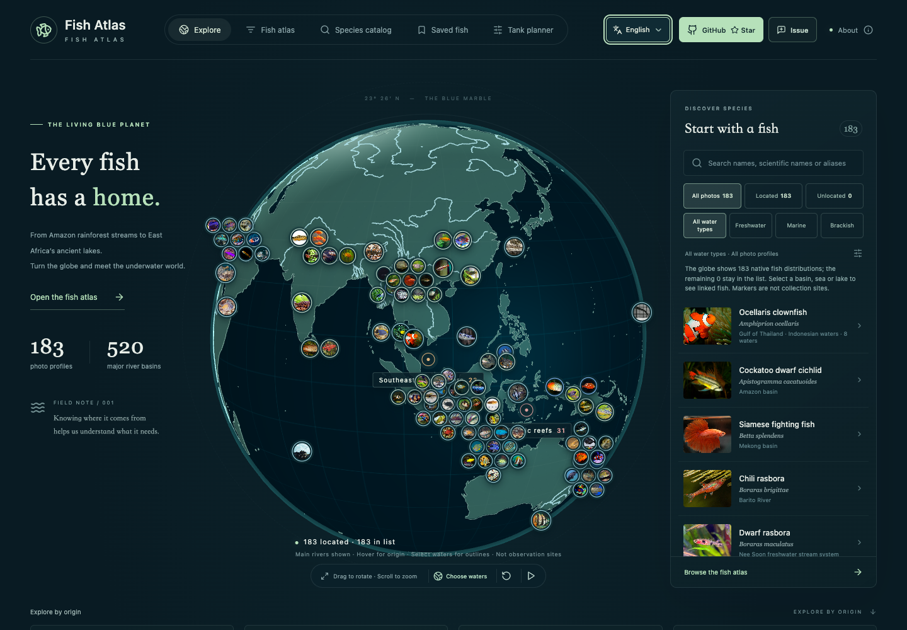

[English](README.md) · [简体中文](README.zh-CN.md) · [Français](README.fr.md) · [Deutsch](README.de.md) · [日本語](README.ja.md)

# Fish Atlas

**[Live-Website öffnen](https://fish-atlas-korbinjoe.korbinzhao.chatgpt.site)** · Öffentlich auf ChatGPT Sites gehostet.

Ein interaktiver Globus, ein Fischatlas mit Fotos, ein taxonomischer Katalog und ein Aquariumplaner. Artenprofile zeigen ihre Quellen und die Herkunft der verwendeten Bilder.

Die Oberfläche startet **standardmäßig auf Englisch**. Über das Sprachmenü stehen **English, 中文, Français, Deutsch und 日本語** zur Verfügung. Die Auswahl wird im Browser gespeichert.



## Funktionen

- **Interaktiver Globus**: drehen, zoomen, Einzugsgebiete auswählen sowie wichtige Flüsse und Seen erkunden.
- **Fotoatlas**: nach Trivialnamen, Synonymen oder wissenschaftlichen Namen suchen; nach Region und Gewässertyp filtern; Favoriten speichern und bis zu drei Arten mit Haltungsreferenzen vergleichen.
- **Verknüpfte Artenansicht**: Ein Klick auf ein Foto öffnet das Profil neben dem Globus und hebt das belegte Herkunftsgewässer hervor. Mit den Pfeiltasten lässt sich durch die gefilterten Ergebnisse blättern.
- **Fotoansicht**: Bilder vergrößern, verschieben und zwischen Arten wechseln, während der Globus sichtbar bleibt.
- **Taxonomischer Katalog**: akzeptierte GBIF-Namen, Familien und Gattungen mit Filtern und Seitennavigation; auch für Arten ohne Foto.
- **Aquariumplaner**: Beckenmaße, geschätztes Wasservolumen, Wasserwerte und Stückzahlen eingeben; bekannte Konflikte und Risiken nachvollziehen; lokal speichern und über einen wiederherstellbaren Link teilen.
- **Quellen und Mitarbeit**: Belege, Bildnachweise und GitHub-Formulare zum Ergänzen oder Korrigieren von Artenprofilen.

## Aktueller Datenumfang

| Bereich | Umfang |
| --- | --- |
| Artenprofile mit Foto | **287 Arten** |
| Profile mit Haltungsreferenzen, die im Planer verwendet werden können | **33 Arten** |
| Fotoprofile ohne ausreichende Haltungsdaten | **254 Arten**, im Planer nicht auswählbar |
| Taxonomischer Katalog | **3.697 Einträge**, davon **3.410 ohne Foto** |
| Geografie | **520 große Fluss- und Seeeinzugsgebiete** des GRDC und 4 ausgewählte Regionen |

Alle 287 Arten mit Foto sind benannten, durch Quellen belegten Herkunftsgewässern zugeordnet. Der Katalog dient der taxonomischen Erkundung und ist keine Liste geeigneter Aquarienfische. Arten ohne Foto lassen sich im Katalog suchen, erscheinen aber nicht im Fotoatlas.

## Schnellstart

Voraussetzungen: **Node.js ab 22.12** in einer kompatiblen Version und npm.

```bash
git clone https://github.com/korbinjoe/fish-atlas.git
cd fish-atlas
npm ci
npm run dev -- --port 4173
```

Öffnen Sie [http://127.0.0.1:4173](http://127.0.0.1:4173). Daten, Fotos und geografische Grundlagen sind bereits im Repository enthalten. Installation und Build starten keine erneute Quellenabfrage.

Für die Vorschau des Produktionsbuilds:

```bash
npm run build
npm run preview -- --port 4174
```

- [Globus erkunden](http://127.0.0.1:4174/#/explore)
- [Fotoatlas](http://127.0.0.1:4174/#/atlas)
- [Artenkatalog](http://127.0.0.1:4174/#/catalog)
- [Aquariumplaner](http://127.0.0.1:4174/#/planner)

Der Build erzeugt `dist/`. Hash-Routing und relative Ressourcenpfade ermöglichen statisches Hosting, auch in Unterverzeichnissen, ohne eine Umschreibung der Routen.

## Sprachen

Ein Sprachwechsel aktualisiert Navigation, Filter, Artenprofile, geografische Namen, Vergleiche und Planer. Die Auswahl wird unter `fish-atlas:locale` gespeichert. Ist der Browserspeicher nicht verfügbar, funktioniert der Wechsel für den aktuellen Besuch.

Die wichtigsten Beschreibungen und Haltungshinweise der 33 dokumentierten Artenprofile liegen in allen fünf Sprachen vor. Die Suche berücksichtigt chinesische und englische Namen, vorhandene Übersetzungen, Synonyme und wissenschaftliche Namen unabhängig von der Anzeigesprache.

Wissenschaftliche Namen, Messwerte, Urheber, Lizenzen und Originalzitate bleiben den Quellen treu. Die Quellenauszüge der 254 zusätzlichen Fotoprofile sind nicht vollständig übersetzt. Rückmeldungen verwenden in der chinesischen Oberfläche ein chinesisches GitHub-Formular, in den übrigen Sprachen ein englisches. Einzelheiten stehen in der [Dokumentation zur Mehrsprachigkeit](docs/i18n.md).

## Daten richtig einordnen

Fotomarkierungen auf dem Globus stehen für ein **belegtes Herkunftsgewässer**. Sie sind keine exakten Fundpunkte und zeigen nicht das vollständige natürliche Verbreitungsgebiet einer Art. Die Grenzen der GRDC-Einzugsgebiete liefern geografischen Kontext und sind keine biologischen Verbreitungsgrenzen.

Historische GBIF-Beobachtungen werden getrennt von Angaben zur natürlichen Verbreitung dargestellt. Der Datensatz enthält 26 ausgewählte Beobachtungen mit Quellen und Lizenzen; ihr Status als einheimische Vorkommen ist unbekannt. Der Globus bietet keine Verfolgung in Echtzeit.

Der Aquariumplaner führt eine erste Prüfung anhand der vorhandenen Referenzen und Regeln durch. Er garantiert weder eine sichere Vergesellschaftung noch einen sicheren Gesamtbesatz. Fehlende Werte bleiben unbekannt; vorgeschlagene Stückzahlen bedeuten nicht, dass das Becken diese Tiere aufnehmen kann.

Temperaturen aus natürlichen Lebensräumen werden nicht automatisch zu Haltungsempfehlungen. Süßwasserhärte in dGH, Alkalinität in dKH und Meerwasserdichte bleiben getrennte Größen. Eine fachliche Freigabe und Tests auf echten Mobilgeräten stehen noch aus; siehe [Prüfliste](docs/release-checklist.md).

## Entwicklung und Prüfung

Das Projekt verwendet React 19, TypeScript, Vite, Three.js, React Three Fiber, Drei und Zod. Die aufgelösten Abhängigkeitsversionen stehen in `package-lock.json`.

```bash
npm run validate
npm test
npm run build
npx playwright install webkit
npm run test:e2e
npm run benchmark
```

Die Browsertests verwenden lokal installiertes Chrome und Playwright WebKit mit einer Produktionsvorschau auf Port 4174. Desktopmessungen und simulierte Touch-Bedienung ersetzen keine Tests auf einem echten Smartphone. `npm run catalog:refresh` aktualisiert den GBIF-Snapshot gezielt über das Netzwerk; für normale Builds ist dies nicht erforderlich.

## Mitwirken und Dokumentation

Lesen Sie den [Leitfaden für Beiträge](CONTRIBUTING.md), bevor Sie eine Korrektur, eine neue Art oder ein Foto vorschlagen. Vorschläge sollten die Überprüfung der Artbestimmung, der Quellen und der Nutzungsrechte ermöglichen. Alternativ können Sie [ein Issue erstellen](https://github.com/korbinjoe/fish-atlas/issues/new/choose).

- [Implementierung und Prüfung](docs/implementation.md) · [Technischer Entwurf](docs/technical-proposal.md)
- [Abdeckung der Einzugsgebiete](docs/global-basin-coverage.md) · [Quellen zur natürlichen Verbreitung](docs/native-distribution-expansion.md)
- [Regionale Erweiterung des Atlas](docs/regional-fish-expansion.md) · [Abdeckung häufiger Aquarienfische](docs/common-aquarium-fish-coverage.md)
- [Mit dem Globus verknüpfte Ansicht](docs/globe-linked-reader.md) · [Fotoansicht](docs/fish-photo-gallery.md)

## Quellen und Lizenzen

Für jedes Foto von Wikimedia Commons gelten eigene Lizenz- und Namensnennungspflichten, bei manchen auch eine Weitergabe unter gleichen Bedingungen. Natural Earth stellt gemeinfreie Geodaten bereit. GRDC/HydroSHEDS-Einzugsgebiete erfordern die Quellenangaben der jeweiligen Anbieter. Der GBIF-Backbone-Katalog steht unter CC BY 4.0; ausgewählte Beobachtungen verwenden die vom Erfassungsprozess unterstützten CC-BY- oder CC0-Lizenzen.

Die Verbreitungsdaten von **FishBase 26.06 stehen unter CC BY-NC 3.0** und erfordern Namensnennung sowie eine nichtkommerzielle Nutzung. Diese Lizenz gilt unabhängig von den Lizenzen des Werkzeugcodes und der Fotos. Beachten Sie vor einer Weiterverwendung die [Quellen und Bildnachweise](public/ATTRIBUTION.md) sowie das [Verzeichnis zusätzlicher Fotos](public/PHOTO_PROFILES_ATTRIBUTION.md). Ersatzillustrationen eignen sich nicht zur Artbestimmung.
