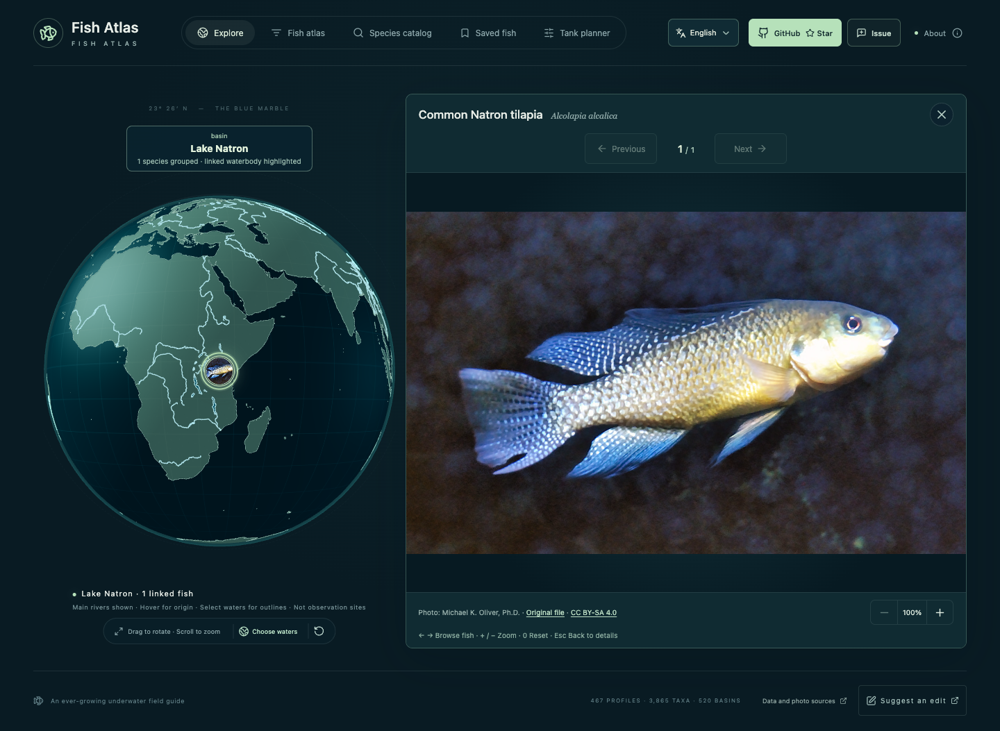
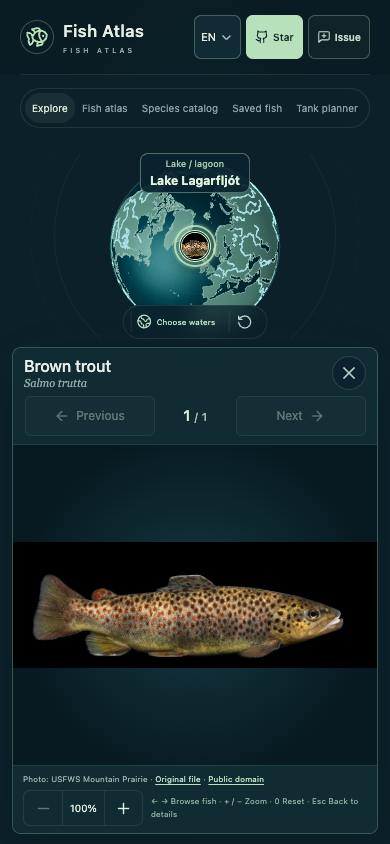

# 空白流域补齐 · 第二轮

2026-10-15

本轮从仍空白的 310 个 GRDC 主要流域出发，增加有真实照片的新鱼种，同时为已有图鉴补充遗漏的原生水体关联。保留此前全部条目和来源；没有可靠照片、原生身份或可解释定位的候选继续留待核对。

| 项目 | 补充前 | 补充后 |
| --- | ---: | ---: |
| 有图鱼种 | 379 | 467 |
| 分类目录 | 3786 | 3865 |
| 已关联主要流域 / 520 | 210 | 376 |
| 已关联全部水域 | 338 | 512 |
| 原生水体关系 | 1988 | 2615 |
| 仍无有图关联的主要流域 | 310 | 144 |

本轮新增 **88 种有图鱼**，填补 **166 个此前空白流域**。当前共有 376 个 GRDC 流域、47 个海域、39 个湖泊／潟湖和 50 个补充河流水系。这里统计的是本图鉴已有来源的覆盖，不表示水域全部鱼种已经收齐。

## 各大洲覆盖

| 大洲 | 主要流域总数 | 补充前 | 补充后 | 本轮填补 |
| --- | ---: | ---: | ---: | ---: |
| 非洲 | 86 | 53 | 65 | 12 |
| 亚洲 | 96 | 33 | 67 | 34 |
| 欧洲 | 77 | 34 | 69 | 35 |
| 北美洲 | 119 | 29 | 88 | 59 |
| 大洋洲 | 51 | 31 | 41 | 10 |
| 南美洲 | 91 | 30 | 46 | 16 |

## 图片、原生身份与定位

照片使用 Wikimedia Commons 具体文件；保留实际作者、原文件页和许可，并逐图查看。排除画谱、食物、混合多物种标本板、分辨率不足和身份冲突照片；馆藏、捕获或保存标本保留原说明，不冒充水下活体照。新图使用原尺寸或缩小版本，短边至少256、长边至少500像素；不放大小图。Hypseleotris compressa 原文件500×299，放大细节有限。

分类用 GBIF 精确接受名，原生分布与 FishBase26.06 逐种原文交叉核对，并补充政府、研究机构、原始研究和专家馆藏凭证。旧广义物种、引入鱼、明确灭绝群体及含混同名河流不自动发布。A.arcasii 的旧 Duero/Soria 照片涉及2023年分类拆分且新名无法精确匹配GBIF，已跳过；不把旧照片绑定到修订后的其他鱼种。

明确河名的原始记录直接关联对应流域；少量文献没有河名、但保留专家鉴定及原始坐标的凭证，结合原生范围和GRDC多边形推定流域，标为medium并说明这是地理推断，保留原始地点与精度。采样凭证点和水域展示锚点不会被描述为照片拍摄地。

新增受控的每条关系定位字段，保留坐标来源与说明。Natron鱼使用专家馆藏记载的南岸泉溪[35.91854,-2.59617]，而非高盐湖心；ChewBahir只有流域级Schall记录，未确认淡水地点，撤回不可靠湖面及父流域定位。Puelo的Galaxias maculatus使用原研究点[-72.32,-41.64]，不放到原文排除的LakePuelo。

已核实湖鱼可同时关联其父集水区，但使用原湖泊位置，只表示已知湖内分布，不推成整条主河或全流域占据。本轮如此补足Turkana、Rukwa、Narva/Peipus三个原有空白父集水区。Jordan鱼使用约旦河淡水河段；DeadSea2904表示集水区，不表示鱼生活在死海盐湖。

NASCO公开Atlas仅作为所选具名大西洋鲑河流的事实依据，未重新发布完整原始数据集或形状。原生范围、现代种群风险和孵化场支持是不同概念；未知状态不解释为当前数量，恢复原生群体不解释为新增引入分布；Lost记录及本轮不稳妥的人工维持记录没有加入。冰岛以原始监测报告逐种补充，Lagarfljót棕鳟采用2024年LAGF02原始WGS84湖站坐标。

地球总览每种鱼只有一个稳定的代表水域标记，以减少同种鱼重复堆叠；按水域筛选可查看该水域全部已有来源的鱼，所有核实关联仍保留。水域展示位置与短引导线帮助理解归属，不代表真实采集密度、完整自然边界或全水系可达。

L.idus和B.sapa在Aral父集水区的原始依据具体为Amudar'ya，因此使用NaturalEarth明确阿姆河河线锚点[60.70292,41.67087]；不放到锡尔河侧通用流域中心或干涸咸海。

完整审阅与跳过记录见 [本轮清单](../content/blank-basin-expansion-2-2026-10-15.json)。图片作者、原文件和许可见 [照片署名表](../public/PHOTO_PROFILES_ATTRIBUTION.md)。每条原生关系和特殊定位说明可在鱼详情中查看。

## 新增鱼种

| 区域批次 | 名称 | 学名 | 原生水体数 | 实拍来源与许可 |
| --- | --- | --- | ---: | --- |
| 北美洲 | 美洲西鲱 | *Alosa sapidissima* | 3 | [Public domain](https://commons.wikimedia.org/wiki/File:Bears_Bluff_NFH_American_shad_electrofishing_24_March_2022.png) |
| 北美洲 | 真亚口鱼 | *Catostomus catostomus* | 14 | [Public domain](https://commons.wikimedia.org/wiki/File:LongnoseSucker.jpg) |
| 北美洲 | 湖白鲑 | *Coregonus artedi* | 10 | [CC BY 4.0](https://commons.wikimedia.org/wiki/File:Coregonus_artedi_51914853.jpg) |
| 北美洲 | 湖白鱼 | *Coregonus clupeaformis* | 12 | [CC BY-SA 3.0](https://commons.wikimedia.org/wiki/File:Coregonus_clupeaformis.jpg) |
| 北美洲 | 粘杜父鱼 | *Cottus cognatus* | 2 | [CC BY-SA 4.0](https://commons.wikimedia.org/wiki/File:SlimySculpin_Keeler.jpg) |
| 北美洲 | 利氏真小鲤 | *Cyprinella leedsi* | 2 | [CC BY 4.0](https://commons.wikimedia.org/wiki/File:Bannerfin_Shiner,_Cross_Creek,_Augusta,_GA,_US_imported_from_iNaturalist_photo_381419742.jpg) |
| 北美洲 | 纺锤镖鲈 | *Etheostoma fusiforme* | 1 | [CC BY 2.0](https://commons.wikimedia.org/wiki/File:Etheostoma_fusiforme_Manokin_10-16-17_0634_(37506816060).jpg) |
| 北美洲 | 切唇鱼 | *Exoglossum maxillingua* | 1 | [CC BY 2.0](https://commons.wikimedia.org/wiki/File:Exoglossum_maxillingua_(S0378)_(12598287284).jpg) |
| 北美洲 | 海氏突颌鱼 | *Hybognathus hayi* | 2 | [CC BY-SA 4.0](https://commons.wikimedia.org/wiki/File:Cypress_Minnow_Hybognathus_hayi.jpg) |
| 北美洲 | Hysterocarpus traskii | *Hysterocarpus traskii* | 1 | [CC BY-SA 3.0](https://commons.wikimedia.org/wiki/File:Russian_River_tule_perch.jpg) |
| 北美洲 | Labidesthes vanhyningi | *Labidesthes vanhyningi* | 1 | [CC BY 3.0](https://commons.wikimedia.org/wiki/File:Golden_silverside.jpg) |
| 北美洲 | 角闪光美洲鱥 | *Luxilus cornutus* | 1 | [Public domain](https://commons.wikimedia.org/wiki/File:Common_Shiner_(Luxilus_cornutus)_Breeding_Male_(51758080652).jpg) |
| 北美洲 | 蛰居美洲石鱥 | *Lythrurus umbratilis* | 2 | [CC BY-SA 3.0](https://commons.wikimedia.org/wiki/File:Lythrurus_umbratilis.JPG) |
| 北美洲 | 马斯科吸口鱼 | *Moxostoma macrolepidotum* | 2 | [Public domain](https://commons.wikimedia.org/wiki/File:Shorthead_Redhorse_Sucker_(Moxostoma_macrolepidotum)_(53029662431).jpg) |
| 北美洲 | 小须美鱥 | *Nocomis micropogon* | 3 | [CC BY 4.0](https://commons.wikimedia.org/wiki/File:Nocomis_micropogon_138442181.jpg) |
| 北美洲 | 金体美鳊 | *Notemigonus crysoleucas* | 1 | [CC BY 4.0](https://commons.wikimedia.org/wiki/File:Notemigonus_crysoleucas_302202325.jpg) |
| 北美洲 | 花身副丽鱼 | *Parachromis managuensis* | 1 | [Public domain](https://commons.wikimedia.org/wiki/File:Parachromis_managuensis_2012_G1.jpg) |
| 北美洲 | 鲑鲈 | *Percopsis omiscomaycus* | 4 | [CC BY 4.0](https://commons.wikimedia.org/wiki/File:Percopsis_omiscomaycus_223496174.jpg) |
| 北美洲 | 奇美洲拟鱥 | *Phenacobius mirabilis* | 5 | [CC BY 4.0](https://commons.wikimedia.org/wiki/File:Phenacobius_mirabilis_-_Gojilynx_-_606630980.jpeg) |
| 北美洲 | 真柱白鲑 | *Prosopium cylindraceum* | 6 | [CC BY-SA 3.0](https://commons.wikimedia.org/wiki/File:%D0%A1%D2%AF%D1%80%D2%AF_(Prosopium_cylindraceum).jpg) |
| 北美洲 | 吻鱥 | *Rhinichthys cataractae* | 5 | [CC BY 4.0](https://commons.wikimedia.org/wiki/File:Rhinichthys_cataractae_-_Langnasen-Wei%C3%9Ffisch_93587939.jpg) |
| 北美洲 | 红胁鱥 | *Richardsonius balteatus* | 5 | [CC BY 4.0](https://commons.wikimedia.org/wiki/File:Redside_shiner.jpg) |
| 北美洲 | 花羔红点鲑 | *Salvelinus malma* | 3 | [CC BY-SA 2.0](https://commons.wikimedia.org/wiki/File:Dolly-Varden-_Morgan_Bond,_U_of_Washington_edit_(15651417154).jpg) |
| 北美洲 | 黑斑须雅罗鱼 | *Semotilus atromaculatus* | 1 | [CC BY 2.0](https://commons.wikimedia.org/wiki/File:Creek_Chub,_Semotilus_atromaculatus.jpg) |
| 北美洲 | 小眼须雅罗鱼 | *Semotilus corporalis* | 3 | [CC BY-SA 4.0](https://commons.wikimedia.org/wiki/File:Semotilus_corporalis.JPG) |
| 北美洲 | 北极茴鱼 | *Thymallus arcticus* | 18 | [CC BY-SA 2.5](https://commons.wikimedia.org/wiki/File:Underwater_Arctic_Grayling.jpg) |
| 亚洲与大洋洲 | 西伯利亚鲟 | *Acipenser baerii* | 13 | [CC BY-SA 4.0](https://commons.wikimedia.org/wiki/File:SiberianSturgeon.webp) |
| 亚洲与大洋洲 | 宽鼻白鲑 | *Coregonus nasus* | 5 | [CC BY-SA 3.0](https://commons.wikimedia.org/wiki/File:Chir_fish.JPG) |
| 亚洲与大洋洲 | 小白鲑 | *Coregonus sardinella* | 5 | [Public domain](https://commons.wikimedia.org/wiki/File:Least_cisco_fish_on_grass_coregonus_sardinella.jpg) |
| 亚洲与大洋洲 | 白北鲑 | *Stenodus nelma* | 3 | [CC BY-SA 4.0](https://commons.wikimedia.org/wiki/File:%D0%9D%D0%B5%D0%BB%D1%8C%D0%BC%D0%B0_%D0%B2_%D1%80%D0%B5%D0%BA%D0%B5_%D0%9E%D0%B1%D1%8C_%D1%81%D1%80%D0%B5%D0%B4%D0%BD%D0%B5%D0%B3%D0%BE_%D1%82%D0%B5%D1%87%D0%B5%D0%BD%D0%B8%D0%B5.jpg) |
| 亚洲与大洋洲 | 穆森白鲑 | *Coregonus muksun* | 3 | [CC BY 3.0](https://commons.wikimedia.org/wiki/File:Muksun.jpg) |
| 亚洲与大洋洲 | 细鳞鲑 | *Brachymystax lenok* | 1 | [Public domain](https://commons.wikimedia.org/wiki/File:Brachymystax_lenokBMNHM.jpg) |
| 亚洲与大洋洲 | 樱鳟 | *Oncorhynchus masou* | 4 | [CC BY-SA 4.0](https://commons.wikimedia.org/wiki/File:Cherry_salmon.jpg) |
| 亚洲与大洋洲 | 远东红点鲑 | *Salvelinus leucomaenis* | 1 | [CC BY 4.0](https://commons.wikimedia.org/wiki/File:Salvelinus_leucomaenis_01.jpg) |
| 亚洲与大洋洲 | 川鯥 | *Nipponocypris temminckii* | 1 | [CC BY-SA 4.0](https://commons.wikimedia.org/wiki/File:Nipponocypris_temminckii_Isahaya.jpg) |
| 亚洲与大洋洲 | 真马口鱼 | *Opsariichthys uncirostris* | 2 | [CC BY-SA 3.0](https://commons.wikimedia.org/wiki/File:Hasu.jpg) |
| 亚洲与大洋洲 | 镰柄 | *Pseudogobio esocinus* | 1 | [CC BY-SA 3.0](https://commons.wikimedia.org/wiki/File:Pseudogobio_esocinus(Hamamatsu,Shizuoka,Japan).jpg) |
| 亚洲与大洋洲 | 银南乳鱼 | *Galaxias argenteus* | 3 | [CC BY-SA 3.0](https://commons.wikimedia.org/wiki/File:Giant_Kokopu.jpg) |
| 亚洲与大洋洲 | 带纹南乳鱼 | *Galaxias fasciatus* | 1 | [CC BY-SA 4.0](https://commons.wikimedia.org/wiki/File:BandedKokopu.JPG) |
| 亚洲与大洋洲 | 大洋洲南乳鱼 | *Galaxias gollumoides* | 1 | [CC BY 4.0](https://commons.wikimedia.org/wiki/File:MA_I256811_Galaxias_gollumoides.jpg) |
| 亚洲与大洋洲 | 澳洲南茴鱼 | *Prototroctes maraena* | 1 | [CC BY-SA 3.0](https://commons.wikimedia.org/wiki/File:Australian_grayling.JPG) |
| 亚洲与大洋洲 | 带鳢 | *Channa lucius* | 4 | [CC BY-SA 3.0](https://commons.wikimedia.org/wiki/File:Channa_lucius_090819-12086_tsa.jpg) |
| 亚洲与大洋洲 | Rasbora argyrotaenia | *Rasbora argyrotaenia* | 5 | [CC BY-SA 3.0](https://commons.wikimedia.org/wiki/File:Rasbo_argyr_150318-49370_tdp.JPG) |
| 亚洲与大洋洲 | Osteochilus vittatus | *Osteochilus vittatus* | 7 | [CC BY-SA 4.0](https://commons.wikimedia.org/wiki/File:Osteochilus_vittatus.jpg) |
| 亚洲与大洋洲 | 银石首鱼 | *Barbonymus gonionotus* | 2 | [CC BY-SA 3.0](https://commons.wikimedia.org/wiki/File:Barbon_gonion_120127-22830_tsm.JPG) |
| 亚洲与大洋洲 | 翠鳢 | *Channa punctata* | 5 | [CC BY-SA 4.0](https://commons.wikimedia.org/wiki/File:Channa_punctata.jpg) |
| 亚洲与大洋洲 | 印度囊鳃鲶 | *Heteropneustes fossilis* | 4 | [CC BY-SA 3.0](https://commons.wikimedia.org/wiki/File:Heteropneustes_fossilis.jpg) |
| 亚洲与大洋洲 | Systomus sarana | *Systomus sarana* | 6 | [Public domain](https://commons.wikimedia.org/wiki/File:Puntius_sarana.jpg) |
| 亚洲与大洋洲 | 香鱼 | *Plecoglossus altivelis* | 11 | [CC0](https://commons.wikimedia.org/wiki/File:Plecoglossus_altivelis_Totto.jpg) |
| 亚洲与大洋洲 | 斑尾小鲃 | *Puntius sophore* | 4 | [CC BY 3.0](https://commons.wikimedia.org/wiki/File:Puntius_sophore_1.jpg) |
| 亚洲与大洋洲 | 真无须魮 | *Pethia ticto* | 2 | [CC BY-SA 4.0](https://commons.wikimedia.org/wiki/File:Ticto_barb_from_arpa_river.jpg) |
| 亚洲与大洋洲 | 叉尾鲇 | *Wallago attu* | 2 | [CC BY-SA 4.0](https://commons.wikimedia.org/wiki/File:Wallago_attu_(1).jpg) |
| 亚洲与大洋洲 | 澳洲鳗鲡 | *Anguilla australis* | 2 | [CC BY 4.0](https://commons.wikimedia.org/wiki/File:Anguilla_australis_248909914.jpg) |
| 亚洲与大洋洲 | 沃氏伊岛银汉鱼 | *Iriatherina werneri* | 1 | [CC BY-SA 4.0](https://commons.wikimedia.org/wiki/File:Iriatherina_werneri.jpg) |
| 亚洲与大洋洲 | 扁头黄黝鱼 | *Hypseleotris compressa* | 3 | [CC BY 3.0](https://commons.wikimedia.org/wiki/File:Hypseleotris_compressa.jpg) |
| 非洲与南美洲 | 肿唇雀丽鱼 | *Alcolapia alcalica* | 2 | [CC BY-SA 4.0](https://commons.wikimedia.org/wiki/File:Alcolapia_alcalica.jpg) |
| 非洲与南美洲 | Andinoacara blombergi | *Andinoacara blombergi* | 1 | [CC BY 4.0](https://commons.wikimedia.org/wiki/File:Andinoacara_blombergi.jpg) |
| 非洲与南美洲 | 鲈鳗 | *Anguilla marmorata* | 2 | [CC BY-SA 3.0](https://commons.wikimedia.org/wiki/File:Oounagi070224.jpg) |
| 非洲与南美洲 | 莫桑比克鳗鲡 | *Anguilla mossambica* | 1 | [CC BY-SA 4.0](https://commons.wikimedia.org/wiki/File:Anguilla_mossambica.jpg) |
| 非洲与南美洲 | 蒂氏裸光盖丽鱼 | *Gymnogeophagus tiraparae* | 3 | [CC BY-SA 4.0](https://commons.wikimedia.org/wiki/File:Gymnogeophagus_tiraparae.jpg) |
| 非洲与南美洲 | 库伦利齿脂鲤 | *Hoplias curupira* | 4 | [CC BY 4.0](https://commons.wikimedia.org/wiki/File:Hoplias_curupira.jpg) |
| 非洲与南美洲 | 铅色野鲮 | *Labeo molybdinus* | 6 | [CC BY 4.0](https://commons.wikimedia.org/wiki/File:Labeo_molybdinus.jpg) |
| 非洲与南美洲 | 小肛真甲鲶 | *Loricariichthys anus* | 4 | [CC BY-SA 2.0](https://commons.wikimedia.org/wiki/File:Loricariichthys_anus.jpg) |
| 非洲与南美洲 | 鲻鱼 | *Mugil cephalus* | 1 | [CC BY-SA 4.0](https://commons.wikimedia.org/wiki/File:M%C3%BAjol_(Mugil_cephalus),_Parque_natural_de_la_Arr%C3%A1bida,_Portugal,_2021-09-09,_DD_25.jpg) |
| 非洲与南美洲 | 弗氏假鳃鳉 | *Nothobranchius furzeri* | 1 | [CC BY-SA 3.0](https://commons.wikimedia.org/wiki/File:Nothobranchius_furzeri_GRZ.jpg) |
| 非洲与南美洲 | Opsaridium peringueyi | *Opsaridium peringueyi* | 5 | [CC BY 3.0](https://commons.wikimedia.org/wiki/File:Opsaridium_peringueyi.jpg) |
| 非洲与南美洲 | 扁粗背鳉 | *Pachypanchax omalonotus* | 1 | [CC BY-SA 3.0](https://commons.wikimedia.org/wiki/File:Pachypanchax_omalonotus_01.jpg) |
| 非洲与南美洲 | 萨氏粗背鳉 | *Pachypanchax sakaramyi* | 1 | [CC BY-SA 3.0](https://commons.wikimedia.org/wiki/File:Pasak_m0.jpg) |
| 非洲与南美洲 | 基氏副热鲷 | *Paretroplus kieneri* | 1 | [CC BY-SA 3.0](https://commons.wikimedia.org/wiki/File:Paretroplus_kieneri_001.jpg) |
| 非洲与南美洲 | 斑副热鲷 | *Paretroplus maculatus* | 1 | [CC BY-SA 3.0](https://commons.wikimedia.org/wiki/File:Paretroplus_maculatus.jpg) |
| 非洲与南美洲 | Peckoltia greedoi | *Peckoltia greedoi* | 1 | [CC BY 4.0](https://commons.wikimedia.org/wiki/File:Peckoltia_greedoi_holotype_lateral.jpg) |
| 非洲与南美洲 | 尾点角茎鳉 | *Phalloceros caudimaculatus* | 2 | [CC BY-SA 4.0](https://commons.wikimedia.org/wiki/File:Phalloceros_caudimaculatus_wild_phenotype.jpg) |
| 非洲与南美洲 | Pseudobarbus asper | *Pseudobarbus asper* | 1 | [CC BY-SA 4.0](https://commons.wikimedia.org/wiki/File:Pseudobarbus_asper_Gamtoos_system.png) |
| 非洲与南美洲 | 细拟魮 | *Pseudobarbus tenuis* | 1 | [CC BY-SA 3.0](https://commons.wikimedia.org/wiki/File:Pseudobarbus_tenuis.jpg) |
| 非洲与南美洲 | Sandelia capensis | *Sandelia capensis* | 1 | [CC BY 2.0](https://commons.wikimedia.org/wiki/File:Sandelia_capensis.jpg) |
| 非洲与南美洲 | Sternopygus macrurus | *Sternopygus macrurus* | 9 | [CC BY 4.0](https://commons.wikimedia.org/wiki/File:Sternopygus_macrurus_60851164.jpg) |
| 欧洲 | Luciobarbus sclateri | *Luciobarbus sclateri* | 2 | [CC BY-SA 4.0](https://commons.wikimedia.org/wiki/File:Barbo_gitano_(Barbus_sclateri).jpg) |
| 欧洲 | Luciobarbus comizo | *Luciobarbus comizo* | 2 | [CC BY-SA 3.0](https://commons.wikimedia.org/wiki/File:Barbo_comizo.jpg) |
| 欧洲 | Luciobarbus bocagei | *Luciobarbus bocagei* | 3 | [CC BY 3.0](https://commons.wikimedia.org/wiki/File:Barbus_bocagei_01_by-dpc.jpg) |
| 欧洲 | 硬鳍拟软口鱼 | *Pseudochondrostoma duriense* | 2 | [CC BY 3.0](https://commons.wikimedia.org/wiki/File:Pseudochondrostoma_duriense_04_by-dpc.jpg) |
| 欧洲 | 高体雅罗鱼 | *Leuciscus idus* | 18 | [CC BY-SA 3.0](https://commons.wikimedia.org/wiki/File:LeuciscusIdusWindeIde56cm_21-4-2009_16-46-58.JPG) |
| 欧洲 | 赤稍雅罗鱼 | *Leuciscus aspius* | 16 | [CC BY-SA 3.0](https://commons.wikimedia.org/wiki/File:Aspius_aspius.jpg) |
| 欧洲 | 文鳊 | *Vimba vimba* | 14 | [CC BY-SA 2.5](https://commons.wikimedia.org/wiki/File:Vimba_vimba.jpg) |
| 欧洲 | 欧洲七鳃鳗 | *Lampetra fluviatilis* | 14 | [CC BY-SA 3.0](https://commons.wikimedia.org/wiki/File:J%C3%B5esilmud2.jpg) |
| 欧洲 | 泼氏七鳃鳗 | *Lampetra planeri* | 14 | [CC BY-SA 3.0](https://commons.wikimedia.org/wiki/File:Sorgenti_del_Pescara_21_(RaBoe).jpg) |
| 欧洲 | 沙巴长臂鳊 | *Ballerus sapa* | 4 | [CC BY-SA 3.0](https://commons.wikimedia.org/wiki/File:Ballerus_sapa.JPG) |
| 欧洲 | 长臂鳊 | *Ballerus ballerus* | 11 | [CC BY 3.0](https://commons.wikimedia.org/wiki/File:Ballerus_ballerus_Hungary.jpg) |
| 欧洲 | 海七鳃鳗 | *Petromyzon marinus* | 13 | [CC BY 4.0](https://commons.wikimedia.org/wiki/File:Petromyzon_marinus_30962764.jpg) |

## 本轮填补的主要流域

| 大洲 | 流域 | 现有有图鱼种 |
| --- | --- | ---: |
| 非洲 | Gouritz · 1304 | 3 |
| 非洲 | Lake Natron · 1910 | 1 |
| 非洲 | Lake Turkana · 1911 | 13 |
| 非洲 | Mangoky · 1311 | 2 |
| 非洲 | Mano (Also Mano River) · 1222 | 1 |
| 非洲 | Medjerda (Also Majardah) · 1224 | 2 |
| 非洲 | Moulouya · 1227 | 1 |
| 非洲 | Rukwa · 1915 | 4 |
| 非洲 | Sebou · 1241 | 1 |
| 非洲 | Tsiribihina · 1321 | 3 |
| 非洲 | Umbeluzi (Also Umbuluzi) · 1323 | 1 |
| 非洲 | Uthukela · 1324 | 1 |
| 亚洲 | Alazeya · 2101 | 1 |
| 亚洲 | Anabar · 2102 | 1 |
| 亚洲 | Brahmani · 2301 | 1 |
| 亚洲 | Chuy (Also Shu) · 2905 | 3 |
| 亚洲 | Damodar · 2304 | 4 |
| 亚洲 | Dong · 2406 | 1 |
| 亚洲 | Gono · 2408 | 2 |
| 亚洲 | Han-Gang · 2409 | 5 |
| 亚洲 | Hanjiang Xixi · 2410 | 1 |
| 亚洲 | Ishikari · 2412 | 1 |
| 亚洲 | Karnaphuli · 2311 | 4 |
| 亚洲 | Khatanga · 2104 | 4 |
| 亚洲 | Kiso · 2414 | 5 |
| 亚洲 | Kitakami · 2415 | 3 |
| 亚洲 | Liao He · 2417 | 1 |
| 亚洲 | Luan He · 2418 | 1 |
| 亚洲 | Ma · 2419 | 1 |
| 亚洲 | Mahanadi · 2313 | 1 |
| 亚洲 | Mahi · 2314 | 8 |
| 亚洲 | Meghna · 2315 | 1 |
| 亚洲 | Mogami · 2423 | 2 |
| 亚洲 | Nakdong · 2424 | 4 |
| 亚洲 | Olenek · 2109 | 1 |
| 亚洲 | Pakchan · 2317 | 1 |
| 亚洲 | Penner · 2318 | 1 |
| 亚洲 | Pyasina · 2114 | 2 |
| 亚洲 | Shinano Gawa · 2404 | 4 |
| 亚洲 | Sittang · 2321 | 2 |
| 亚洲 | Tapi · 2322 | 4 |
| 亚洲 | Taz · 2115 | 1 |
| 亚洲 | Tenryu · 2427 | 1 |
| 亚洲 | Tone · 2429 | 4 |
| 亚洲 | Vam Co · 2431 | 2 |
| 亚洲 | Yodo · 2435 | 2 |
| 欧洲 | Angermanalven · 6201 | 2 |
| 欧洲 | Dead Sea · 2904 | 1 |
| 欧洲 | Dramselva · 6209 | 1 |
| 欧洲 | Glomaa · 6213 | 1 |
| 欧洲 | Gota · 6214 | 1 |
| 欧洲 | Guadalquivir · 6215 | 1 |
| 欧洲 | Guadiana · 6216 | 2 |
| 欧洲 | Gudena · 6217 | 8 |
| 欧洲 | Iijoki · 6218 | 3 |
| 欧洲 | Kalixalven · 6219 | 1 |
| 欧洲 | Kem · 6102 | 1 |
| 欧洲 | Kemijoki · 6220 | 2 |
| 欧洲 | Kizilirmak · 6221 | 1 |
| 欧洲 | Kokemaenjoki · 6222 | 6 |
| 欧洲 | Kymijoki · 6224 | 1 |
| 欧洲 | Lagarfljot · 6104 | 1 |
| 欧洲 | Lima (Also Limia) · 6225 | 2 |
| 欧洲 | Lulealven · 6227 | 2 |
| 欧洲 | Mino (Also Minho) · 6230 | 2 |
| 欧洲 | Motala Strom · 6231 | 3 |
| 欧洲 | Narva · 6232 | 24 |
| 欧洲 | Olfusa · 6237 | 2 |
| 欧洲 | Oulujoki · 6239 | 3 |
| 欧洲 | Pivdenny Buh (Also Southern Bug) · 6240 | 1 |
| 欧洲 | Ponoy · 6108 | 1 |
| 欧洲 | Schelde (Also Escaut) · 6245 | 6 |
| 欧洲 | Shannon · 6248 | 1 |
| 欧洲 | Skjern A · 6249 | 1 |
| 欧洲 | Spey · 6250 | 1 |
| 欧洲 | Tana · 6111 | 1 |
| 欧洲 | Thjorsa · 6254 | 2 |
| 欧洲 | Trent · 6256 | 1 |
| 欧洲 | Tweed · 6257 | 1 |
| 欧洲 | Varzuga · 6113 | 1 |
| 欧洲 | Vyg · 6114 | 1 |
| 北美洲 | Albany · 4101 | 4 |
| 北美洲 | Alsek · 4401 | 5 |
| 北美洲 | Altamaha · 4201 | 1 |
| 北美洲 | Anderson · 4102 | 2 |
| 北美洲 | Arnaud · 4103 | 5 |
| 北美洲 | Attawapiskat · 4104 | 1 |
| 北美洲 | Back · 4105 | 3 |
| 北美洲 | Baleine, Grande Riviere De La  · 4106 | 2 |
| 北美洲 | Caniapiscau · 4108 | 12 |
| 北美洲 | Churchill · 4109 | 4 |
| 北美洲 | Churchill · 4207 | 7 |
| 北美洲 | Colville · 4110 | 2 |
| 北美洲 | Connecticut · 4210 | 1 |
| 北美洲 | Copper · 4408 | 5 |
| 北美洲 | Coppermine · 4111 | 1 |
| 北美洲 | Eastmain · 4112 | 2 |
| 北美洲 | Eel · 4409 | 1 |
| 北美洲 | Ellice · 4113 | 1 |
| 北美洲 | Feuilles · 4115 | 1 |
| 北美洲 | George · 4116 | 2 |
| 北美洲 | Hayes · 4117 | 1 |
| 北美洲 | Hornaday · 4119 | 1 |
| 北美洲 | James · 4215 | 1 |
| 北美洲 | Klamath · 4413 | 2 |
| 北美洲 | Kobuk · 4121 | 4 |
| 北美洲 | Kuskokwim · 4414 | 15 |
| 北美洲 | La Grande · 4122 | 11 |
| 北美洲 | Merrimack · 4218 | 1 |
| 北美洲 | Moose · 4124 | 20 |
| 北美洲 | Nass  · 4416 | 1 |
| 北美洲 | Natashquan · 4222 | 1 |
| 北美洲 | Noatak · 4126 | 5 |
| 北美洲 | Nottaway · 4127 | 12 |
| 北美洲 | Nushagak · 4418 | 2 |
| 北美洲 | Pee Dee · 4228 | 1 |
| 北美洲 | Penobscot · 4229 | 1 |
| 北美洲 | Quoich · 4128 | 1 |
| 北美洲 | Roanoke · 4232 | 1 |
| 北美洲 | Rogue · 4420 | 2 |
| 北美洲 | Rupert · 4129 | 13 |
| 北美洲 | Sabine · 4233 | 3 |
| 北美洲 | Saguenay · 4234 | 1 |
| 北美洲 | Saint Johns · 4237 | 1 |
| 北美洲 | Salinas · 4422 | 1 |
| 北美洲 | Santee · 4241 | 1 |
| 北美洲 | Seal · 4130 | 2 |
| 北美洲 | Severn · 4131 | 3 |
| 北美洲 | Skagit · 4426 | 1 |
| 北美洲 | Stikine · 4428 | 2 |
| 北美洲 | Susitna · 4430 | 3 |
| 北美洲 | Susquehanna · 4245 | 1 |
| 北美洲 | Suwannee · 4246 | 1 |
| 北美洲 | Taku · 4431 | 2 |
| 北美洲 | Thelon · 4132 | 4 |
| 北美洲 | Thlewiaza  · 4133 | 1 |
| 北美洲 | Tijuana (Also Tia Juana) · 4432 | 1 |
| 北美洲 | Trinity · 4247 | 2 |
| 北美洲 | Ulua · 4248 | 1 |
| 北美洲 | Winisk · 4134 | 1 |
| 大洋洲 | Clutha · 5406 | 5 |
| 大洋洲 | Gascoyne · 5307 | 1 |
| 大洋洲 | Kelantan · 5416 | 1 |
| 大洋洲 | Murchison · 5308 | 1 |
| 大洋洲 | Pahang · 5427 | 1 |
| 大洋洲 | Perak · 5310 | 2 |
| 大洋洲 | Purari · 5428 | 1 |
| 大洋洲 | Rajang · 5429 | 2 |
| 大洋洲 | South Esk  · 5433 | 1 |
| 大洋洲 | Waiau · 5436 | 4 |
| 南美洲 | Baker · 3404 | 1 |
| 南美洲 | Barima · 3206 | 1 |
| 南美洲 | Biobio · 3405 | 1 |
| 南美洲 | Capim · 3207 | 2 |
| 南美洲 | Esmeraldas · 3410 | 1 |
| 南美洲 | Gurupi · 3221 | 1 |
| 南美洲 | Itapicuru · 3223 | 1 |
| 南美洲 | Jacui · 3224 | 1 |
| 南美洲 | Merin (Also Mirim) · 3230 | 1 |
| 南美洲 | Pascua · 3420 | 1 |
| 南美洲 | Pindare · 3240 | 1 |
| 南美洲 | Puelo · 3422 | 1 |
| 南美洲 | San Juan · 3424 | 1 |
| 南美洲 | Santa Cruz · 3244 | 1 |
| 南美洲 | Serrano · 3426 | 1 |
| 南美洲 | Yelcho · 3429 | 1 |

## 仍待补齐

下表中的空白表示目前没有通过本项目核对的有图原生鱼种关联，并不表示当地没有鱼。终端盐湖的鱼可能只生活在支流或泉水；不能把流域记录放到不适生的盐湖中央。对于现代分类拆分、原生／引入冲突、历史灭绝群体、缺少可用实拍或原始地点不明确的情况，保留空白。已填补流域仍可能缺少大量本地鱼种。

| 大洲 | 尚空白流域 |
| --- | --- |
| 非洲 | Abhe Bad (Also Abhe Bid Hayk) (1901)；Atoui (1201)；Chelif (1206)；Chergui (1903)；Chew Bahir (Also Lake Stefanie) (1904)；Chiloango (Also Shiloango, Also Louango) (1207)；Daoura (1906)；Djerid (1907)；Great Fish (Also Groot-Vis) (1305)；Great Kei (Also Groot-Kei) (1306)；Guir (1908)；Hodna (1909)；Jubba (Also Genale Wenz) (1308)；Lurio (1310)；Mbini (Also Woleu) (1223)；Messalo (1313)；Olifants (1213)；Rharsa (1914)；Tafna (1243)；Umba (1322)；Utamboni (Also Mitemboni) (1245) |
| 亚洲 | Alakol (2901)；Atrek (2903)；Daling He (2405)；Dasht Kaur (2305)；Dong Nai (2407)；Hamun (2906)；Hamun-I-Lora (2907)；Hamun-I-Mashkel (2908)；Har Us Nuur (2909)；Hingol (2308)；Kamchatka (2413)；Lake Balkhash (2910)；Lake Urmia (2911)；Lam (Also Xongka) (2416)；Nadym (2107)；Omoloy (2110)；Palyavaam (2111)；Popigay (2112)；Pur (2113)；Sarysu (2912)；Talas (2913)；Tarim He (Also Talimu He) (2914)；Thu Bon (2428)；Torghay (2915)；Tuban (2323)；Ulungur Hu (2916)；Uvs Nuur (Also Ubsu-Nur) (2918)；Ysyk-Kol (Also Issyk-Kul) (2919)；Zhem (Also Emba) (2920) |
| 欧洲 | Daugava (Also Zapadnaya Dvina, Also Zakhodnaya Dzvina) (6203)；Jokulsa A Fjollum (6101)；Kovda (6103)；Mezen (6105)；Nestos (Also Mesta) (6234)；Orontes (2201)；Svarta (6110)；Tuloma (6112) |
| 北美洲 | Apalachicola (4202)；Armeria (4402)；Baleine, Riviere De La (4107)；Candelaria (4204)；Changuinola (4206)；Choluteca (4403)；Coatan (4404)；Coco (4208)；Concepcion (4407)；Ferguson (4114)；Fuerte Nuevo (4411)；Goascoran (4412)；Grande De Matagalpa (4212)；Hayes (4118)；Hondo (4213)；Horton (4120)；Lempa (4415)；Little Mecatina (4216)；Manicouagan (4217)；Motagua (4221)；Negro (4417)；Paz (4419)；Pearl (4227)；Saint Croix (4235)；Saint John (Also Saint-Jean) (4236)；San Pedro (4424)；Santiago (4425)；Sarstoon (4242)；Sixaola (4244)；Skeena (4427)；Verde (4433) |
| 大洋洲 | Bancannia Lake (5901)；Bengawan Solo (5401)；Brantas (5402)；Bulungan (5404)；Digul (Also Uwimbu) (5408)；Lake Gairdner (5904)；Lake Torrens (5903)；Lorentz (5421)；Pulau (Also Eilanden) (5410)；Sembakung (5431) |
| 南美洲 | Acarau (3201)；Amacuro (Also Amakura) (3202)；Azopardo (3403)；Blanca (3901)；Cancosa (3902)；Canete (3406)；Catatumbo (3208)；Chico (3209)；Chira (3407)；Cisnes (3408)；Coig (3211)；Copiapo (3409)；Cosapilla (3903)；Cuyuni (3215)；Deseado (3217)；Doce (3218)；Gallegos (3220)；Huasco (3412)；Itapecuru (3222)；Jurado (3413)；Laguna Del Bayo (3904)；Laguna Escondida (3905)；Laguna Mucar (3906)；Lauca (3907)；Limari (3414)；Loa (3415)；Majes (3416)；Mar Chiquita (3908)；Mearim (3229)；Mira (3417)；Mucuri (3231)；Ocona (3418)；Paraguacu (3235)；Paraiba (3236)；Patia (3421)；Poopo (3909)；Rapel (3423)；Salar Del Pular (3910)；Salina De Jama (3911)；Salsa (3241)；Santa (3425)；Titicaca (3912)；Vasa Barris (3249)；Zapaleri (3913)；Zarumilla (3430) |

## 验证与维护

- 生产构建：通过（Sites build-site helper，内容／分类／图片／TypeScript／Vite）
- 单元测试：69项通过
- 增量发布器：8项通过；独立增量合并保留旧来源并拒绝冲突覆盖
- 地理校验：0个错误；全部受控坐标与所有鱼种—水域组合已检查
- 既有资料保留：379个既有profile逐字段保持原值，原生关系逐条保持原值
- 浏览器：14个唯一场景／浏览器组合通过（7场景×Chrome/WebKit）；88张新照片在两浏览器均逐卡自然加载成功。原始坐标、来源、大图键盘／鼠标切换及390px手机布局通过。首轮2个测试选择器歧义已修正并复测通过，未更改产品代码。
- 浏览器记录：[QA汇总](blank-basin-round2-qa-summary.json)，[首轮原始记录](blank-basin-round2-e2e-results.json)，[修正选择器后的复测](blank-basin-round2-recheck-results.json)。
- 图审：88张新增真实照片均经实际查看；桌面／手机两张最终截图实际查看，无未解决问题。

新增鱼的未核对养护参数保持未知，不自动加入鱼缸规划；规划仍仅使用 33 种已审核养护资料。资料采集共用节流和缓存，图片使用来源原尺寸或缩小版本，不放大小图。增量发布器保留先前原生关系，拒绝冲突的来源覆盖；正常构建也会检查全部图钉的流域归属。

本报告使用冻结统计，后续补充不会改写这轮的结果。重新生成：

```bash
python3 scripts/report-basin-expansion.py content/blank-basin-expansion-2-2026-10-15.json docs/blank-basin-expansion-2.md
```




