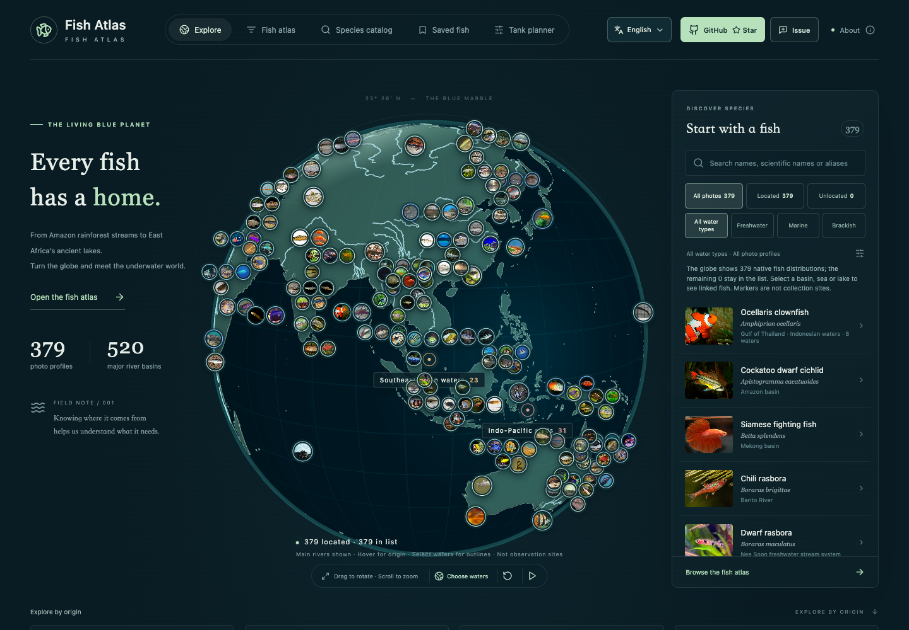
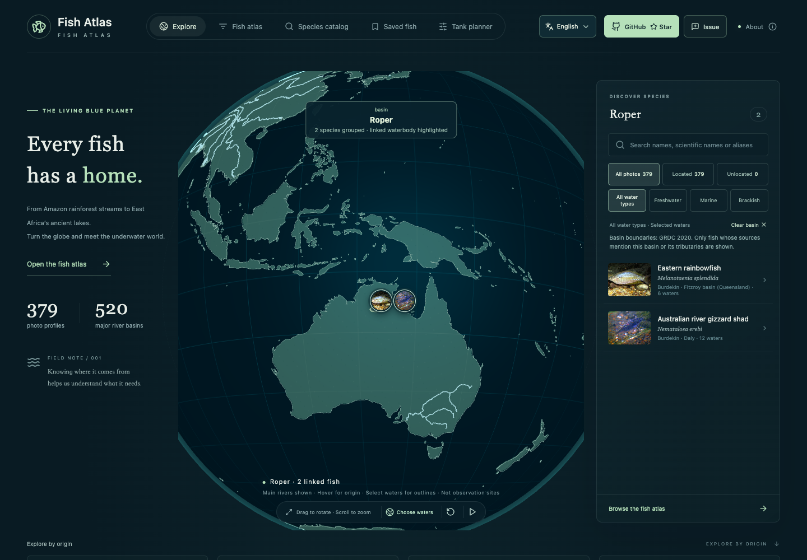

# 空白流域优先补齐

2026-10-15

本轮优先选择此前没有有图鱼种关联的水域，补充非洲、南美洲、大洋洲、南亚和西亚鱼类，并复查已收录广布鱼的漏记分布。所有新增条目均有实际查看过的真实照片及具名原生水体依据；没有照片或只有国家级范围的候选不进入地球。

| 项目 | 补充前 | 补充后 |
| --- | ---: | ---: |
| 有图图鉴 | 287 | 379 |
| 分类目录 | 3697 | 3786 |
| 已关联主要流域 | 94 | 210 |
| 仍无有图关联的主要流域 | 426 | 310 |
| 已关联全部水域 | 203 | 338 |
| 鱼种—原生水体关系 | 1394 | 1988 |

本轮新增 92 种有图鱼，填补 116 个主要流域。当前关联水域包括 210 个 GRDC 流域、47 个海域、37 个湖泊／潟湖、44 个补充河流水系。统计表示当前图鉴的覆盖，不是水域内全部鱼种数。

## 各大洲覆盖

| 大洲 | GRDC 主要流域总数 | 补充前有鱼 | 补充后有鱼 | 新填补 |
| --- | ---: | ---: | ---: | ---: |
| 非洲 | 86 | 2 | 53 | 51 |
| 亚洲 | 96 | 21 | 33 | 12 |
| 欧洲 | 77 | 29 | 34 | 5 |
| 北美洲 | 119 | 25 | 29 | 4 |
| 大洋洲 | 51 | 9 | 31 | 22 |
| 南美洲 | 91 | 8 | 30 | 22 |

## 本轮填补的主要流域

| 大洲 | 水域 | 有图鱼种数 |
| --- | --- | ---: |
| 非洲 | Bandama · 1202 | 9 |
| 非洲 | Baraka · 1301 | 1 |
| 非洲 | Bia · 1203 | 5 |
| 非洲 | Buzi (Also Budzi) · 1302 | 3 |
| 非洲 | Cavally · 1204 | 1 |
| 非洲 | Cestos (Also Nuon) · 1205 | 1 |
| 非洲 | Chad · 1902 | 20 |
| 非洲 | Comoe (Also Komoe) · 1208 | 9 |
| 非洲 | Corubal (Also Koliba) · 1210 | 6 |
| 非洲 | Cross · 1211 | 9 |
| 非洲 | Cuanza · 1212 | 4 |
| 非洲 | Cuvelai · 1905 | 1 |
| 非洲 | Draa · 1214 | 1 |
| 非洲 | Galana · 1303 | 2 |
| 非洲 | Gambia · 1215 | 12 |
| 非洲 | Geba (Also Kayanga) · 1216 | 4 |
| 非洲 | Great Scarcies (Also Kolente) · 1217 | 4 |
| 非洲 | Incomati (Also Komati) · 1307 | 2 |
| 非洲 | Kouilou · 1218 | 2 |
| 非洲 | Kunene (Also Cunene) · 1219 | 6 |
| 非洲 | Limpopo · 1309 | 8 |
| 非洲 | Little Scarcies (Also Kaba) · 1220 | 3 |
| 非洲 | Loffa (Also Lofa River) · 1221 | 1 |
| 非洲 | Maputo (Also Lusutfu, Also Usutu) · 1312 | 2 |
| 非洲 | Melrhir · 1912 | 1 |
| 非洲 | Moa (Also Makona) · 1225 | 2 |
| 非洲 | Mono · 1226 | 8 |
| 非洲 | Niger · 1228 | 20 |
| 非洲 | Nile · 1229 | 19 |
| 非洲 | Ntem · 1230 | 1 |
| 非洲 | Nyanga · 1231 | 1 |
| 非洲 | Nyong · 1232 | 2 |
| 非洲 | Okavango (Also Cubango) · 1913 | 6 |
| 非洲 | Orange · 1234 | 3 |
| 非洲 | Oueme · 1235 | 9 |
| 非洲 | Pangani · 1314 | 1 |
| 非洲 | Pra · 1236 | 6 |
| 非洲 | Pungwe  (Also Pungoe) · 1315 | 3 |
| 非洲 | Rufiji · 1316 | 3 |
| 非洲 | Ruvu · 1317 | 2 |
| 非洲 | Ruvuma (Also Rovuma) · 1318 | 2 |
| 非洲 | Saint John River · 1237 | 1 |
| 非洲 | Saint Paul River · 1238 | 2 |
| 非洲 | Sanaga · 1239 | 6 |
| 非洲 | Sassandra · 1240 | 6 |
| 非洲 | Save · 1319 | 2 |
| 非洲 | Senegal · 1242 | 18 |
| 非洲 | Tana · 1320 | 2 |
| 非洲 | Tano (Also Tanoe) · 1244 | 4 |
| 非洲 | Volta · 1246 | 18 |
| 非洲 | Zambezi · 1325 | 10 |
| 亚洲 | Anadyr · 2402 | 1 |
| 亚洲 | Aral Sea · 2902 | 8 |
| 亚洲 | Godavari · 2307 | 6 |
| 亚洲 | Indigirka · 2103 | 1 |
| 亚洲 | Kolyma · 2105 | 3 |
| 亚洲 | Lena · 2106 | 2 |
| 亚洲 | Narmada · 2316 | 1 |
| 亚洲 | Ob · 2108 | 5 |
| 亚洲 | Shatt Al Arab · 2320 | 2 |
| 亚洲 | Ural (Also Oral) · 2917 | 16 |
| 亚洲 | Yana · 2116 | 1 |
| 亚洲 | Yenisey · 2117 | 2 |
| 欧洲 | Maritsa River · 6229 | 4 |
| 欧洲 | Neman (Also Nemunas, Also Nyoman) · 6233 | 19 |
| 欧洲 | Neva · 6235 | 1 |
| 欧洲 | Severnaya Dvina · 6109 | 15 |
| 欧洲 | Tornealven (Also Tornionjoki, Also Tornionvayla) · 6255 | 3 |
| 北美洲 | Brazos · 4203 | 2 |
| 北美洲 | Colorado · 4209 | 2 |
| 北美洲 | San Antonio · 4239 | 1 |
| 北美洲 | Yaqui · 4434 | 3 |
| 大洋洲 | Ashburton · 5301 | 2 |
| 大洋洲 | Blackwood · 5302 | 1 |
| 大洋洲 | Buller · 5403 | 2 |
| 大洋洲 | Burdekin · 5405 | 2 |
| 大洋洲 | De Grey River · 5303 | 2 |
| 大洋洲 | Drysdale · 5304 | 1 |
| 大洋洲 | Durack · 5409 | 1 |
| 大洋洲 | Fitzroy · 5411 | 3 |
| 大洋洲 | Fitzroy · 5305 | 5 |
| 大洋洲 | Flinders  · 5412 | 1 |
| 大洋洲 | Fortescue · 5306 | 2 |
| 大洋洲 | Gilbert · 5413 | 1 |
| 大洋洲 | Lake Eyre · 5902 | 3 |
| 大洋洲 | Leichhardt · 5420 | 1 |
| 大洋洲 | Mcarthur · 5424 | 2 |
| 大洋洲 | Mitchell · 5425 | 3 |
| 大洋洲 | Murray · 5309 | 7 |
| 大洋洲 | Ord · 5426 | 2 |
| 大洋洲 | Roper · 5430 | 2 |
| 大洋洲 | Sepik · 5432 | 2 |
| 大洋洲 | Victoria · 5435 | 3 |
| 大洋洲 | Waikato · 5437 | 3 |
| 南美洲 | Aisen · 3401 | 1 |
| 南美洲 | Araguari · 3204 | 1 |
| 南美洲 | Atrato · 3205 | 3 |
| 南美洲 | Chubut · 3210 | 1 |
| 南美洲 | Colorado · 3212 | 1 |
| 南美洲 | Coppename Rivier · 3213 | 2 |
| 南美洲 | Courantyne · 3214 | 1 |
| 南美洲 | De Contas · 3216 | 1 |
| 南美洲 | Guayas · 3411 | 1 |
| 南美洲 | Jaguaribe · 3225 | 2 |
| 南美洲 | Jequitinhonha · 3226 | 1 |
| 南美洲 | Magdalena · 3227 | 7 |
| 南美洲 | Maroni · 3228 | 5 |
| 南美洲 | Negro · 3232 | 2 |
| 南美洲 | Oiapoque (Also Oyapok) · 3233 | 1 |
| 南美洲 | Palena (Also Corcovado) · 3419 | 1 |
| 南美洲 | Paraiba Do Sul · 3237 | 3 |
| 南美洲 | Parnaiba · 3239 | 3 |
| 南美洲 | Rio De La Plata · 3243 | 1 |
| 南美洲 | Suriname Rivier · 3246 | 2 |
| 南美洲 | Tumbes (Also Tumbez) · 3427 | 1 |
| 南美洲 | Valdivia · 3428 | 1 |

## 来源与定位

分类采用 GBIF 精确物种匹配。FishBase 26.06 的 native／endemic + present 记录与物种分布文字交叉检查；澳洲等区域进一步采用 Australian Museum／Fishes of Australia、政府和原始分类文献。引入记录、旧广义物种概念及与范围文字冲突的记录不会只凭原生标签自动发布。每条关系保留来源和依据，并在需要时补充审阅限制。

照片来自具体 Wikimedia Commons 文件，保留作者、原文件页和实际许可。逐图检查排除历史画谱、食物照、疑似近似种、低分辨率或权属不足候选。馆藏、捕获或保存标本如有使用会保留原说明。Wikipedia 的短节选使用实际来源语言；没有百科词条的鱼仍可凭分类、真实照片和独立分布来源收录，不伪造百科链接或习性。

河流鱼关联具名流域；海水、湖泊鱼分别关联海域、湖泊。沿海潟湖／河口鱼使用河口或独立潟湖位置，避免落在大流域内陆中心。澳大利亚昆士兰 Fitzroy（5411）与西澳 Fitzroy（5305）分别处理；阿根廷 Negro 与亚马孙支流 Negro 不混用。湖泊多边形和河口位置采用 Natural Earth 1:10m 或来源具名坐标。地球标记是水域展示位置，不是采集点或完整分布边界。

复查已有鱼补入的北亚、欧洲关系也经过范围审阅：排除 Leuciscus leuciscus 的西伯利亚近似种、Salvelinus alpinus 的白海／波罗的海冲突、Abramis brama 的引入西伯利亚记录、Scardinius erythrophthalmus 的西伯利亚误记及 Oncorhynchus gorbuscha 的叶尼塞关系。丁鱥在叶尼塞只使用来源限定的南部纬度范围。

完整物种清单、图片许可、跳过原因和审阅记录见 [本轮审阅清单](../content/blank-basin-expansion-2026-10-15.json)；运行时分布依据仍可从每条鱼详情查看。照片授权汇总见 [署名表](../public/PHOTO_PROFILES_ATTRIBUTION.md)。

## 新增鱼种

### 非洲 · 30 种

| 名称 | 学名 | 原生水体关联数 | 照片与许可 |
| --- | --- | ---: | --- |
| 尖齿胡鲶 | *Clarias gariepinus* | 35 | [CC BY-SA 3.0](https://commons.wikimedia.org/wiki/File:Clarias_garie_080516_9166_H_tdp.jpg) |
| 齐氏非鲫 | *Coptodon zillii* | 11 | [CC BY-SA 3.0](https://commons.wikimedia.org/wiki/File:St._Peter%27s_Fish.jpg) |
| 小点非洲攀鲈 | *Ctenopoma acutirostre* | 1 | [CC BY-SA 3.0](https://commons.wikimedia.org/wiki/File:Leopard-Buschfisch.jpg) |
| 直鳍魮 | *Enteromius paludinosus* | 9 | [CC BY 4.0](https://commons.wikimedia.org/wiki/File:Enteromius_paludinosus_(10.3897-zookeys.902.39606)_Figure_13.jpg) |
| 芦鳗 | *Erpetoichthys calabaricus* | 3 | [CC BY-SA 3.0](https://commons.wikimedia.org/wiki/File:Akwa19_reedfish.jpg) |
| 裸臀鱼 | *Gymnarchus niloticus* | 7 | [CC BY-SA 3.0](https://commons.wikimedia.org/wiki/File:Gymnarchus007.JPG) |
| 长丝异鳃鲶 | *Heterobranchus longifilis* | 31 | [CC BY 4.0](https://commons.wikimedia.org/wiki/File:Heterobranchus_longifilis_53146551.jpg) |
| 尼罗异耳骨舌鱼 | *Heterotis niloticus* | 9 | [CC BY 3.0](https://commons.wikimedia.org/wiki/File:Heterotis_niloticus.png) |
| 短身狗脂鲤 | *Hydrocynus brevis* | 6 | [CC BY-SA 3.0](https://commons.wikimedia.org/wiki/File:Hydrocynus_brevis.jpg) |
| 福氏狗脂鲤 | *Hydrocynus forskahlii* | 27 | [CC BY-SA 3.0](https://commons.wikimedia.org/wiki/File:Hydrocynus_forskahlii.jpg) |
| 虎鱼 | *Hydrocynus vittatus* | 20 | [CC BY-SA 4.0](https://commons.wikimedia.org/wiki/File:Hydrocynus_vittatus_Gifu.jpg) |
| 尼罗尖吻鲈 | *Lates niloticus* | 7 | [CC BY-SA 4.0](https://commons.wikimedia.org/wiki/File:Lates_niloticus_by_DaijuAzuma.jpg) |
| 电鲶 | *Malapterurus electricus* | 8 | [CC BY-SA 3.0](https://commons.wikimedia.org/wiki/File:Malapterurus_electricus_1.jpg) |
| 奥利亚口孵非鲫 | *Oreochromis aureus* | 4 | [CC BY-SA 2.0](https://commons.wikimedia.org/wiki/File:Blue_Tilapia_(cropped).jpg) |
| 莫三比克口孵非鲫 | *Oreochromis mossambicus* | 2 | [CC BY-SA 3.0](https://commons.wikimedia.org/wiki/File:Oreochromis_mossambicus.JPG) |
| 尼罗口孵非鲫 | *Oreochromis niloticus* | 12 | [CC BY-SA 4.0](https://commons.wikimedia.org/wiki/File:Til%C3%A1pia_ou_Sarotherodon_niloticus_2.jpg) |
| 齿蝶鱼 | *Pantodon buchholzi* | 6 | [CC BY-SA 3.0](https://commons.wikimedia.org/wiki/File:Pantodon_buchholzi.jpg) |
| 暗副鳢 | *Parachanna obscura* | 24 | [CC BY-SA 4.0](https://commons.wikimedia.org/wiki/File:Parachanna_obscura_-_Aqua_Porte_Dor%C3%A9e_01.JPG) |
| 恩氏多鳍鱼 | *Polypterus endlicherii* | 7 | [CC BY-SA 3.0](https://commons.wikimedia.org/wiki/File:Polypterus_endlicherii.jpg) |
| 塞内加尔多鳍鱼 | *Polypterus senegalus* | 14 | [CC0](https://commons.wikimedia.org/wiki/File:Polypterus_senegalus_-_Senegal-Fl%C3%B6sselhecht_-_Albino.jpg) |
| 石花肺鱼 | *Protopterus aethiopicus* | 7 | [CC BY-SA 4.0](https://commons.wikimedia.org/wiki/File:Leopard_lungfish_(Protopterus_aethiopicus)_close_-_GRB.JPG) |
| 西非肺鱼 | *Protopterus annectens* | 11 | [CC BY 2.5](https://commons.wikimedia.org/wiki/File:G%C5%91tehal-2.jpg) |
| 长肺鱼 | *Protopterus dolloi* | 3 | [CC BY-SA 3.0](https://commons.wikimedia.org/wiki/File:Dolloi.jpg) |
| 加利略帚齿非鲫 | *Sarotherodon galilaeus* | 23 | [CC BY 4.0](https://commons.wikimedia.org/wiki/File:Cichlidae_(10.3897-zse.96.55837)_Figure_9_Sarotherodon_galilaeus_1.jpg) |
| 黑颏帚齿非鲫 | *Sarotherodon melanotheron* | 3 | [CC BY 3.0](https://commons.wikimedia.org/wiki/File:Blackchin_tilapia.png) |
| 中间锡伯鲶 | *Schilbe intermedius* | 40 | [CC0](https://commons.wikimedia.org/wiki/File:Schilbe_intermedius_127711042.jpg) |
| 大头鮨丽鱼 | *Serranochromis macrocephalus* | 6 | [CC BY-SA 4.0](https://commons.wikimedia.org/wiki/File:Serranochromis_macrocephalus_fish_Zimbabwe.jpg) |
| 沙尔歧须𬶏 | *Synodontis schall* | 9 | [CC BY-SA 3.0](https://commons.wikimedia.org/wiki/File:Synodontis_schall_(cropped).jpg) |
| 赞比西河歧须𬶏 | *Synodontis zambezensis* | 2 | [CC BY 4.0](https://commons.wikimedia.org/wiki/File:Synodontis_zambezensis_70328519.jpg) |
| 斯氏非鲫 | *Tilapia sparrmanii* | 11 | [CC BY-SA 2.0](https://commons.wikimedia.org/wiki/File:Tilapia_sparrmanii.jpg) |

### 美洲 · 30 种

| 名称 | 学名 | 原生水体关联数 | 照片与许可 |
| --- | --- | ---: | --- |
| 宽体安迪丽鱼 | *Andinoacara latifrons* | 2 | [CC BY 2.0](https://commons.wikimedia.org/wiki/File:Andinoacara_latifrons_(16495110976).jpg) |
| 克氏卡奎丽鱼 | *Caquetaia kraussii* | 2 | [CC BY 2.0](https://commons.wikimedia.org/wiki/File:Caquetaia_kraussi_(16797021605).jpg) |
| 眼点丽鱼 | *Cichla ocellaris* | 2 | [CC BY-SA 3.0](https://commons.wikimedia.org/wiki/File:ButterflyPeacockBass_01.jpg) |
| 钝吻魣脂鲤 | *Ctenolucius hujeta* | 1 | [CC BY-SA 3.0](https://commons.wikimedia.org/wiki/File:Freshwater_Barracuda_-_Ctenolucius_hujeta.png) |
| 马格达护胸鲶 | *Hoplosternum magdalenae* | 1 | [CC BY 3.0](https://commons.wikimedia.org/wiki/File:Hoplosternum_magdalenae.png) |
| 条纹鲮脂鲤 | *Prochilodus lineatus* | 2 | [CC BY 4.0](https://commons.wikimedia.org/wiki/File:Prochilodus_lineatus_cropped.jpg) |
| 马格达河鲮脂鲤 | *Prochilodus magdalenae* | 2 | [CC BY 2.0](https://commons.wikimedia.org/wiki/File:Prochilodus_magdalenae_(16197296986).jpg) |
| 铲吻油鲶 | *Sorubim lima* | 4 | [CC BY-SA 3.0](https://commons.wikimedia.org/wiki/File:Silure_spatule.jpg) |
| 火焰魮脂鲤 | *Hyphessobrycon flammeus* | 1 | [CC BY 4.0](https://commons.wikimedia.org/wiki/File:Hyphessobrycon_flammeus,_%D0%91%D0%B5%D1%81%D0%B0%D1%80%D0%B0%D0%B1%D0%BA%D0%B0,_%D0%9A%D0%B8%D1%97%D0%B2,_%D0%A3%D0%BA%D1%80%D0%B0%D1%97%D0%BD%D0%B0,_02000_imported_from_iNaturalist_photo_319666874.jpg) |
| 矮丽鱼 | *Nannacara anomala* | 1 | [CC BY-SA 4.0](https://commons.wikimedia.org/wiki/File:Nannacara_anomala_female1.jpg) |
| 斯氏珠母丽鱼 | *Geophagus steindachneri* | 1 | [CC BY-SA 3.0](https://commons.wikimedia.org/wiki/File:Geophagus_steindachneri_in_Tropicarium-Oceanarium_Budapest.jpg) |
| 鞍斑宝丽鱼 | *Aequidens tetramerus* | 4 | [CC BY 3.0](https://commons.wikimedia.org/wiki/File:Aequidens_tetramerus1.jpg) |
| 博纳里牙汉鱼 | *Odontesthes bonariensis* | 1 | [CC BY-SA 3.0](https://commons.wikimedia.org/wiki/File:Odontesthes_bonariensis.JPG) |
| 西域若花鳉 | *Poeciliopsis occidentalis* | 2 | [CC BY 2.0](https://commons.wikimedia.org/wiki/File:Gila_topminnow_Poeciliopsis_occidentalis.jpg) |
| 特氏黑鲈 | *Micropterus treculii* | 3 | [CC0](https://commons.wikimedia.org/wiki/File:Micropterus_treculii_153726353.jpg) |
| 素色突颌鱼 | *Hybognathus placitus* | 3 | [CC0](https://commons.wikimedia.org/wiki/File:Hybognathus_placitus.jpg) |
| 伯氏亚口鱼 | *Catostomus bernardini* | 1 | [CC BY-SA 4.0](https://commons.wikimedia.org/wiki/File:Catostomus_bernardini.jpg) |
| 普拉特南乳鱼 | *Galaxias platei* | 5 | [CC BY 4.0](https://commons.wikimedia.org/wiki/File:Plate%27s_Galaxias,_Vicente_P%C3%A9rez_Rosales_-_Avenida_Presidente_Jorge_Alessandri,_Llanquihue,_Los_Lagos,_Chile_imported_from_iNaturalist_photo_113175422.jpg) |
| 维纳斯线纹脂鲤 | *Nematocharax venustus* | 2 | [CC BY 4.0](https://commons.wikimedia.org/wiki/File:Nematocharax_costai_(UFRJ_8216-l).png) |
| 紫骨尾鱼 | *Gila purpurea* | 1 | [Public domain](https://commons.wikimedia.org/wiki/File:Gila_purpurea.jpg) |
| 斯坦氏隐带丽鱼 | *Apistogramma steindachneri* | 3 | [CC BY-SA 2.0](https://commons.wikimedia.org/wiki/File:Apistogramma_steindachneri_Armbruster.jpg) |
| 莫氏石脂鲤 | *Brycon moorei* | 1 | [CC BY-SA 4.0](https://commons.wikimedia.org/wiki/File:Brycon_moorei.jpg) |
| 苏里南珠母丽鱼 | *Geophagus surinamensis* | 2 | [CC BY-SA 3.0](https://commons.wikimedia.org/wiki/File:Geophagus_surinamensis.jpg) |
| 欧氏圭亚那丽鱼 | *Guianacara owroewefi* | 3 | [CC BY 4.0](https://commons.wikimedia.org/wiki/File:Guianacara_owroewefi_5587337.jpg) |
| 安氏高鳉 | *Hypsolebias antenori* | 1 | [CC BY-SA 4.0](https://commons.wikimedia.org/wiki/File:Hypsolebias_antenori,_Parque_Nacional_da_Furna_Feia,_Diego_Bento.jpg) |
| 真鲈 | *Percichthys trucha* | 4 | [CC BY 3.0](https://commons.wikimedia.org/wiki/File:Percichthys_trucha.png) |
| 银大眼脂鲤 | *Tetragonopterus argenteus* | 6 | [CC BY-SA 4.0](https://commons.wikimedia.org/wiki/File:Tetragonopterus_argenteus.jpg) |
| 四斑半齿脂鲤 | *Hemiodus quadrimaculatus* | 3 | [CC BY-SA 2.0](https://commons.wikimedia.org/wiki/File:Hemiodus_quadrimaculatus_Armbruster.jpg) |
| 拟驼背施氏油鲶 | *Steindachneridion parahybae* | 1 | [CC BY 3.0](https://commons.wikimedia.org/wiki/File:Sparahybae_photolizandradolfini.jpg) |
| 小鳞利齿脂鲤 | *Hoplias microlepis* | 2 | [CC BY 4.0](https://commons.wikimedia.org/wiki/File:Hoplias_microlepis_BMNH_1864.1.26.309.tif) |

### 亚洲与大洋洲 · 32 种

| 名称 | 学名 | 原生水体关联数 | 照片与许可 |
| --- | --- | ---: | --- |
| 澳洲虹银汉鱼 | *Melanotaenia australis* | 9 | [CC BY-SA 3.0](https://commons.wikimedia.org/wiki/File:300_Melanotaenia_australis_Western_rainbowfish_Mitchell_River_NP_VIII-2013.jpg) |
| 杜氏虹银汉鱼 | *Melanotaenia duboulayi* | 1 | [CC BY 4.0](https://commons.wikimedia.org/wiki/File:Melanotaenia_duboulayi_238169871.jpg) |
| 麦氏虹银汉鱼 | *Melanotaenia maccullochi* | 1 | [CC BY-SA 4.0](https://commons.wikimedia.org/wiki/File:Melanotaenia_maccullochi.jpg) |
| Melanotaenia splendida | *Melanotaenia splendida* | 6 | [CC BY-SA 3.0](https://commons.wikimedia.org/wiki/File:Eastern_Rainbowfish_01.jpg) |
| 格氏新海鲶 | *Neoarius graeffei* | 4 | [CC0](https://commons.wikimedia.org/wiki/File:Neoarius_graeffei.jpg) |
| 珍珠龙鱼 | *Scleropages jardinii* | 1 | [CC BY-SA 3.0](https://commons.wikimedia.org/wiki/File:Scleropages_jardinii_043.JPG) |
| 巴氏南脂鲈 | *Nannatherina balstoni* | 1 | [CC BY 4.0](https://commons.wikimedia.org/wiki/File:Nannatherina_balstoni.jpg) |
| 三带虹银汉鱼 | *Melanotaenia trifasciata* | 1 | [CC BY-SA 4.0](https://commons.wikimedia.org/wiki/File:Melanotaenia_trifasciata_2zz2.jpg) |
| 尖吻鲈 | *Lates calcarifer* | 4 | [CC BY-SA 4.0](https://commons.wikimedia.org/wiki/File:Lates_calcarifer,_2014-09-19a.jpg) |
| 北澳海𬶭 | *Nematalosa erebi* | 12 | [CC BY 4.0](https://commons.wikimedia.org/wiki/File:Nematalosa_erebi_157461902.jpg) |
| 短鳍南乳鱼 | *Galaxias brevipinnis* | 2 | [CC BY-SA 4.0](https://commons.wikimedia.org/wiki/File:Juvenile_koaro,_photo_by_Stella_McQueen.jpg) |
| 大斑南乳鱼 | *Galaxias maculatus* | 3 | [CC BY-SA 4.0](https://commons.wikimedia.org/wiki/File:Inanga.jpg) |
| 圆尾麦氏鲈 | *Macquaria ambigua* | 3 | [CC BY-SA 3.0](https://commons.wikimedia.org/wiki/File:Golden_perch.JPG) |
| 澳洲麦氏鲈 | *Macquaria australasica* | 1 | [CC BY-SA 3.0](https://commons.wikimedia.org/wiki/File:Macquarie_perch.jpg) |
| 黄体魮 | *Carasobarbus luteus* | 1 | [CC BY 3.0](https://commons.wikimedia.org/wiki/File:Carasobarbus_luteus_-_ZooKeys-339-001-g024.jpg) |
| 河虹银汉鱼 | *Melanotaenia fluviatilis* | 1 | [CC BY-SA 3.0](https://commons.wikimedia.org/wiki/File:Murray_River_Rainbow_Fish.jpg) |
| 大鳗鲡 | *Anguilla dieffenbachii* | 1 | [CC BY-SA 4.0](https://commons.wikimedia.org/wiki/File:New_Zealand_longfin_eel_(Anguilla_dieffenbachii)_Piha.jpg) |
| 淡红墨头鱼 | *Garra rufa* | 1 | [CC BY-SA 3.0](https://commons.wikimedia.org/wiki/File:Garra_Rufa.JPG) |
| 双色鳗鲡 | *Anguilla bicolor* | 1 | [CC BY-SA 3.0](https://commons.wikimedia.org/wiki/File:Specimen_of_Anguilla_bicolor_pacifica.JPG) |
| 线鳢 | *Channa striata* | 5 | [CC BY-SA 3.0](https://commons.wikimedia.org/wiki/File:Gabus_070909_0074_rwg.jpg) |
| Garra mullya | *Garra mullya* | 1 | [CC BY-SA 4.0](https://commons.wikimedia.org/wiki/File:Garra_mullya.jpg) |
| 巴基斯坦𫚥鳉 | *Aplocheilus panchax* | 4 | [CC BY 3.0](https://commons.wikimedia.org/wiki/File:Aplocheilus_panchax.jpg) |
| 波条鿕 | *Devario aequipinnatus* | 3 | [CC BY-SA 2.5](https://commons.wikimedia.org/wiki/File:Devario_aequipinnatus.JPG) |
| 绿腹丽鱼 | *Etroplus suratensis* | 2 | [CC BY 2.0](https://commons.wikimedia.org/wiki/File:Etroplus_suratensis.jpg) |
| 大刺鳅 | *Mastacembelus armatus* | 6 | [CC BY-SA 3.0](https://commons.wikimedia.org/wiki/File:Tire_Track_Eel.jpg) |
| 墨瑞鳕 | *Maccullochella peelii* | 1 | [CC BY 3.0](https://commons.wikimedia.org/wiki/File:Murray_cod_resting_in_an_aquarium.jpg) |
| 澳洲鳗鲶 | *Tandanus tandanus* | 1 | [CC BY-SA 3.0](https://commons.wikimedia.org/wiki/File:Tandanus_tandanus.JPG) |
| 西氏后鳍鲑 | *Retropinna semoni* | 1 | [CC BY-SA 4.0](https://commons.wikimedia.org/wiki/File:Australian_smelt_(Retropinna_semoni).jpg) |
| 条纹唇银汉鱼 | *Chilatherina fasciata* | 1 | [CC BY-SA 3.0](https://commons.wikimedia.org/wiki/File:Chilatherina_fasciata_male.jpg) |
| 多舌鳞银汉鱼 | *Glossolepis multisquamata* | 1 | [CC BY-SA 2.0](https://commons.wikimedia.org/wiki/File:Glossolepis_multisquamatus_at_Berlin_acquarium_(2521285743).jpg) |
| Chlamydogobius eremius | *Chlamydogobius eremius* | 1 | [CC BY-SA 2.5](https://commons.wikimedia.org/wiki/File:Chlamydogobius_eremius.jpg) |
| 细波鱼 | *Rasbora daniconius* | 7 | [CC BY 4.0](https://commons.wikimedia.org/wiki/File:Rasbora_daniconius_53178946.jpg) |

## 验证与维护

生产构建和内容校验：通过（首轮缺来源元数据已补齐，再构建通过）。单元测试 64 项通过；增量导入测试 4 项通过；地理标记错误 0 个。浏览器结果：Chrome 10/10、WebKit 10/10，20项指定用例首轮全部通过，无重试。

独立预览确认 379 个鱼种标记的图片全部加载，代表 239 个水域；按具体水域筛选可查看全部已核实关联，不因每种鱼只保留一个总览代表标记而丢失其他水域关系。默认英文，1440px 桌面总览与 390px 手机详情均无横向溢出。Roper 筛选后的方向键切鱼、URL、选中照片与地球同步，无百科页面条目的照片与独立来源正常。

发布器保留旧增量资料，拒绝分类身份、图片路径及水体冲突。没有 Wikipedia 的条目不显示空的百科来源；多语言节选标记实际 lang。Wikimedia 采集共用串行节流和缓存，限流时停止该来源采集，不更换端点规避限制。研究缓存不参与正常构建。

```bash
npm run build
npm test
python3 scripts/test-regional-publisher.py
npx tsx scripts/check-distribution-pins.ts
python3 scripts/report-blank-basin-coverage.py
```

仍有 310 个主要流域没有经核实的有图鱼种；已关联水域也未覆盖全部当地鱼。缺少的习性、养护参数及具体分布仍保持未知。新增条目没有经核对的养护参数，因此不自动进入鱼缸规划。




