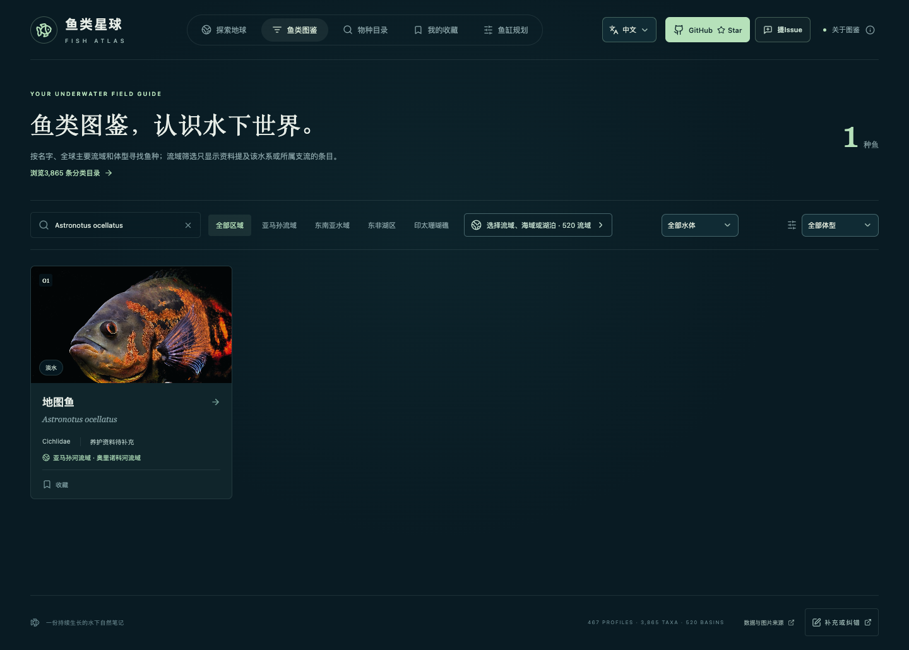

# 中文鱼名规范与修正

2026-10-15

核对全部467种有图鱼。原数据没有发现UTF-8解码损坏；53个主名与一般繁简转换结果有差异，11个主名包含扩展区鱼字。后者是合法Unicode汉字，但不常见且字体兼容性较差。机械全量转简体还会把鮰、鮈、鱊等字换成更生僻的扩展区字，本次采用受控字形表。

本轮规范或更换了 **74个中文显示名**。普通繁体统一为简体；鱼字优先保留已有文献和常见系统字体支持的BMP写法。有确切物种配对来源时优先采用易读俗名，例如白条鱼、花骨鱼、丁桂鱼、燕子美人；资料名称、学名和合法旧写法仍可查证或搜索。

同时纠正来源标签中的错名／错字：大鳞吸口鱼、银高体鲃、九棘多刺鱼、黑背天竺鲷、无斑鸳鸯鮨。明确属于其他物种或错误转录的名称不再作为别名匹配；不会为了容易读而从英文编造新中文名。Danionella dracula等未核实到可靠替代俗名的鱼保留现有名称。

## 显示与检索规则

- 图鉴、地球、详情、图片大图、收藏与分类目录通过同一中文名称规则显示。
- 原始繁体及扩展区旧字作为搜索别名保留；确认错误的名称移除。
- 34个重点名称提供逐种来源。选择通俗显示名的鱼，在中文详情来源区保留资料名称及中文名称依据。
- 鱥、䱗、䱻、鱊、鿕等是鱼类专业用字，不能随意当作错字或替换成另一种鱼；仅在有可靠俗名时调整主标题。
- CJK标题字体增加系统中文回退，避免只依赖衬线字体。未新增外部字体下载。
- 英文别名识别覆盖全部Han码点，避免将扩展区中文鱼字误当成英文名。

## 重点名称与依据

| 学名 | 中文显示名 | 资料名称（如有） | 来源 |
| --- | --- | --- | --- |
| *Acheilognathus macropterus* | 大鳍鱊 | — | [依据1](https://nyncj.wuhan.gov.cn/zhlm/tzgg/202004/P020230424423477651555.pdf) |
| *Alphestes immaculatus* | 无斑鸳鸯鮨 | — | [依据1](https://fishdb.sinica.edu.tw/eng/chinesequer2.php?R1=&T1=&cn=&dere=desc&fm=&gc=&me=&orderby=family_ch&page=421&pz=30&vn=) |
| *Ameiurus melas* | 黑鮰 | — | [依据1](https://fishdb.sinica.edu.tw/eng/chinesequer2.php?R1=&T1=&cn=&dere=&fm=&gc=&orderby=science&page=3&pz=500&vn=) |
| *Ameiurus natalis* | 黄鮰 | — | [依据1](https://www.gbif.org/zh/taxon/CQKF)、[依据2](https://fishdb.sinica.edu.tw/eng/chinesequer2.php?R1=&T1=&cn=&dere=&fm=&gc=&orderby=science&page=3&pz=500&vn=) |
| *Aplocheilus panchax* | 巴基斯坦鰕鳉 | — | [依据1](https://fishdb.sinica.edu.tw/eng/chinesequer2.php?R1=&T1=&cn=&dere=desc&fm=&gc=&orderby=family_name&page=67&pz=500&vn=) |
| *Apogon atradorsatus* | 黑背天竺鲷 | — | [依据1](https://fishdb.sinica.edu.tw/chi/chinesequer2.php?R1=&T1=&cn=&dere=desc&fm=&gc=&me=&orderby=is_accepted_name&page=103&pz=200&vn=) |
| *Barbonymus gonionotus* | 银高体鲃 | — | [依据1](https://fishdb.sinica.edu.tw/taxon/395479-fishdb) |
| *Canthigaster bennetti* | 本氏河鲀 | — | [依据1](https://fishdb.sinica.edu.tw/mobi/species.php?id=383024)、[依据2](https://www.tfrin.gov.tw/theme_list.php?page=536&theme=dictionary) |
| *Coregonus artedi* | 湖白鲑 | — | [依据1](https://fishdb.sinica.edu.tw/eng/chinesequer2.php?D1=&R1=&T1=&cn=&dere=desc&fm=&gc=&orderby=science&page=525&pz=50&vn=)、[依据2](https://fishbase.se/ComNames/CommonNamesList.php?GenusName=Coregonus&ID=235&SpeciesName=artedi) |
| *Coregonus clupeaformis* | 鲱形白鲑 | — | [依据1](https://fishdb.sinica.edu.tw/eng/chinesequer2.php?R1=&T1=&cn=&dere=asc&fm=&gc=&orderby=science&page=329&pz=25&vn=)、[依据2](https://fishbase.se/ComNames/CommonNameSummary.php?autoctr=267297)、[依据3](https://www.sciengine.com/doi/pdf/6C52E49D91134E1B82D2505DD7E2F8FC) |
| *Cottus gobio* | 鮈杜父鱼 | — | [依据1](https://fishdb.sinica.edu.tw/eng/chinesequer2.php?R1=&T1=&cn=&dere=desc&fm=&gc=&orderby=family_name&page=958&pz=25&vn=) |
| *Devario aequipinnatus* | 大斑马 | 波条鿕 | [依据1](https://fishdb.sinica.edu.tw/chi/import_already_pic.php?id=1433) |
| *Hemibarbus labeo* | 重唇鱼 | 唇䱻 | [依据1](https://xuebao.dlou.edu.cn/article/2025/2095-1388/202502003.html)、[依据2](https://patents.google.com/patent/CN101965923B/zh)、[依据3](https://www.moa.gov.cn/xw/bmdt/202106/P020210617329140415572.pdf) |
| *Hemibarbus maculatus* | 花骨鱼 | 花䱻 | [依据1](https://www.xinping.gov.cn/u/cms/xpxzfxxgk/202008/2816011103h1.pdf)、[依据2](https://www.moa.gov.cn/xw/bmdt/202106/P020210617329140415572.pdf)、[依据3](https://xuebao.dlou.edu.cn/article/2020/2095-1388/202001002.html) |
| *Hemiculter leucisculus* | 白条鱼 | 䱗 | [依据1](https://dfz.jl.gov.cn/jltc/201802/t20180211_5217565.html)、[依据2](https://www.moa.gov.cn/xw/bmdt/202106/P020210617329140415572.pdf) |
| *Hypancistrus zebra* | L046熊猫异型 | 斑马下钩鲶 | [依据1](https://fishdb.sinica.edu.tw/chi/import_forbidden_pic.php?id=37)、[依据2](https://www.moa.gov.cn/nybgb/2018/201811/201901/P020190102426865426990.pdf) |
| *Ictalurus furcatus* | 长鳍真鮰 | — | [依据1](https://fishdb.sinica.edu.tw/chi/chinesequer2.php?R1=&T1=&cn=&dere=asc&fm=&gc=&me=&orderby=family_ch&page=112&pz=200&vn=) |
| *Ictalurus punctatus* | 斑点叉尾鮰 | — | [依据1](https://std.samr.gov.cn/db/search/stdDBDetailed?id=91D99E4D52812E24E05397BE0A0A3A10)、[依据2](https://yyj.moa.gov.cn/kjzl/201904/t20190428_6230770.htm)、[依据3](https://fishdb.sinica.edu.tw/chi/chinesequer2.php?R1=&T1=&cn=&dere=asc&fm=&gc=&me=&orderby=family_ch&page=112&pz=200&vn=) |
| *Iriatherina werneri* | 燕子美人 | 沃氏伊岛银汉鱼 | [依据1](https://kmweb.moa.gov.tw/subject/subject.php?id=21704) |
| *Leuciscus aspius* | 赤稍雅罗鱼 | — | [依据1](https://fishdb.sinica.edu.tw/chi/chinesemodi.php?D1=&R1=&T1=&cn=&dere=asc&fm=&gc=&me=&orderby=datelastmodified&page=65&pz=15&vn=) |
| *Luxilus cornutus* | 角闪光美洲鱥 | — | [依据1](https://fishdb.sinica.edu.tw/eng/chinesequer2.php?R1=&T1=&cn=&dere=asc&fm=&gc=&orderby=chinese_mainland&page=269&pz=100&vn=) |
| *Lythrurus umbratilis* | 蛰居美洲石鱥 | — | [依据1](https://fishdb.sinica.edu.tw/eng/chinesequer2.php?R1=&T1=&cn=&dere=&fm=&gc=&orderby=science&page=38&pz=500&vn=) |
| *Macropodus hongkongensis* | 香港斗鱼 | 香港斗鱼 | [依据1](https://bih.gov.hk/tc/fast-facts/species-named-after-hong-kong/index-id-22.html)、[依据2](https://www.natureintouch.gov.hk/documents/275279/1049958/Species_Identification_Guide_Student_StreamEcosystem_en_20231026.pdf/42efad61-f0d7-1bdb-4f21-8c8feac77ffb?t=1698740427164) |
| *Macropodus opercularis* | 叉尾斗鱼 | 盖斑斗鱼 | [依据1](https://www.natureintouch.gov.hk/documents/275279/1049958/Species_Identification_Guide_Student_StreamEcosystem_en_20231026.pdf/42efad61-f0d7-1bdb-4f21-8c8feac77ffb?t=1698740427164) |
| *Moxostoma macrolepidotum* | 大鳞吸口鱼 | — | [依据1](https://fishdb.sinica.edu.tw/chi/chinesequer2.php?D1=&R1=&T1=&cn=&dere=&fm=&gc=&me=&orderby=family_name&page=184&pz=30&vn=) |
| *Nipponocypris temminckii* | 特氏东瀛鲤 | 特氏东瀛鲤 | [依据1](https://fishdb.sinica.edu.tw/chi/chinesequer2.php?R1=&T1=&cn=&dere=asc&fm=&gc=&me=&orderby=family_name&page=633&pz=20&vn=)、[依据2](https://www.cgr.mlit.go.jp/yasaka/ikimono/organism2018/d0007.htm) |
| *Nocomis micropogon* | 小须美鱥 | — | [依据1](https://fishdb.sinica.edu.tw/eng/chinesequer2.php?R1=&T1=&cn=&dere=asc&fm=&gc=&orderby=chinese_taiwan&page=94&pz=100&vn=) |
| *Phenacobius mirabilis* | 奇美洲拟鱥 | — | [依据1](https://fishdb.sinica.edu.tw/eng/chinesequer2.php?R1=&T1=&cn=&dere=asc&fm=&gc=&orderby=family_name&page=432&pz=30&vn=) |
| *Pungitius pungitius* | 九棘多刺鱼 | — | [依据1](https://www.mee.gov.cn/xxgk2018/xxgk/xxgk01/202305/W020230522536559098623.pdf)、[依据2](https://www.biodiversity-science.net/CN/article/downloadArticleFile.do?attachType=PDF&id=8668) |
| *Pylodictis olivaris* | 铲鮰 | — | [依据1](https://fishdb.sinica.edu.tw/chi/chinesequer2.php?R1=&T1=&cn=&dere=asc&fm=&gc=&me=&orderby=family_ch&page=112&pz=200&vn=) |
| *Rhinichthys cataractae* | 吻鱥 | — | [依据1](https://fishdb.sinica.edu.tw/chi/chinesequer2.php?R1=&T1=&cn=&dere=asc&fm=&gc=&me=&orderby=chinese_taiwan&page=47&pz=100&vn=)、[依据2](https://fishdb.sinica.edu.tw/chi/specimen_species.php?R1=recno&R2=&dere=asc&key=&m=&page=1&pz=200) |
| *Richardsonius balteatus* | 红胁鱥 | — | [依据1](https://fishdb.sinica.edu.tw/chi/chinesequer2.php?R1=&T1=&cn=&dere=asc&fm=&gc=&me=&orderby=author&page=53&pz=200&vn=) |
| *Synodontis schall* | 沙尔歧须鮠 | — | [依据1](https://fishdb.sinica.edu.tw/eng/chinesequer2.php?R1=&T1=&cn=&dere=asc&fm=&gc=&orderby=chinese_mainland&page=34&pz=500&vn=) |
| *Tinca tinca* | 丁桂鱼 | 丁鱥 | [依据1](https://www.schinafish.cn/cn/article/pdf/preview/10.12131/20250164.pdf)、[依据2](https://nyncw.cq.gov.cn/wsdw/cqsscz/tzgg/202312/P020220222732842930981.pdf)、[依据3](https://www.moa.gov.cn/xw/bmdt/202106/P020210617329140415572.pdf) |

## 全部主名变化

| 学名 | 原主名 | 现主名 |
| --- | --- | --- |
| *Abudefduf bengalensis* | 孟加拉豆娘魚 | 孟加拉豆娘鱼 |
| *Abudefduf concolor* | 雜色豆娘魚 | 杂色豆娘鱼 |
| *Acanthistius cinctus* | 環帶刺鮨 | 环带刺鮨 |
| *Acanthogobius flavimanus* | 黃鰭刺鰕虎魚 | 黄鳍刺鰕虎鱼 |
| *Acanthurus achilles* | 心斑刺尾魚 | 心斑刺尾鱼 |
| *Acanthurus albipectoralis* | 白胸鰭刺尾魚 | 白胸鳍刺尾鱼 |
| *Acanthurus auranticavus* | 橘色刺尾魚 | 橘色刺尾鱼 |
| *Acantopsis dialuzona* | 蒼帶小刺眼鰍 | 苍带小刺眼鳅 |
| *Acantopsis octoactinotos* | 八線小刺眼鰍 | 八线小刺眼鳅 |
| *Acentronura breviperula* | 短身細尾海龍 | 短身细尾海龙 |
| *Acentronura tentaculata* | 南非細尾海馬 | 南非细尾海马 |
| *Achoerodus viridis* | 綠藍唇魚 | 绿蓝唇鱼 |
| *Agosia chrysogaster* | 長鰭鱥 | 长鳍鱥 |
| *Alfaro cultratus* | 刀鱗鱂 | 刀鳞鳉 |
| *Alphestes immaculatus* | 無斑鴛鴛鮨 | 无斑鸳鸯鮨 |
| *Alticus monochrus* | 單色跳彈䲁 | 单色跳弹鳚 |
| *Amatitlania siquia* | 橘斑嬌麗魚 | 橘斑娇丽鱼 |
| *Amblyglyphidodon flavilatus* | 黃側凹牙豆娘魚 | 黄侧凹牙豆娘鱼 |
| *Amblypomacentrus breviceps* | 短頭鈍雀鯛 | 短头钝雀鲷 |
| *Amblyrhynchotes honckenii* | 白點寬吻魨 | 白点宽吻鲀 |
| *Ameiurus melas* | 黑𫚔 | 黑鮰 |
| *Ameiurus natalis* | 黄𫚔 | 黄鮰 |
| *Amphilophus citrinellus* | 橘色雙冠麗魚 | 橘色双冠丽鱼 |
| *Anampses caeruleopunctatus* | 青斑阿南魚 | 青斑阿南鱼 |
| *Anampses cuvier* | 居氏阿南魚 | 居氏阿南鱼 |
| *Aphanius fasciatus* | 斑條祕鱂 | 斑条秘鳉 |
| *Aplocheilus panchax* | 巴基斯坦𫚥鳉 | 巴基斯坦鰕鳉 |
| *Apogon atradorsatus* | 黑幼背天竺鯛 | 黑背天竺鲷 |
| *Arothron diadematus* | 紅海叉鼻魨 | 红海叉鼻鲀 |
| *Arothron firmamentum* | 瓣叉鼻魨 | 瓣叉鼻鲀 |
| *Aspidoras fuscoguttatus* | 棕點盾皮鮠 | 棕点盾皮鮠 |
| *Astronotus ocellatus* | 地圖魚 | 地图鱼 |
| *Axelrodia riesei* | 里氏阿克塞脂鯉 | 里氏阿克塞脂鲤 |
| *Barbonymus gonionotus* | 银石首鱼 | 银高体鲃 |
| *Belonesox belizanus* | 墨西哥魣鱂 | 墨西哥魣鳉 |
| *Belontia signata* | 梳尾格鬥魚 | 梳尾格斗鱼 |
| *Botia birdi* | 伯德氏沙鰍 | 伯德氏沙鳅 |
| *Botia dario* | 達林沙鰍 | 达林沙鳅 |
| *Callichthys callichthys* | 美鯰 | 美鲶 |
| *Canthigaster axiologus* | 三帶尖鼻魨 | 三带尖鼻鲀 |
| *Canthigaster bennetti* | 笨氏尖鼻魨 | 本氏河鲀 |
| *Centrolabrus exoletus* | 小口棘隆頭魚 | 小口棘隆头鱼 |
| *Chaetodon andamanensis* | 黃蝴蝶魚 | 黄蝴蝶鱼 |
| *Chaetodon argentatus* | 銀身蝴蝶魚 | 银身蝴蝶鱼 |
| *Chelmonops truncatus* | 截尾鑷蝶魚 | 截尾镊蝶鱼 |
| *Cnesterodon decemmaculatus* | 十斑銼齒鱂 | 十斑锉齿鳉 |
| *Cobitis bilineata* | 雙線鰍 | 双线鳅 |
| *Coradion altivelis* | 褐帶少女魚 | 褐带少女鱼 |
| *Coregonus clupeaformis* | 湖白鱼 | 鲱形白鲑 |
| *Cottus gobio* | 𬶋杜父鱼 | 鮈杜父鱼 |
| *Devario aequipinnatus* | 波条鿕 | 大斑马 |
| *Gila atraria* | 猶他骨尾魚 | 犹他骨尾鱼 |
| *Gobio gobio* | 𬶋 | 鮈 |
| *Hemibarbus labeo* | 唇䱻 | 重唇鱼 |
| *Hemibarbus maculatus* | 花䱻 | 花骨鱼 |
| *Hemibrycon taeniurus* | 條紋半齧脂鯉 | 条纹半啮脂鲤 |
| *Hemiculter leucisculus* | 䱗 | 白条鱼 |
| *Hypancistrus zebra* | 斑馬下鈎鯰 | L046熊猫异型 |
| *Ictalurus furcatus* | 长鳍真𫚔 | 长鳍真鮰 |
| *Ictalurus punctatus* | 斑点叉尾𫚔 | 斑点叉尾鮰 |
| *Iriatherina werneri* | 沃氏伊岛银汉鱼 | 燕子美人 |
| *Leporacanthicus heterodon* | 異牙兔甲鯰 | 异牙兔甲鲶 |
| *Macropodus hongkongensis* | 香港鬥魚 | 香港斗鱼 |
| *Macropodus opercularis* | 蓋斑鬥魚 | 叉尾斗鱼 |
| *Moenkhausia bonita* | 博奈直線脂鯉 | 博奈直线脂鲤 |
| *Moxostoma macrolepidotum* | 马斯科吸口鱼 | 大鳞吸口鱼 |
| *Nematalosa erebi* | 北澳海𬶭 | 北澳海鰶 |
| *Nipponocypris temminckii* | 川鯥 | 特氏东瀛鲤 |
| *Prionurus biafraensis* | 比夫拉多板盾尾魚 | 比夫拉多板盾尾鱼 |
| *Pungitius pungitius* | 八棘多刺鱼 | 九棘多刺鱼 |
| *Pylodictis olivaris* | 铲𫚔 | 铲鮰 |
| *Synodontis schall* | 沙尔歧须𬶏 | 沙尔歧须鮠 |
| *Synodontis zambezensis* | 赞比西河歧须𬶏 | 赞比西河歧须鮠 |
| *Tinca tinca* | 丁鱥 | 丁桂鱼 |

## 验证

生产构建通过，73项单元测试、11项发布器测试、Chrome和WebKit各3项浏览器回归通过。新增主名均无替换字符或扩展区Han字；真实照片、467种身份、全部2,615条原生关系与水域数据保持原值。浏览器检查了简体标题、鮰/𫚔双写法搜索、详情与大图、中英文切换，以及错误物种标签不再匹配。

逐条变化和来源见[审阅记录](../content/chinese-name-review-2026-10-15.json)，浏览器结果见[检查报告](chinese-name-e2e-results.json)。这是字符串全表检查及重点名称来源核对，不表示全部467种中文名称已经过鱼类专家审定。

维护采用标准库脚本和同一受控表，不依赖运行环境安装OpenCC：

```bash
python3 scripts/apply-chinese-names.py          # 检查已发布名称是否符合政策
python3 scripts/apply-chinese-names.py --write  # 应用已审核名称并更新图片署名
python3 scripts/test-regional-publisher.py
npm run build
```

[受控转换与逐种偏好](../content/chinese-name-policy.json)；字形审计使用[OpenCC](https://github.com/BYVoid/OpenCC)辅助发现差异，导入和前端不直接全量套用词典。


