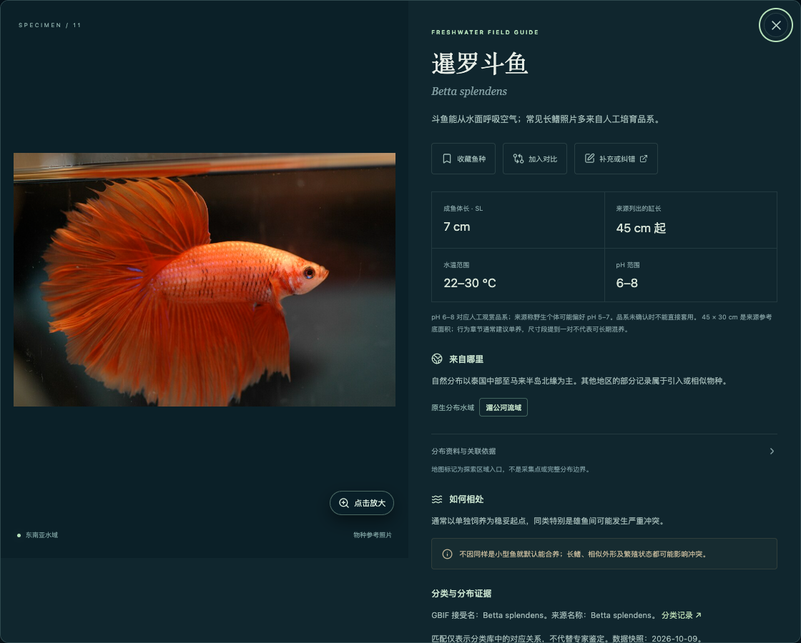
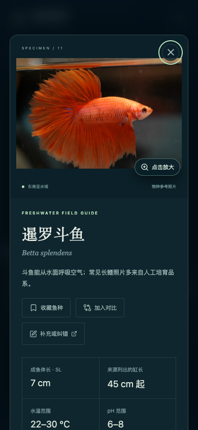

# 鱼类资料补充与纠错入口

鱼类详情（包括地球联动阅读区和普通详情弹窗）的操作栏新增“补充或纠错”。所有 183 种照片图鉴共用此入口；页脚和关于页提供不绑定鱼种的入口，可推荐新鱼。

入口打开 `korbinjoe/fish-atlas` 的中文 GitHub Issue 表单，预填鱼名、学名与图鉴永久链接。URL 不携带搜索条件、版本参数或鱼缸规划数据。用户自行登录 GitHub，选择补充资料、修正错误或推荐新鱼，再确认提交；维护者核对后更新。

表单仅要求反馈类型和说明，参考资料及照片来源可选。需要照片时提供原始页面、作者与授权方式，避免用不明来源图片替换图鉴。使用方式见 [参与完善资料](../CONTRIBUTING.md)。

## 验证

2026-10-13 生产构建通过。Chrome 和 WebKit 的 8 项新增反馈检查通过，覆盖两类详情预填、页面参数清理、通用入口、唯一入口、手机 44px 点击区和横向溢出；32 项图鉴与地球联动回归通过。

桌面入口：

手机入口：

