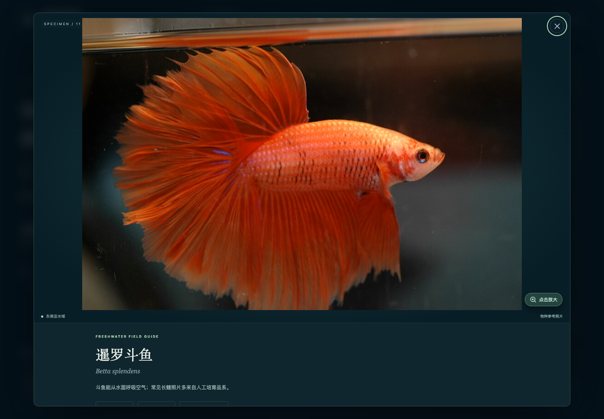
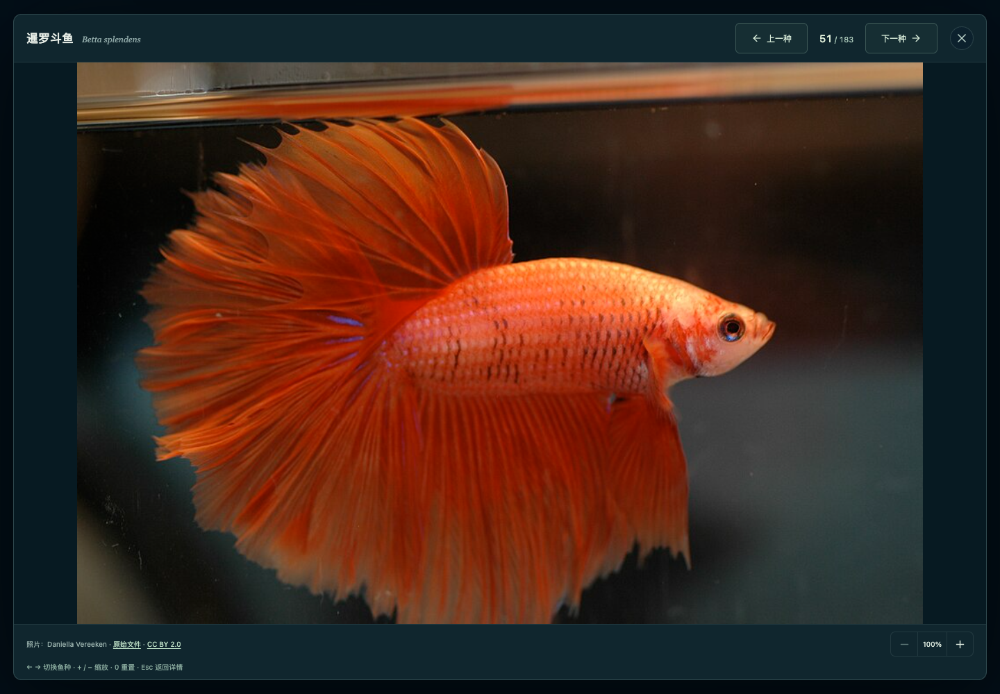
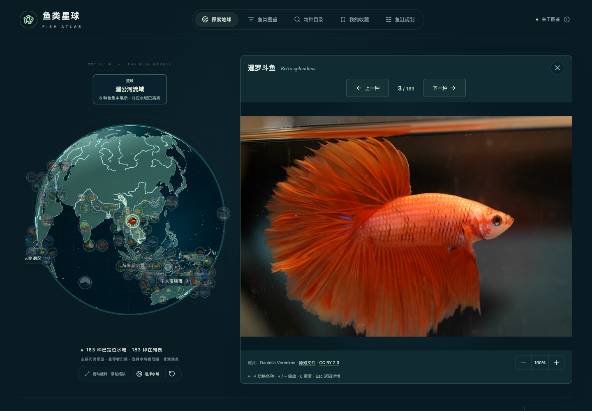
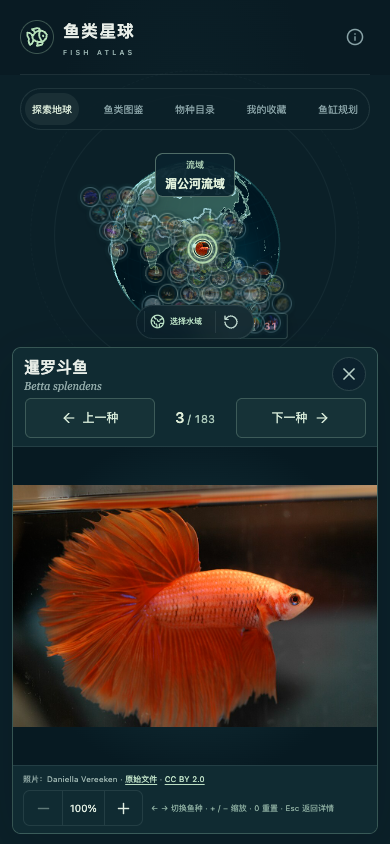
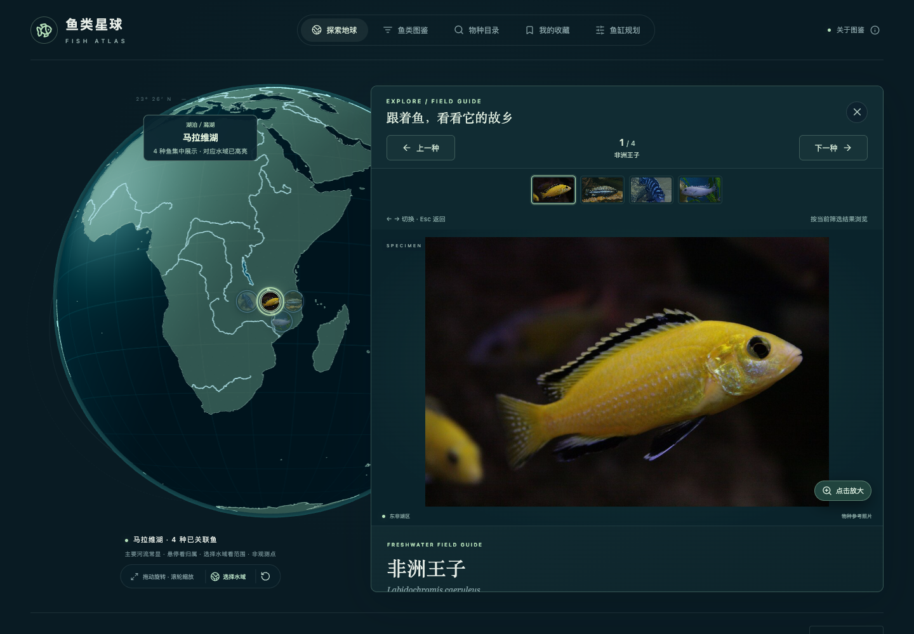
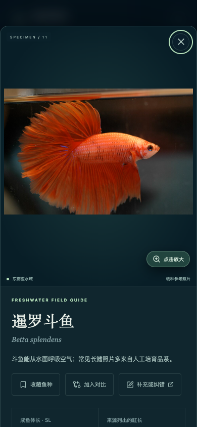
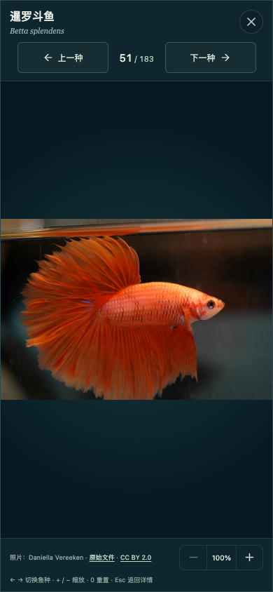

# 鱼详情与大图连续浏览

2026-10-13 更新：普通鱼详情改为上方大图、下方资料的单列布局。桌面详情宽度最多 1280 px，图片区默认占屏幕高度的 74%，在 380–900 px 范围内适配；照片保持完整比例。手机照片铺满可用宽度，资料接续在下方，关闭按钮随详情滚动保持可达。探索地球中的内联详情也扩大了照片。

点击照片进入大图模式后，照片尽量占满剩余视区。上方提供上一种、当前位置和下一种，下方保留图片署名、缩放控件和按键提示。

探索地球的大图模式在右侧详情面板内展开，左侧地球持续可见、可拖动旋转、滚轮缩放和点选鱼种。照片与地球沿用同一筛选序列，方向键或按钮切换时同时更新；桌面打开和关闭大图不重建或改变地球 Canvas 尺寸。手机采用上方紧凑地球、下方大图的固定视区，两者同时可见；关闭大图会恢复打开前的阅读位置和照片按钮焦点。

| 操作 | 结果 |
| --- | --- |
| `←`／`→` 或上一种／下一种 | 在当前筛选结果内循环切换鱼种 |
| `+`／`=`、`-` | 每次调整 50% 缩放，范围 100%–300% |
| `0` 或点击百分比 | 恢复完整照片视图 |
| 双击照片 | 切换完整视图与 200% 缩放 |
| 放大后拖动／手机滚动 | 查看照片细节 |
| `Esc` 或关闭大图 | 返回当前鱼种详情，并恢复照片按钮焦点 |

普通图鉴沿用图鉴筛选与排序；探索地球沿用探索页面的筛选与排序。探索过程中切换鱼种会同步更新地球选中标记和水域视角。连续切换替换当前历史记录，大图保持打开；每张新照片恢复到完整视图。再次按 `Esc` 可关闭详情。

探索页大图使用可访问的内联图片区，原详情保持挂载并暂时隐藏，关闭后返回当前鱼的详情。普通图鉴大图与详情沿用对话框，支持在已有养护参考的鱼与新增照片条目之间连续切换。键盘处理避开输入法组字、输入控件及组合快捷键；打开水域选择等对话框时，优先由对话框处理按键。

## 验证

生产构建通过。Chrome、WebKit 共 48 项浏览器检查全部通过，覆盖图片首屏占比、跨条目类型切换、筛选序列、快速连续按键、地球同步、历史记录、缩放重置、分层关闭与焦点恢复、手机无横向溢出和操作可达性。Codex 内置浏览器也实测了大图中的方向键切换与返回详情。

保留地球的大图模式另完成生产构建与 Chrome、WebKit 共 34 项相关回归，全部通过。覆盖桌面地球与大图分离、同一 Canvas 及绘制缓冲尺寸保持不变、地球滚轮缩放、筛选与相机同步、水域选择的按键优先级、390×844 和 360×740 手机双视区及控件可达、关闭后的滚动位置与焦点恢复、历史记录和导航清理。Codex 内置浏览器确认了地球和大图同时显示。

桌面默认详情：

大图连续浏览：

探索页大图保留左侧地球：

探索地球中的详情照片：

手机默认详情与大图：

