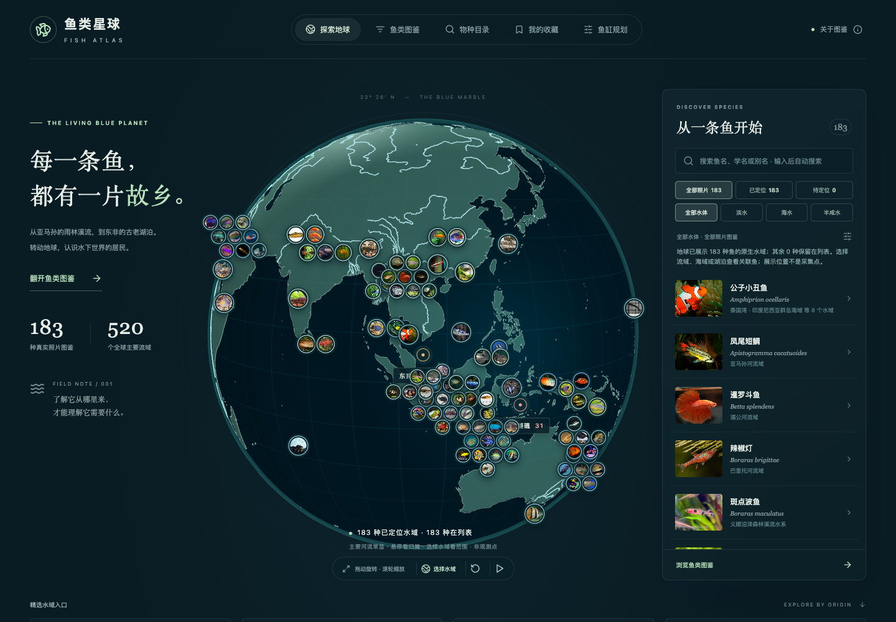
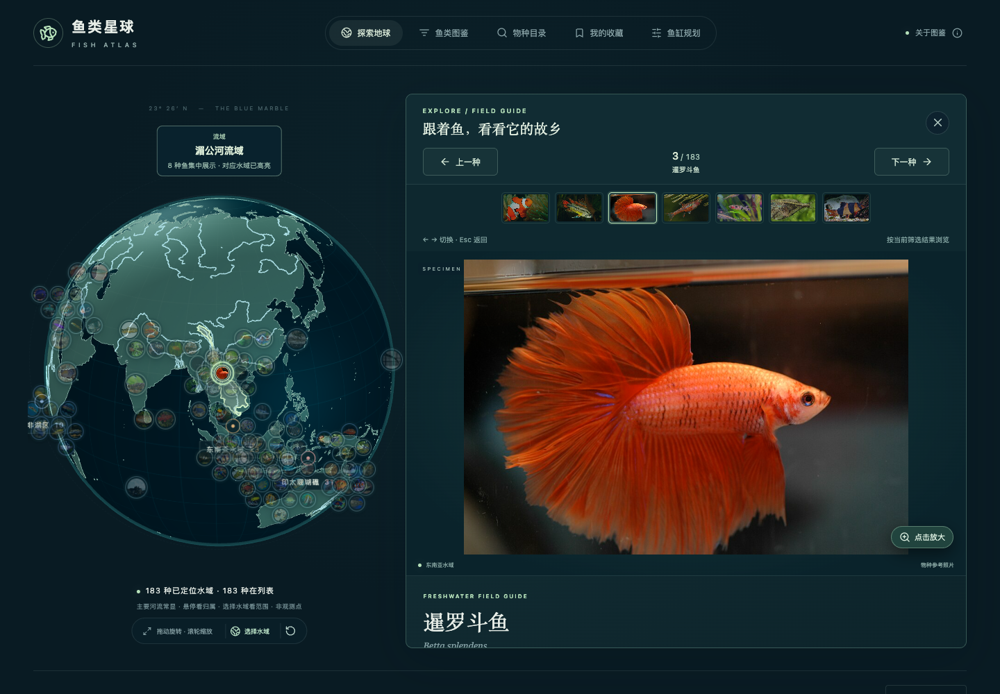
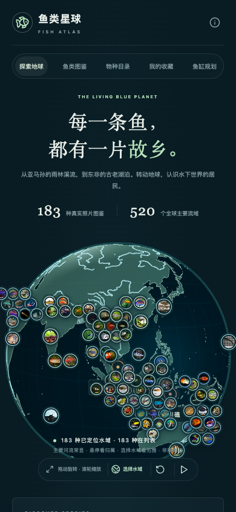
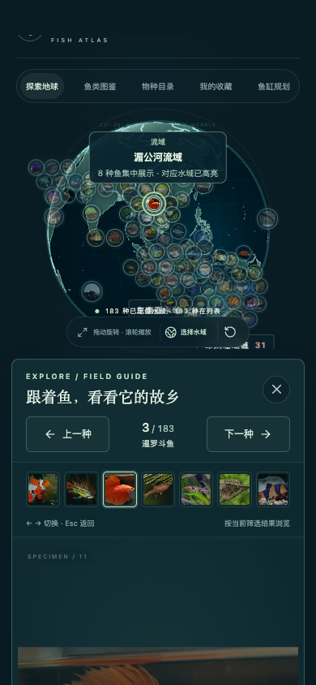

# 地球动画性能与默认尺寸优化

2026-10-13：扩大探索页的默认地球，修复空闲后切鱼跳到目标的动画问题，并降低连续切鱼时的页面更新成本。

## 改动

- 桌面探索区增加地球列与可用高度，默认球面直径按视区短边的约 94% 适配；阅读侧栏按约 90% 适配。窄高平板也能完整显示球面。
- 布局一次应用最终尺寸，再用 480 毫秒的平移与等比缩放移动同一个地球。Canvas 测量使用未受 transform 影响的尺寸，避免把视觉变换当作新的绘图尺寸。动画保持球形。
- 相机独立用 `performance.now()` 计算每次飞行进度。首次进入详情约 950 毫秒，切鱼约 700 毫秒；快速连按从当前方向继续，空闲时间不再计入下一次飞行。
- 稳定筛选结果、照片数组与水域定位索引；每帧复用向量与四元数，镜头没有变化时跳过照片投影。照片位置使用 `translate3d`，避免每帧修改布局坐标和读取 DOM 尺寸。
- 保持高亮材质与几何体挂载，使用透明占位纹理预热着色器路径，减少首次查看水域时的编译停顿。
- 保存镜头时同时保存自动适配状态。默认视角跨页返回后继续适配窗口，手动缩放仍保留；关闭详情、顶部导航、查看证据与浏览器返回都能恢复探索布局。

183 种照片标记、原生水域关联、高清海岸线与矢量河流仍保留。没有通过减少鱼种或降低地图分辨率来改善动画。

## 本机对比

在同一台电脑、Chrome 独立无头上下文、1440 × 1000 视口、DPR 1 与 2 下运行相同输入：打开斗鱼详情，下一种，间隔 80 毫秒连续切换三次，再按 Esc 关闭。未筛选鱼种，未限制 CPU 或网络。优化前使用提交 `63f5470` 的构建；优化后使用本次构建。每个操作、每种 DPR 各采样一次，持续约 1300 毫秒。

| 操作 | 优化前 RAF 帧间隔 P95，DPR 1 / 2 | 优化后，DPR 1 / 2 |
| --- | --- | --- |
| 打开鱼详情 | 33.4 / 33.4 ms | 16.8 / 16.8 ms |
| 切换下一种 | 16.7 / 16.7 ms | 16.8 / 16.8 ms |
| 连续切换三次 | 33.3 / 33.3 ms | 16.8 / 16.8 ms |
| 关闭详情 | 16.8 / 16.8 ms | 16.7 / 16.8 ms |

优化后的两组采样没有记录到超过 50 毫秒的主线程长任务，但个别 RAF 间隔仍可达到 50–67 毫秒。打开、关闭详情各改变一次实际绘图缓冲区尺寸，切鱼不改变尺寸；优化前这组测量中缓冲区变化次数同样是一次，不能据此声称其变化次数下降。

空闲后切换的相机动画恢复到约 700 毫秒；旧版在本组“下一种”采样中约 395–404 毫秒就结束。动画时长修复另有真实键盘回归，覆盖等待 1200 毫秒后再切鱼。

这些结果反映本机采样的改进。RAF 衡量浏览器动画调度，不能当作所有设备的 GPU 帧率保证；按需绘制的 Canvas 在相机静止后会停止绘制，因此整段采样的 Canvas 平均帧数也不等于动画期间帧率。

原始数据：[优化前](./globe-navigation-before.json)、[优化后](./globe-navigation-after.json)。复现命令，先保持生产预览运行：

```sh
npm run build
npm run preview -- --port 4174 --strictPort
# 在另一个终端运行，采样期间避免同时运行其它浏览器测试。
node scripts/benchmark-globe-navigation.mjs --output docs/globe-navigation-after.json
```

## 验证

- 生产构建、内容校验与 44 项单元测试通过。
- Chrome / WebKit 的 56 项全流程回归通过，覆盖图鉴、照片大图、阅读、河网、水域归属和移动端。
- 随后补充边界修复，18 项地球专项回归通过（包含重跑的 8 项与新增的 10 项），覆盖 621 / 768 像素平板的完整球面、自动适配与手动缩放跨页保留、过渡等比缩放、各返回入口、空闲后切鱼以及五档宽度的导航。
- 实际查看桌面、手机的探索与阅读页面截图，以及桌面过渡中的截图；移动端无页面横向溢出。

默认探索页（[改动前截图](./globe-size-before.png)）：



侧边阅读：



手机探索：



手机阅读：


