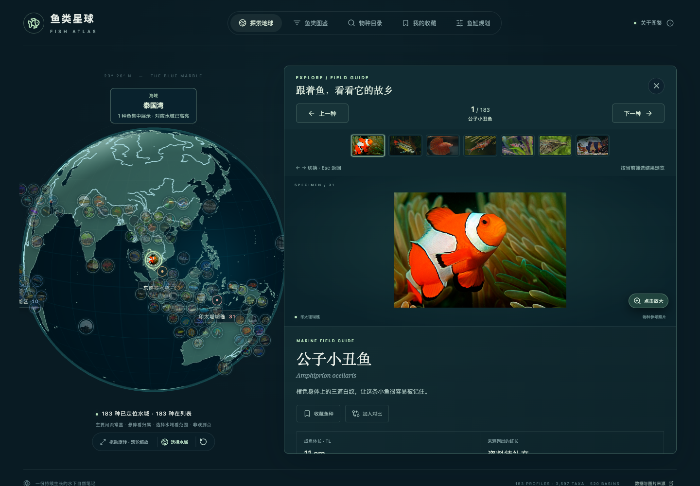
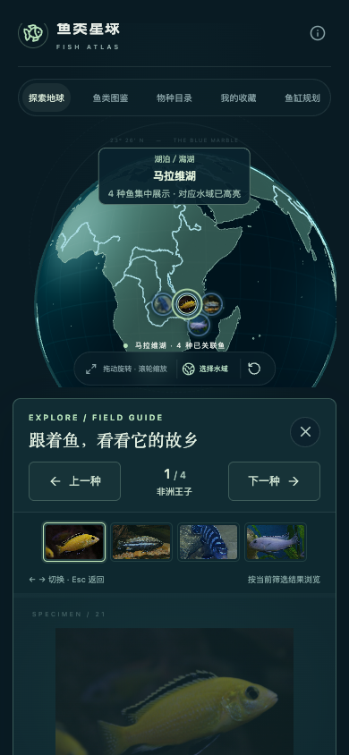

# 地球与鱼类详情联动浏览

点击地球上的鱼或旁侧鱼卡片后，在当前探索页面打开详情。桌面上地球移动到左侧，右侧展开完整图鉴；地球 Canvas 保持挂载，已有缩放与地图状态继续保留。关闭详情时恢复探索布局。

## 快速浏览

- 使用 `←`、`→` 或“上一种 / 下一种”切换，浏览顺序沿用当前筛选结果。
- 点击附近鱼种的照片缩略图直接切换，也可继续点击地球上的鱼。
- 选中的鱼以薄荷色边框与光晕突出显示，地球平滑转向它关联的原生水域。
- `Esc` 关闭详情。打开照片大图后，`←`／`→` 继续在当前筛选内切换鱼种，地球同步联动；此时 `Esc` 只返回当前鱼的详情。编辑输入框、输入法组字及下拉控件时，避免抢占按键。
- 详情大图继续支持点击放大，核对依据与分布来源保留在完整详情中。

## 布局与动效

桌面布局一次应用最终尺寸，使用 480 毫秒的平移与等比缩放将已有地球移动到侧边，避免逐帧修改 Canvas 缓冲区。介绍区同时收拢，为右侧详情腾出空间。切换鱼种时，详情内容使用 190 毫秒的轻微位移与淡入，滚动位置回到顶部。阅读区保留固定的关闭与切换入口。

首次转向约 950 毫秒，切换鱼种约 700 毫秒；新的选择从当前视角接续，快速连按也按每次事件前进。相机根据侧边视区宽高比调整距离，使地球尽量完整显示；相机使用独立的实际时间计时，空闲后切鱼仍播放完整动画；布局变化期间继续原来的动画时钟，避免反复重启动画。

首次打开详情新增一次历史记录，后续切换替换当前记录。关闭或浏览器返回会恢复打开前的视角、滚动位置和焦点；选择另一水域会回到该水域的筛选列表。

手机上地球位于详情上方，使用较紧凑的 280 像素视区；详情跟随文档滚动，不叠加内部滚动陷阱。用户启用“减少动态效果”时，关闭布局过渡和内容动画，并相应处理地球转向动画。

## 实现边界

详情中的分布信息与地球定位继续使用既有、带来源的原生水域关联。联动改变视角与选中状态，不改写地理分布数据，也不将屏幕上的图片避让位置当作真实观测坐标。普通图鉴详情和照片大图的弹层行为保持原有作用域。

## 验证

2026-10-13 联动浏览初版完成生产构建与 44 项单元测试。Chrome 和 WebKit 共 40 项浏览器检查通过，覆盖快速连续切换、同一 Canvas 保持挂载、相机与所选鱼种同步、筛选范围、照片放大时的按键处理、历史记录与关闭后的焦点/滚动恢复，以及手机布局和减少动态效果。

后续增加了地球动画性能优化与更大的默认视区，见[性能与尺寸记录](./globe-animation-performance.md)。扩大了详情照片，并加入大图模式内的鱼种切换，相关交互和验证见[大图浏览记录](./fish-photo-gallery.md)。

桌面效果：

手机效果：

