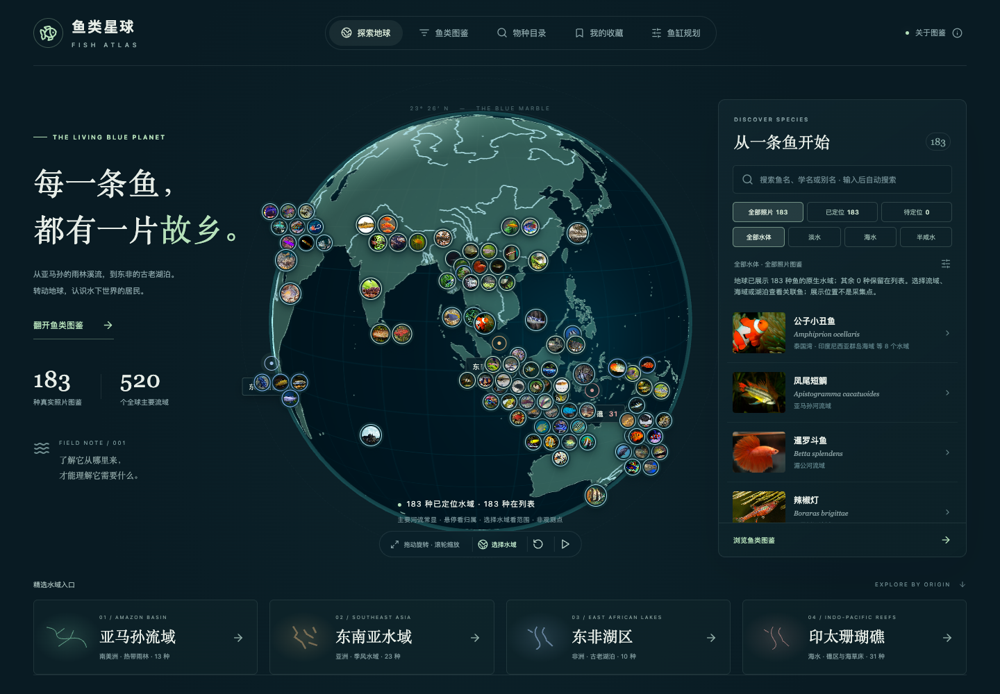
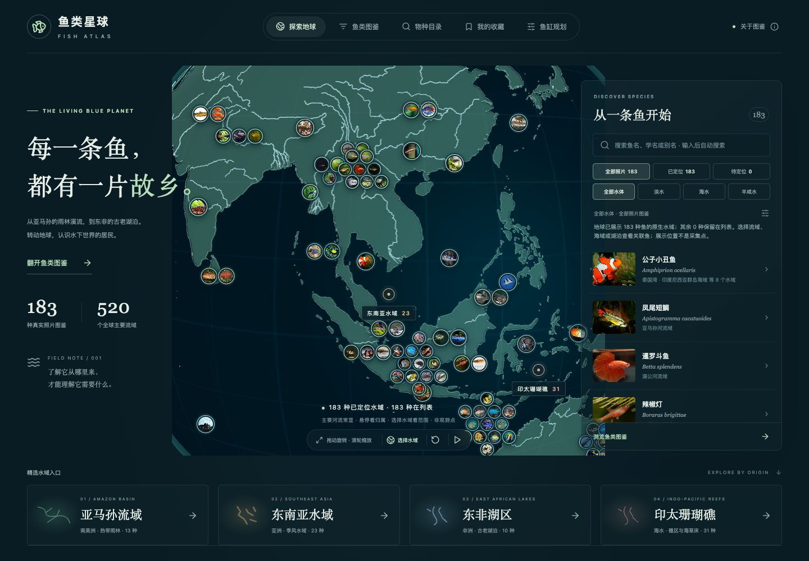
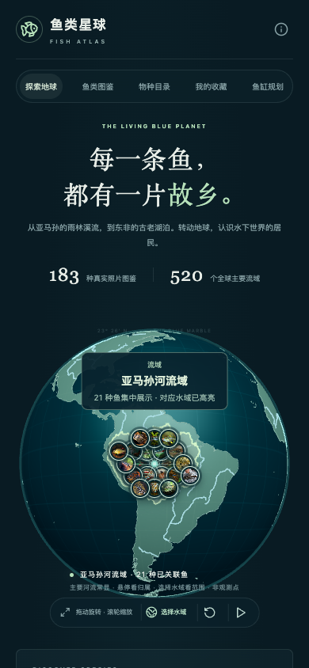

# 地球高清河网与默认图层

2026-10-13。

地球缩放时，原有固定尺寸的位图会被一起放大，河道和海岸线随之变模糊。本次将这两类线条改为球面矢量绘制，并扩充全球河网；总览默认展示主要河流和湖泊，流域轮廓在查看归属时出现。

## 显示与交互

- 海陆填色使用最高 4,096 × 2,048 的桌面底图、2,048 × 1,024 的手机底图，实际尺寸受设备最大纹理能力限制。渲染 DPR 为 `[1, 2]`，纹理采用设备支持的各向异性过滤，最高 16。
- 海岸线、主要河流、重要支流和湖岸使用球面矢量线段，线宽以 CSS 像素计。放大地球时仍由当前屏幕分辨率绘制线条，不放大纹理中的河道像素。
- Natural Earth `scalerank ≤ 4` 的 **783 个线段**默认显示；镜头距球心小于 **2.7** 时，再显示 `scalerank 5–6` 的 **943 个线段**。这两个数字是资料中的河流／湖泊中心线段数，一条具名河流可能包含多个线段。
- 全球 **520 个主要流域**继续支持点击陆地、搜索和筛选。默认隐藏全局流域轮廓；悬停鱼照片、键盘聚焦照片或选择水域时，显示对应水域的轮廓和填色。只有来源锚点的小水系沿用锚点提示。
- 本次保持已有 **183 种照片鱼、133 个关联原生水域**及定位关系。照片仍围绕所属水域的共同展示锚点排列，详情和筛选使用原来的分布依据。

实现见 [`Globe.tsx`](../src/components/Globe.tsx)、[`GlobeHydrology.tsx`](../src/components/GlobeHydrology.tsx)、[`globeLines.ts`](../src/lib/globeLines.ts) 与 [`globeTextures.ts`](../src/lib/globeTextures.ts)。

## 数据与来源

| 图层 | 官方资料 | 运行数据 |
| --- | --- | --- |
| 河网 | Natural Earth [10m Rivers + Lake Centerlines，含 scale ranks 与 tapering](https://www.naturalearthdata.com/downloads/10m-physical-vectors/10m-rivers-lake-centerlines/)，5.0.0 | 1,726 段、399 个原始河流编号、349 个命名水道；其中主要层包含 126 个命名水道 |
| 海陆 | Natural Earth [50m Land](https://www.naturalearthdata.com/downloads/50m-physical-vectors/50m-land/)，下载文件内版本 4.1.0 | 1,420 个陆地多边形／多多边形 |

河网保留全球 `scalerank ≤ 6` 的资料，包含 1,461 段河流、244 段湖泊中心线和 21 段间歇河流。没有按原来的几个示例流域裁剪。主要水系覆盖校验包含亚马孙、尼罗、刚果、长江、湄公河、恒河、布拉马普特拉、多瑙、密西西比、尼日尔、赞比西、奥里诺科、莱茵、伏尔加、黑龙江／阿穆尔和墨累河。

Natural Earth 是用于地图制图的参考资料，不能代表全球所有溪流，也不适合推断鱼的精确栖息地。湖泊中心线用于连接经过湖泊／水库的河网。官方资料提示，部分亚马孙与俄罗斯东北部河道位置仍有限制。鱼种的水域关联继续使用物种分布、分类文献和具名记录，不由背景河线自动生成。

两份 GeoJSON 均采用保留拓扑的 Douglas–Peucker 简化，容差 **0.02°**，坐标保留 **5 位小数**；陆地外环转为 d3-geo 球面所需的顺时针方向。河网 909,284 字节，陆地 855,010 字节，合计 **1,764,294 字节**，低于 3 MB 的未压缩运行数据预算。此精度是展示用途，不表示测量精度。

完整来源 URL、原始 ZIP 的 SHA256、数据版本、筛选参数、线段数量和体积保存在 [`globe-geography.json`](../content/enrichment/globe-geography.json)。数据遵循 Natural Earth 的[公共领域使用条款](https://www.naturalearthdata.com/about/terms-of-use/)；项目署名见 [`ATTRIBUTION.md`](../public/ATTRIBUTION.md)。

## 重建

使用 Python 环境中的 `pyshp` 与 `shapely`，执行：

```bash
python scripts/build-globe-geography.py --cache /tmp/fish-geography
```

脚本从官方 Natural Earth AWS 下载地址获取 ZIP、核验锁定的 SHA256、读取归档内的版本并输出：

- [`waterways.json`](../content/enrichment/waterways.json)：全球河网。
- [`globe-land.json`](../content/enrichment/globe-land.json)：陆地填色与海岸线。
- [`globe-geography.json`](../content/enrichment/globe-geography.json)：来源和处理记录。

若上游文件改变，脚本会停止并报告校验差异，需核对新版本后再更新固定校验值。日常构建使用已有运行数据，无须再次联网下载。

## 截图







## 验证

本轮验证涵盖主要水系覆盖、主线与支流分层、陆地球面朝向、坐标范围、运行数据体积，以及默认图层、缩放清晰度、流域选择和照片归属交互。

- `npm test`：44 项通过；`npm run build`：内容校验、TypeScript 与生产构建通过。
- Chrome 与 WebKit 的相关浏览器回归：28 项全部通过，包括 DPR 2、放大后的支流显示、默认无水域轮廓、手机筛选及照片紧凑布局。
- `scripts/check-distribution-pins.ts`：地理错误 0；已有 183 种照片鱼保持定位。
- 本机 Chrome 2 秒自转采样：119 个实际渲染帧，约 59 FPS。此结果是本机短采样，不代表所有设备。
- WebKit 独立首次加载检查：桌面约 1.2 秒完成前半球照片投影，手机约 1.8 秒完成亚马孙 21 张照片投影，无上下文丢失。装饰纹理由小型图案一次绘制，避免数万次复杂海岸线剪裁阻塞首帧。
- 桌面总览、最大放大和手机选中水域截图已检查；用户浏览器已刷新到新版默认河网。
