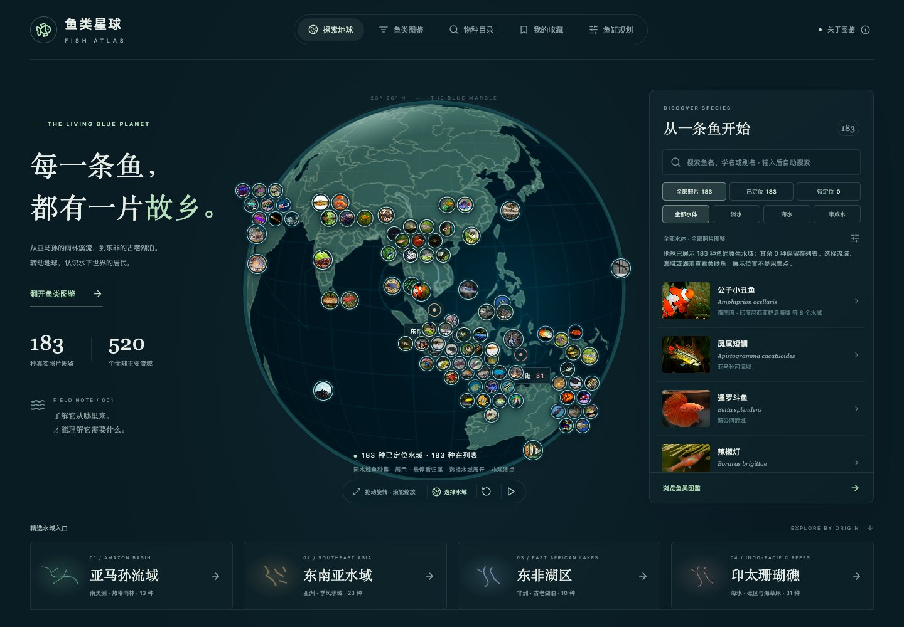
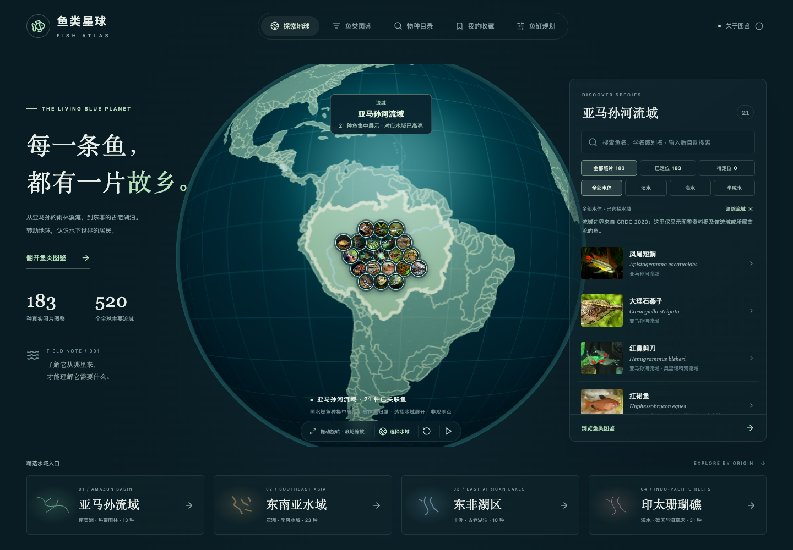
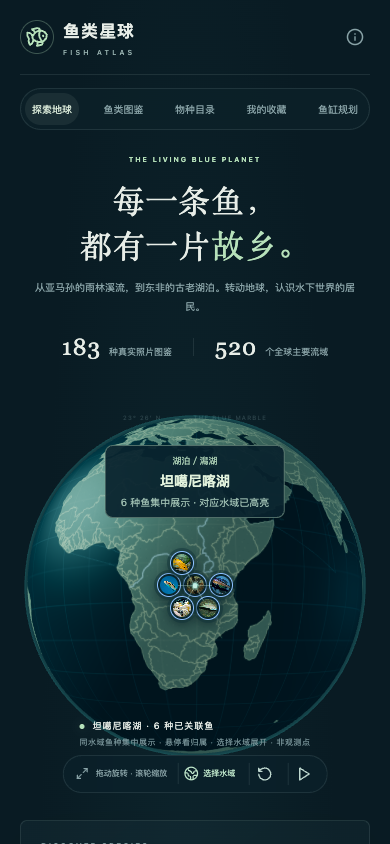

# 地球照片与水域归属调整

2026-10-13。

原先会先在整个水域范围内散布鱼种，再使用无固定半径的屏幕避让。照片可以离开对应流域很远，交叉的长引导线也难以阅读。

本次改为：

- 总览固定每种鱼的代表原生水域，搜索、分类和输入顺序不再改变归属。其他有依据的关联仍可通过水域筛选查看。
- 同一水域共享经过边界校验的展示锚点，不再生成随机鱼种地理位置。湖区南北限制、来源提供的点坐标、海域不落到陆地等约束保留。
- 图片贴近地球表面，同水域鱼群从中心向外紧凑排列；密集区域缩小图片，不删除或抽样鱼种。总览屏幕偏移上限为桌面 48px／手机 34px，选中水域为 72px／48px。
- 悬停或键盘聚焦时显示鱼名、原生水域名，高亮该水域与同组照片，并弱化其他照片。选中水域时持续显示名称与鱼种数量；短连接线只在对应组高亮时出现。
- 没有边界的小溪流／湖泊仅高亮来源锚点，不虚构水域轮廓。显示位置表达水域关联，不是实地采集坐标或完整分布范围。

仍保留全部 183 种有照片的鱼及 628 条鱼—水域关联。

## 截图

## 验证

回归覆盖全部鱼种保留、代表水域稳定、正确水域包含、湖区限制、紧凑布局和最大偏移，以及桌面／手机上的水域名称、分组高亮和单张照片点击。

- `npm test`：36 项单元测试通过。
- `npm run build`：内容校验、TypeScript 与生产构建通过。
- `npx tsx scripts/check-distribution-pins.ts`：0 个地理错误。
- Chrome／WebKit：现有 20 项水域相关回归通过；新增 4 项布局回归补测通过。布局检查等待视角动画完成后验证点击区域，避免把动画途中暂时在屏幕边缘的照片误判为遮挡。
- 1440px 桌面与 390px 手机：亚马孙 21 张、坦噶尼喀湖 6 张照片全部保留，每张照片中心均能命中自己的按钮，页面无横向溢出。
