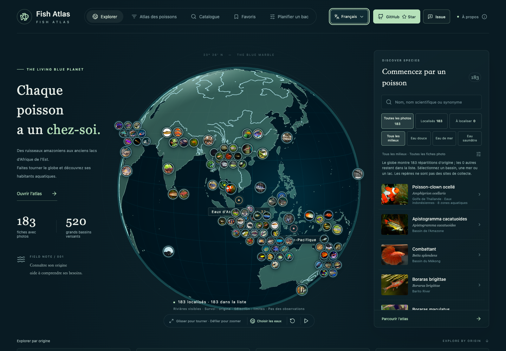
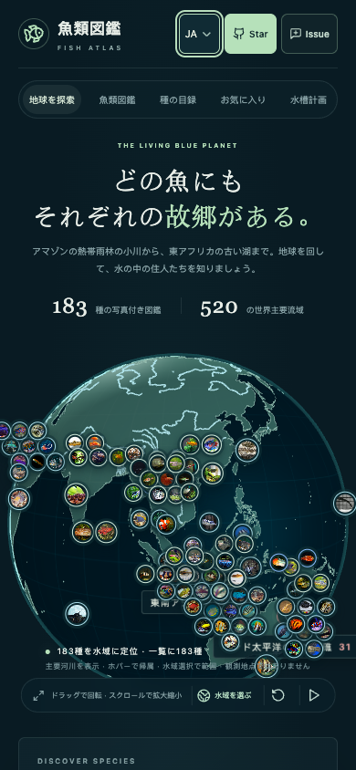

# 多语言界面

2026-10-14 更新：首次访问固定默认英文，不随浏览器语言自动改变。页头的语言选择提供五种语言，使用与现有界面一致的 shadcn/ui 下拉菜单，支持鼠标、触屏和键盘操作。

| 语言 | 菜单名称 | HTML language tag |
| --- | --- | --- |
| 英文（默认） | English | en |
| 中文 | 中文 | zh-CN |
| 法文 | Français | fr |
| 德文 | Deutsch | de |
| 日文 | 日本語 | ja |

语言选择保存在独立的 `fish-atlas:locale` 浏览器存储项，不修改收藏、规划或页面筛选参数。无效偏好回退英文；存储不可用时，本次访问仍可切换。其他标签页的语言变更与清除偏好会同步。页面标题、描述信息和 `html.lang` 一起更新。

## 覆盖范围

导航、引导、搜索、筛选、水域选择、地球标记与提示、照片浏览、收藏、对比、分类目录、规划预设、表单、推荐数量、风险信息、来源说明和无障碍标签均已接入翻译资源。规划的规则、数量、单位、原始数据和稳定 ID 不随语言改变。

原有 33 种鱼的描述、自然分布、习性、注意事项及养护参考说明有英文、法文、德文和日文译文。英文常见名来自既有资料；无法确认的其他语言常见名使用学名。水域名保留稳定地理 ID，常见流域、海域、湖泊有对应译名；未提供译名的地名保留来源名称。

150 条补充照片资料中的 Wikipedia 英文节选、FishBase 原始范围文字及分布证据引文保留来源语言，并标注 `lang`。作者、许可、引用链接和学名保留原值。翻译不增加尚未核对的饲养或分布结论。

搜索同时索引原中文名、英文名、已收录的各语言名、别名及学名；在法文界面输入 `Combattant` 后切回英文，结果仍能保留。切换语言不会关闭地球旁的详情、大图，也不会重建 Canvas。语言菜单打开时，方向键和 Esc 优先操作菜单，避免误切鱼或关闭照片。

中文资料反馈保留原 Issue 表单；其余语言使用新增英文表单，预填当前语言、显示鱼名、学名和干净的永久链接。支持使用五种语言描述建议，仍由用户自行登录和提交。

## 实现

`src/i18n/index.tsx` 提供 React 上下文、持久化、插值、数字格式与鱼名／地名／资料文本工具。资源按 App、组件、规划与资料分文件维护，中文原文作为消息键；新增文案需提供 `en`、`fr`、`de`、`ja`，中文沿用原文。

英文俗名使用由既有 GBIF 目录提取的 `english-names.json`：保留 2,379 个名称，约 104 KB，避免语言模块在首页直接加载约 620 KB 的完整分类记录。物种目录继续按需加载。翻译在 React 渲染中处理，不通过 DOM 替换或外部在线翻译服务实现，地球没有新增逐帧翻译工作。

## 验证

- 生产构建和资料校验通过；56 项单元测试通过，覆盖原有业务以及默认语言、存储异常、插值、数值单位、名称回退、33 种资料译文和反馈 URL。
- 168 项浏览器全量回归定位了分类名称与图片替代文本一致性问题，修复后在最终构建完成 46 项 Chrome／WebKit 定向回归，全部通过；另一次 WebKit 动画启动时序检查保留原断言单独复测通过。
- 新增的 16 项多语言浏览器检查覆盖真实默认英文（浏览器语言为中文）、五语言切换、刷新持久化、筛选与收藏保留、跨语言搜索、目录、照片键盘操作、同一地球 Canvas、语言菜单键盘优先级、手机布局及规划数量。
- Codex 内置浏览器实测了英文与法文切换，保留英文预览。

默认英文：

法文桌面：

日文手机：

