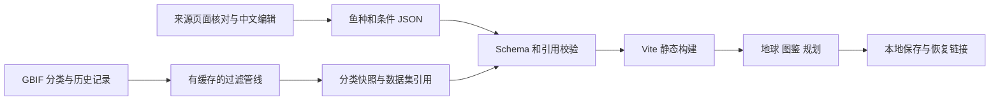
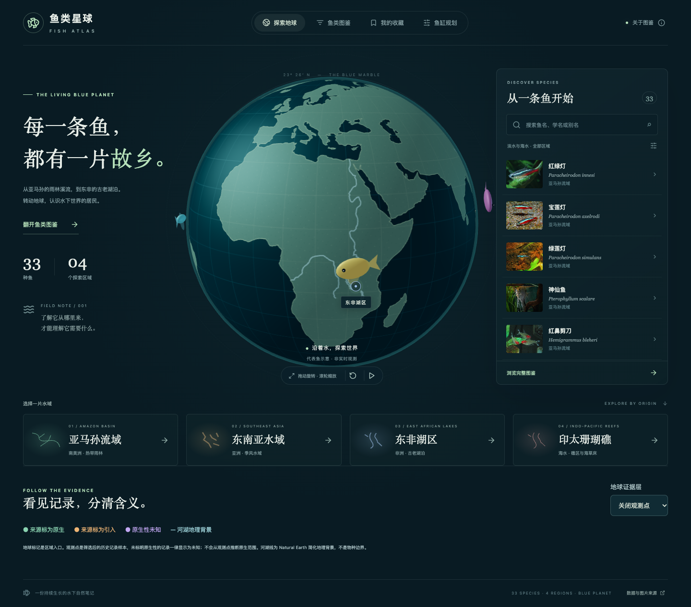

# 鱼类星球：实施与验证记录

日期：2026-10-09 · 版本：0.2.0

本页保留 v0.2.0 的实施与测试记录；v0.3.0 的物种目录扩充见 [目录扩充说明](catalog-expansion.md)。

技术方案的应用功能已继续推进到 M3 首批规则与海水扩展：当前包含 33 种鱼、4 个区域、图鉴、鱼缸条件核对、混养风险提示、分类和观测证据。专家签核与真实手机验收仍待外部验证，因此当前是本地可运行版本，不宣称所有发布条件已通过。

## 访问

[探索地球](http://127.0.0.1:4174/#/explore) · [鱼类图鉴](http://127.0.0.1:4174/#/atlas) · [鱼缸规划](http://127.0.0.1:4174/#/planner)

启动方法见 [README](../README.md)。静态产物在 `dist/`，包括本地图片及 [署名文件](../public/ATTRIBUTION.md)，没有发布公网。

## 本轮完成

| 项目 | 实现与边界 |
| --- | --- |
| 鱼缸条件 | 首次打开显示普通热带淡水规划示例；也可选择偏软水、东非湖慈鲷或海水方案。缸长、宽、高、暂估有效水量、水温、pH、淡水硬度或海水比重均可编辑；空白为未知，负值、越界与几何容积冲突被拒绝。模板值不是实测水质 |
| 规划保存 | 最多 6 种鱼，每种 1–200 条；本地保存、读取、清空和恢复链接；无效、重复或未知 ID 不进入规则 |
| 条件核对 | 逐条展示来源与冲突；已知冲突可隐藏，未知条件不会判为符合；不计算安全总载量 |
| 行为规则 | 23 个物种行为档案；其中 11 种有明确的群养数量下限；单养、领地、咬鳍、具体捕食风险与未覆盖因素均单独提示 |
| 对比联动 | 对比页展示组合风险，可以将当前鱼种带入规划 |
| 海水图鉴 | 公子小丑鱼、蓝倒吊、泗水玫瑰；新增印太珊瑚礁区域及水体筛选，33 张本地授权照片齐全 |
| 分类对齐 | 33 个 GBIF 精确物种级匹配，展示接受名与原来源名；匹配不等于专家鉴定 |
| 分布证据 | 文献分布和观测样本分开展示；26 条历史观测，含日期、坐标不确定度、记录者、许可、数据集与原始记录 |
| 地理背景 | Natural Earth 精选河流与东非湖泊轮廓；不作为物种分布边界 |
| 内容补充 | 从正文补回 5 个淡水缸长及适用条件，补充缸宽与部分缸高；海水容积不强行转为缸长 |
| 可访问性 | 关闭详情后恢复原卡片焦点；修复手机规划页与导航的间距；保留原生对话框、跳转链接及减少动态效果支持 |

## 结构与数据管线

`src/lib/planner.ts` 实现纯函数规则与来源明确的推荐加入数量；`src/lib/tankPresets.ts` 保存 4 个完整入门方案、常见缸体示例尺寸、参数来源与暂估水量计算（几何容积的 80%，使用前须改成实测值）；`components/Planner.tsx` 负责输入、基础配置提示与结果。完整方案提供水温、pH、dGH／SG 的**规划假设**，不推断用户鱼缸实际水质；只切换尺寸时保留水质假设，切换水体类型时改用对应水体的入门方案。表单控件在 `components/ui/`，使用 shadcn/ui 的 Input、Radix Select 与 Checkbox 组合接口并以现有 CSS 配色适配；中文搜索框保留输入法组词保护，停顿后自动查询。`lib/evidence.ts` 验证分类和记录结构；`components/Evidence.tsx` 展示出处。原有搜索、收藏、详情、对比保持在 `App.tsx`，地球在 `components/Globe.tsx`。

GBIF 管线接受精确且置信度至少 95 的物种级匹配。历史样本限定人工观测、有坐标、无 GBIF 空间问题标记、1950 年后有日期、坐标不确定度不超过 10 km，并检查 CC BY／CC0 许可。去掉明显无效坐标、重复位置和明确标为人工饲养的记录；每种最多 5 条。这是保守的展示样本筛选，不证明观测本身的鉴定准确，也不代表完整分布。

当前 26 条样本均未注明原生性，因此全部显示为“原生性未知”。原生与引入的图例、字段和呈现方式均已实现，但没有为了填满图例而猜测标签。缺乏合格样本会明确展示空状态。

来源缓存不进入构建产物。采集失败保留旧快照；日常构建不会调用网络接口。第三方数据引用和照片署名随应用提供。

## 测试

- `npm run build`：内容校验、TypeScript、生产构建。
- `npm test`：14 项单元测试通过，包含完整入门方案、规格预设、未知参数、缸宽／缸高、海水比重、数量、混养规则、无效规划恢复。
- 58 项浏览器测试通过：29 个流程在 Chrome 和 Playwright WebKit 各执行一次，0 失败、0 跳过。结果见 [e2e-results.json](e2e-results.json)。覆盖推荐数量、数量编辑、shadcn 下拉筛选、自动搜索与中文输入法组合输入。
- 本轮覆盖：地球与区域、搜索返回、收藏恢复、对比、手机布局、存储受限、外网阻断、WebGL 丢失及初始不可用、图片失败、规划输入与分享、海水、观测证据、损坏链接、键盘焦点和反复导航。
- [依赖审计](npm-audit.json) 当前 0 项已知漏洞，不等同于完整安全审计。

首次新增键盘测试发现详情会卸载原列表，导致关闭后焦点丢失；现已保持背景页面，两个引擎复测通过。手机截图检查还发现规划内容靠边及导航遮挡，已补充左右留白与顶部间距断言。

构建仍提示 Three.js 分块超过 500 kB（压缩前），未通过提高告警阈值掩盖它；实际首屏传输和交互抽测见下文。

## 性能抽测

[原始记录](performance-v2.json)，脚本 `scripts/benchmark.mjs`，每组只测一次。时间指标是 Canvas 实际开始绘制，不是 LCP 或正式 TTI。帧率读取 Three.js 渲染计数，采样为约 4 秒自转；不代表长时间或真实手机表现。

| 指标 | 桌面 Chrome | 触摸模拟 + 限速 |
| --- | --- | --- |
| 视口 | 1440 × 1000 | 390 × 844 |
| CPU / 网络 | 不限速，本机 | 4 倍 CPU 限速、10 Mbps 下行、5 Mbps 上行、80 ms 延迟 |
| Canvas 开始绘制 | 567 ms | 1333 ms |
| 首屏子资源传输 | 1,153,606 字节 | 438,213 字节 |
| 首屏照片请求 | 5 | 0（列表位于首屏下方） |
| 约 4 秒自转 | 60 FPS | 60 FPS |
| 动画回调 P95 间隔 | 17 ms | 17 ms |
| 横向溢出 | 无 | 无 |
| 触摸拖动无误开详情 | 不适用 | 已验证 |

已加载数据的搜索抽测：中文名 27 ms、英文别名 33 ms、空结果 33 ms。测量从程序派发输入事件到结果更新后的动画帧，属于本机单次样本，见 [搜索记录](search-performance.json)。

关闭缓存，统计 Resource Timing 子资源，不含主 HTML 与后续滚动。照片按可见区域加载。真实手机 GPU、温度限制及 Safari 版本差异未被模拟覆盖。

## 外部条件与资料缺口

详见 [发布与复核记录](release-checklist.md)、[逐条复核清单](review-queue.csv) 和 [内容检查记录](content-review.json)。

1. 专家签核：本次没有鱼类专家参与，不能把自动校验与来源阅读写成专家审定。
2. 真实手机：当前没有可操作手机的验证证据，且本机 `xctrace` 工具不可用。WebKit 和触摸模拟的结果已明确分开。
3. 数据缺口：七彩神仙的水温、pH、硬度保持未知；公子小丑鱼和泗水玫瑰保留已知容积而不臆造缸长。
4. 公网发布：没有配置域名、托管目标与部署账号，目前交付可运行静态产物。

## 界面

[桌面规划](desktop-planner.png) · [手机探索](mobile-preview.png) · [手机规划](mobile-planner.png) · [手机详情](mobile-detail.png)
