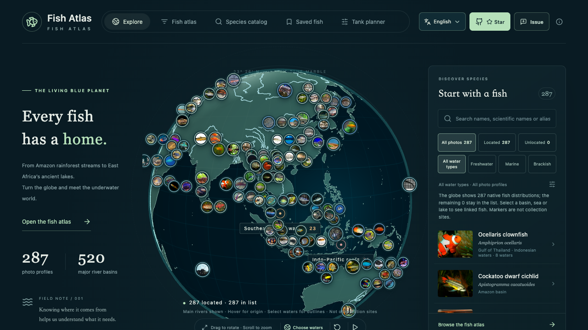
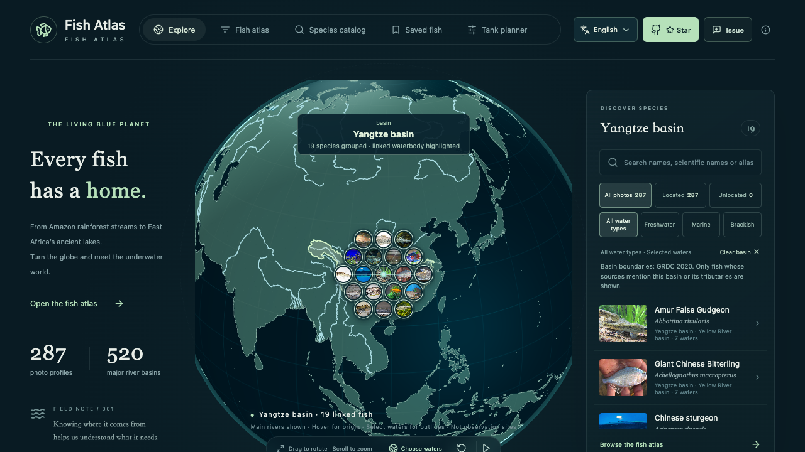

# 美国、中国与欧洲鱼类补齐

2026-10-14

本轮按区域选择代表鱼类，补充此前偏少的温带淡水鱼、洄游鱼和欧洲沿海鱼。新记录均有实际查看过的真实照片，以及具名原生水体的来源。资料不足的养护参数继续留空。

| 项目 | 补充前 | 补充后 |
| --- | ---: | ---: |
| 有图图鉴 | 183 | 287 |
| 分类目录 | 3597 | 3697 |
| 已关联的主要流域 | 43 | 94 |
| 已关联的全部水域 | 133 | 203 |
| 鱼种—原生水体关系 | 628 | 1394 |

中国批次新增 24 种，欧洲批次新增 43 种，美国／北美批次新增 37 种，合计 104 种；批次是采集工作口径，同一种鱼的原生范围可以跨多个区域。

已关联水域包括 94 个 GRDC 主要流域、47 个海域、25 个湖泊／潟湖和 37 个补充河流水系。520 个流域的地图层仍完整保留，尚无资料的流域不会伪造鱼种。

## 重点水域

表内数字是该水域关联的有图鱼种数，同一鱼跨水域计数；不是当地鱼类总数，也不表示占据水域全部区域。

| 水域 | 补充前 | 补充后 |
| --- | ---: | ---: |
| 长江 | 2 | 19 |
| 黄河 | 0 | 6 |
| 珠江 | 3 | 13 |
| 黑龙江 | 0 | 18 |
| 密西西比 | 0 | 24 |
| 圣劳伦斯 | 0 | 18 |
| 哥伦比亚 | 1 | 8 |
| 萨克拉门托 | 0 | 5 |
| 莱茵 | 0 | 26 |
| 多瑙 | 0 | 29 |
| 伏尔加 | 0 | 25 |
| 塞纳 | 0 | 19 |
| 泰晤士 | 0 | 13 |
| 第聂伯 | 0 | 26 |
| 苏必利尔湖 | 0 | 9 |
| 密歇根湖 | 0 | 7 |
| 休伦湖 | 0 | 10 |
| 伊利湖 | 0 | 10 |
| 安大略湖 | 0 | 10 |

## 来源与修正

分类、科属和稳定 key 采用 GBIF 精确物种匹配；与当前分类研究存在物种概念冲突的条目跳过。FishBase 26.06 范围文字与 native／endemic + present 生态记录经过逐条交叉检查，矛盾、引入或身份不明记录不会直接进入地球。英文俗名以 GBIF 与 FishBase FBname 为依据；中文使用核对的物种名，并保留可靠简繁、常用别名供搜索。

照片来自具体 Wikimedia Commons 文件，每张保留作者、原始文件页和许可。CC BY、CC BY-SA、CC0 与已核实的 Public domain 保持原许可；旧绘画、地图、误种和授权依据不足的候选已排除。部分照片为馆藏、捕获或保存标本，保留原说明。Wikipedia 导言及章节节选保留来源语言，不把 FishBase 文字冒充 Wikipedia 引文。完整署名见 [照片与文字署名](../public/PHOTO_PROFILES_ATTRIBUTION.md)。

- 移除 *Chromis viridis* 的地中海原生关联，保留印太范围。依据：[FishBase 5679](https://www.fishbase.se/summary/5679)。
- *Gila atraria* 保留哥伦比亚父流域内的上斯内克河关系，并补 Bonneville／大盐湖流域；不是将鱼放进高盐的大盐湖湖面。引入的密苏里及科罗拉多种群排除。依据：[USGS 原生范围](https://nas.er.usgs.gov/queries/FactSheet.aspx?speciesID=531)。
- *Cobitis bilineata* 的罗讷关系保留，依据明确到所属 Durance 水系；不是错误扩展到莱茵。
- 五大湖分别定位，新增日内瓦、拉多加、奥涅加、楚德、兴凯、贝加尔和青海等湖泊。大型水域使用 Natural Earth 多边形，小湖泊保留明确来源的坐标。
- 泰晤士补充采用 [DEFRA／EA 具名调查](https://questions-statements.parliament.uk/written-questions/detail/2023-10-17/HL10629/) 与 [JNCC 英国原生鱼清单](https://data.jncc.gov.uk/data/18f27480-a7e1-498c-9cca-f9eacbed2324/SSSI-Guidelines-19-Freshwaterfish-2018.pdf) 交叉关联，标为 medium。调查不区分野生与人工增殖个体，相关限制在鱼详情保留；旧广义物种概念、外来鲤类不据此加入。
- 北方狗鱼补北美原生水体；黑花鲈的原生范围不确定，移除与审阅限定范围不一致的 Waccamaw 关系。
- 原 *Micropterus salmoides* 的旧广义资料暂不发布，避免将重新定义的佛罗里达谱系套用北美旧范围；依据：[2022 原始分类研究](https://www.nature.com/articles/s41598-022-11743-2)。

## 地球与检索

总览仍为每种鱼保留一个代表标记，采用全量已核实关系的确定性匹配，优先让更多有依据的水域得到展示，再平衡剩余鱼种。当前 287 种代表标记覆盖 166 个水域，补充前首条关系策略只显示 75 个水域。分配只在资料快照变化时重算；搜索、语言和种类筛选不会让同一鱼跳到其他国家。选择具体水域仍显示那里所有已关联鱼种。

首页主要流域入口增加圣劳伦斯、黄河、珠江、莱茵。Atlas、Catalog 支持新鱼的学名、英文俗名、简繁中文及已核实别名搜索。新鱼不加入缺乏饲养参数的鱼缸规划。

## 增量维护

已修复原照片发布脚本和分类刷新脚本覆盖旧增量资料的问题。新发布器先校验分类、图片文件和具名分布来源，保留已有资料并拒绝冲突；公开快照构建不依赖研究缓存或联网。

```bash
python3 scripts/publish-regional-batches.py --dry-run <reviewed-batch.json>
python3 scripts/publish-regional-batches.py <reviewed-batch.json>
npm run build
npm test
python3 scripts/test-regional-publisher.py
npx tsx scripts/check-distribution-pins.ts
```

发布器需要 Pillow。batch 包含 catalog、profiles、distributions、waterbodies、可选完整 distributionPatches 和 review.visualReviewed=true；review.speciesAliases 为核对过的中文别名。distributionPatches 表示明确替换，不应拿旧批次覆盖后来修正。研究缓存不入仓库，发布结果与审阅清单均已保存；[区域审阅清单](../content/regional-expansion.json) 保留新物种、照片许可、跳过原因与修正记录。

## 新增鱼种

### 中国 · 24 种

| 名称 | 学名 | 原生水体关联数 | 图片与许可 |
| --- | --- | ---: | --- |
| 翘嘴鲌 | *Culter alburnus* | 5 | [CC BY-SA 4.0](https://commons.wikimedia.org/wiki/File:Culter_alburnus.jpg) |
| 鳙 | *Hypophthalmichthys nobilis* | 4 | [CC BY 2.0](https://commons.wikimedia.org/wiki/File:Bighead_carp_(March_2012).jpg) |
| 三角鲂 | *Megalobrama terminalis* | 2 | [CC BY-SA 4.0](https://commons.wikimedia.org/wiki/File:Megalobrama_terminalis.jpg) |
| 青鱼 | *Mylopharyngodon piceus* | 3 | [Public domain](https://commons.wikimedia.org/wiki/File:Schwarzer_Amur_(Mylopharyngodon_piceus),_juvenile.jpg) |
| 草鱼 | *Ctenopharyngodon idella* | 3 | [CC BY 3.0](https://commons.wikimedia.org/wiki/File:2x_amur_b%C3%ADl%C3%BD.jpg) |
| 高体鳑鲏 | *Rhodeus ocellatus* | 1 | [CC BY-SA 3.0](https://commons.wikimedia.org/wiki/File:Rhodeus_ocellatus_ocellatus-m.JPG) |
| 䱗 | *Hemiculter leucisculus* | 3 | [CC BY 4.0](https://commons.wikimedia.org/wiki/File:Hemiculter_leucisculus_-_Yung-Lun_Lin_-_586216605.jpeg) |
| 鲢 | *Hypophthalmichthys molitrix* | 3 | [Public domain](https://commons.wikimedia.org/wiki/File:Silver_Carp_Adult_(Hypophthalmichthys_molitrix).jpg) |
| 团头鲂 | *Megalobrama amblycephala* | 1 | [CC BY-SA 4.0](https://commons.wikimedia.org/wiki/File:Megalobrama_amblycephala_Kasumigaura2.jpg) |
| 大鳍鱊 | *Acheilognathus macropterus* | 7 | [CC BY-SA 3.0](https://commons.wikimedia.org/wiki/File:%E3%82%AA%E3%82%AA%E3%82%BF%E3%83%8A%E3%82%B4%E6%96%B0%E5%88%A9%E6%A0%B9%E5%B7%9D.jpg) |
| 鳜 | *Siniperca chuatsi* | 3 | [CC BY-SA 3.0](https://commons.wikimedia.org/wiki/File:%D0%90%D1%83%D1%85%D0%B0_(%D0%BA%D0%B8%D1%82%D0%B0%D0%B9%D1%81%D0%BA%D0%B8%D0%B9_%D0%BE%D0%BA%D1%83%D0%BD%D1%8C)_%D1%87%D1%83%D1%87%D0%B5%D0%BB%D0%BE.JPG) |
| 鲇 | *Silurus asotus* | 1 | [CC BY 2.0](https://commons.wikimedia.org/wiki/File:Silurus.jpg) |
| 中华鲟 | *Acipenser sinensis* | 4 | [CC BY-SA 3.0](https://commons.wikimedia.org/wiki/File:Acipenser_sinensis.JPG) |
| 乌鳢 | *Channa argus* | 4 | [CC BY 2.0](https://commons.wikimedia.org/wiki/File:Snakehead_-_Channa_argus.jpg) |
| 麦穗鱼 | *Pseudorasbora parva* | 4 | [CC BY-SA 3.0](https://commons.wikimedia.org/wiki/File:Pseudorasbora_parva.jpg) |
| 哲罗鲑 | *Hucho taimen* | 2 | [CC BY 2.5](https://commons.wikimedia.org/wiki/File:Hucho_taimen_June_2007_Uur_River.jpg) |
| 中华倒刺鲃 | *Spinibarbus sinensis* | 1 | [CC BY 3.0](https://commons.wikimedia.org/wiki/File:Spinibarbis_sinensis.jpg) |
| 青海湖裸鲤 | *Gymnocypris przewalskii* | 1 | [CC BY-SA 3.0](https://commons.wikimedia.org/wiki/File:Gymnocypris_przewalskii_2013.JPG) |
| 棒花鱼 | *Abbottina rivularis* | 7 | [CC BY-SA 4.0](https://commons.wikimedia.org/wiki/File:Abbottina_rivularis.jpg) |
| 唇䱻 | *Hemibarbus labeo* | 3 | [CC BY-SA 3.0](https://commons.wikimedia.org/wiki/File:Hemibarbus_labeo.JPG) |
| 华鳈 | *Sarcocheilichthys sinensis* | 4 | [CC0](https://commons.wikimedia.org/wiki/File:Sarcocheilichthys_sinensis.JPG) |
| 葛氏鲈塘鳢 | *Perccottus glenii* | 1 | [CC BY-SA 3.0](https://commons.wikimedia.org/wiki/File:%D0%A0%D0%BE%D1%82%D0%B0%D0%BD_%D0%B2_%D0%B0%D0%BA%D0%B2%D0%B0%D1%80%D0%B8%D1%83%D0%BC%D0%B5_%D1%84%D0%BE%D1%82%D0%BE2.JPG) |
| 日本鳗鲡 | *Anguilla japonica* | 2 | [CC BY-SA 2.5](https://commons.wikimedia.org/wiki/File:Anguilla_japonica.jpg) |
| 花䱻 | *Hemibarbus maculatus* | 7 | [CC BY-SA 4.0](https://commons.wikimedia.org/wiki/File:Hemibarbus_maculatus_Shanghai_Aquarium.jpg) |

### 美国／北美 · 0 种

| 名称 | 学名 | 原生水体关联数 | 图片与许可 |
| --- | --- | ---: | --- |

### 欧洲 · 43 种

| 名称 | 学名 | 原生水体关联数 | 图片与许可 |
| --- | --- | ---: | --- |
| 白斑狗鱼 | *Esox lucius* | 27 | [CC BY-SA 3.0](https://commons.wikimedia.org/wiki/File:Esox_lucius_ZOO_1.jpg) |
| 欧洲河鲈 | *Perca fluviatilis* | 18 | [CC BY-SA 2.0](https://commons.wikimedia.org/wiki/File:Perca_fluviatilis_-_Perche_commune_-_European_perch_(cropped).jpg) |
| 湖拟鲤 | *Rutilus rutilus* | 20 | [CC BY-SA 3.0](https://commons.wikimedia.org/wiki/File:Rutilus_rutilus_by_Algirdas_cropped.jpg) |
| 丁鱥 | *Tinca tinca* | 19 | [CC BY-SA 4.0](https://commons.wikimedia.org/wiki/File:Tinca_tinca_Natural_History_Museum_University_of_Pisa.jpg) |
| 𬶋 | *Gobio gobio* | 18 | [CC BY-SA 3.0](https://commons.wikimedia.org/wiki/File:Riviergrondel.jpg) |
| 真鱥 | *Phoxinus phoxinus* | 5 | [CC BY-SA 3.0](https://commons.wikimedia.org/wiki/File:Vairon_WIKI800px_(cropped).JPG) |
| 欧鲢 | *Squalius cephalus* | 17 | [CC BY-SA 4.0](https://commons.wikimedia.org/wiki/File:Oniria_-_Squalius_cephalus_03.jpg) |
| 黑鲫 | *Carassius carassius* | 13 | [CC BY-SA 3.0](https://commons.wikimedia.org/wiki/File:CarassiusCarassius8.JPG) |
| 欧洲鳗鲡 | *Anguilla anguilla* | 31 | [CC BY 4.0](https://commons.wikimedia.org/wiki/File:Anguilla_anguilla_France_1.jpg) |
| 三刺鱼 | *Gasterosteus aculeatus* | 27 | [CC BY-SA 4.0](https://commons.wikimedia.org/wiki/File:Dreistachliger_Stichling_unterwasser.jpg) |
| 欧鲶 | *Silurus glanis* | 14 | [CC BY-SA 3.0 de](https://commons.wikimedia.org/wiki/File:Silurus_glanis_02.jpg) |
| 北极红点鲑 | *Salvelinus alpinus* | 2 | [CC BY 4.0](https://commons.wikimedia.org/wiki/File:Salvelinus_alpinus_311639131.jpg) |
| 大西洋鳕 | *Gadus morhua* | 5 | [CC BY-SA 4.0](https://commons.wikimedia.org/wiki/File:Atlantic_Cod,_Atlantischer_Kabeljau_(Gadus_morhua).jpg) |
| 欧白鱼 | *Alburnus alburnus* | 17 | [CC BY-SA 2.5](https://commons.wikimedia.org/wiki/File:AlburnusAlburnus1.JPG) |
| 大鼻软口鱼 | *Chondrostoma nasus* | 9 | [CC BY-SA 2.5](https://commons.wikimedia.org/wiki/File:Chondrostoma_nasus_(aka).jpg) |
| 欧洲苦鱼 | *Rhodeus amarus* | 12 | [CC BY-SA 3.0](https://commons.wikimedia.org/wiki/File:RhodeusSericeusBitterlingMaleSpawningColors.jpg) |
| 荫鱼 | *Umbra krameri* | 2 | [CC BY-SA 4.0](https://commons.wikimedia.org/wiki/File:European_Mudminnow_(Umbra_krameri)_02.jpg) |
| 欧洲鲈 | *Dicentrarchus labrax* | 10 | [CC BY 2.0](https://commons.wikimedia.org/wiki/File:Sealife,_Bray,_Ireland._(6985874908).jpg) |
| 多瑙哲罗鱼 | *Hucho hucho* | 1 | [CC BY-SA 4.0](https://commons.wikimedia.org/wiki/File:Danube_Salmon_-_Huchen_(Hucho_hucho).jpg) |
| 梅花鲈 | *Gymnocephalus cernua* | 14 | [CC BY-SA 3.0](https://commons.wikimedia.org/wiki/File:Gymnocephalus_cernuus_P%C3%A4rnu_River_Estonia_2010-01-06.jpg) |
| 条须鳅 | *Barbatula barbatula* | 17 | [CC BY 3.0](https://commons.wikimedia.org/wiki/File:Barbatula_barbatula.jpg) |
| 大西洋鲱 | *Clupea harengus* | 5 | [CC BY 4.0](https://commons.wikimedia.org/wiki/File:Clupea_harengus_New_Jersey.jpg) |
| 鲭鱼 | *Scomber scombrus* | 10 | [CC BY 4.0](https://commons.wikimedia.org/wiki/File:Scomber_scombrus_217326414.jpg) |
| 鳎 | *Solea solea* | 9 | [CC BY-SA 4.0](https://commons.wikimedia.org/wiki/File:Solea_solea_1.jpg) |
| 欧洲鲽 | *Pleuronectes platessa* | 4 | [CC BY-SA 4.0](https://commons.wikimedia.org/wiki/File:Pleuronectes_platessa.jpg) |
| 金头鲷 | *Sparus aurata* | 6 | [CC BY 4.0](https://commons.wikimedia.org/wiki/File:Sparus_aurata,_Alpes-Maritimes,_Provence-Alpes-C%C3%B4te_d%27Azur,_FR_imported_from_iNaturalist_photo_207799710.jpg) |
| 杂斑盔鱼 | *Coris julis* | 7 | [CC BY-SA 4.0](https://commons.wikimedia.org/wiki/File:Doncella_(Coris_julis),_Cabo_de_Palos,_Espa%C3%B1a,_2022-07-17,_DD_69.jpg) |
| 大菱鲆 | *Scophthalmus maximus* | 9 | [CC BY-SA 3.0](https://commons.wikimedia.org/wiki/File:Psetta_maxima_Luc_Viatour.jpg) |
| 茴鱼 | *Thymallus thymallus* | 14 | [CC BY-SA 4.0](https://commons.wikimedia.org/wiki/File:Grayling_Thymallus_thymallus.JPG) |
| Barbus barbus | *Barbus barbus* | 12 | [CC BY 2.0](https://commons.wikimedia.org/wiki/File:Barbel.jpg) |
| 𬶋杜父鱼 | *Cottus gobio* | 6 | [CC BY-SA 3.0](https://commons.wikimedia.org/wiki/File:Cottus_Pesh.JPG) |
| 光鳃鱼 | *Chromis chromis* | 5 | [CC BY 4.0](https://commons.wikimedia.org/wiki/File:Mediterranean_Damselfish,_Var,_Provence-Alpes-C%C3%B4te_d%27Azur,_FR_imported_from_iNaturalist_photo_140272057_(cropped).jpg) |
| 欧鳊 | *Abramis brama* | 18 | [Public domain](https://commons.wikimedia.org/wiki/File:Carp_bream1.jpg) |
| 褐鳟 | *Salmo trutta* | 26 | [Public domain](https://commons.wikimedia.org/wiki/File:Brown_Trout_(Salmo_trutta)_(53678765394).jpg) |
| 大西洋鲑 | *Salmo salar* | 17 | [Public domain](https://commons.wikimedia.org/wiki/File:Atlantischer_Lachs.jpg) |
| 雅罗鱼 | *Leuciscus leuciscus* | 14 | [Public domain](https://commons.wikimedia.org/wiki/File:Leuciscus_leuciscus.jpg) |
| 红眼鱼 | *Scardinius erythrophthalmus* | 17 | [Public domain](https://commons.wikimedia.org/wiki/File:Scardinius_erythropthalmus_2009_G1.jpg) |
| 白梭吻鲈 | *Sander lucioperca* | 10 | [Public domain](https://commons.wikimedia.org/wiki/File:Sander_lucioperca_1.jpg) |
| 纵带泥鳅 | *Misgurnus fossilis* | 13 | [Public domain](https://commons.wikimedia.org/wiki/File:Misgurnus_fossilis_2009_G1.jpg) |
| 八棘多刺鱼 | *Pungitius pungitius* | 11 | [Public domain](https://commons.wikimedia.org/wiki/File:Pungitius_pungitius.jpg) |
| 小体鲟 | *Acipenser ruthenus* | 4 | [Public domain](https://commons.wikimedia.org/wiki/File:Acipenser_ruthenus_Prague_Vltava_1.jpg) |
| 江鳕 | *Lota lota* | 17 | [CC BY-SA 3.0](https://commons.wikimedia.org/wiki/File:Tr%C3%BCsche_Walchensee.jpg) |
| 鲤鱼 | *Cyprinus carpio* | 5 | [CC BY-SA 3.0](https://commons.wikimedia.org/wiki/File:Cyprinus_carpio_2008_G1_(cropped).jpg) |

## 覆盖边界

本轮是区域定向扩展，不是美国、中国、欧洲鱼种全量库。全球主要流域中仍有 426 个没有已核实的有图鱼种关系；已关联的流域也只有当前收录的代表鱼，不代表全部当地鱼。未取得合格图片、物种身份冲突或仅有国家级范围的候选继续等待复核。新增记录缺少的行为、养护参数及未核实分布保留未知，不根据科属推测。

## 验证

生产构建、内容与分类/照片校验通过；60 项单元测试及 2 项增量导入保留/冲突测试通过；全部水域照片标记地理校验错误数为 0。

Chrome 与 WebKit 的 62 项指定浏览器用例首轮 60 项通过，2 项 Chrome 的启动超时和瞬态动画观测失败在原测试不变的定向复核中全部通过；WebKit 首轮 31 项全通过。没有把首轮报告描述为 62/62。最后移除一条黑花鲈来源不明确的 Waccamaw 关系后，已重新构建并通过单元、内容和地理校验。

独立预览实查 287 个标记全部图片加载成功、166 个代表水域；长江筛选 19 张实图、无横向溢出。新中文别名在英文界面可检索：桂鱼在 Atlas 命中 Siniperca chuatsi，白鲢在 Catalog 命中 Hypophthalmichthys molitrix。




