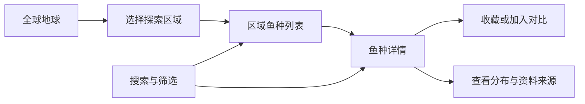
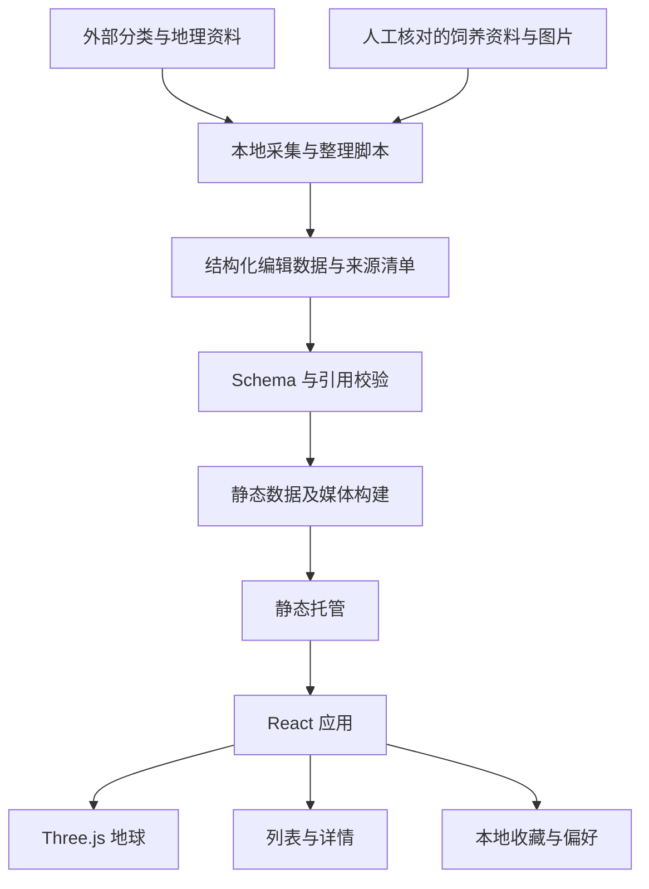

# 鱼类星球：交互式鱼类图鉴技术方案

版本：v0.1  
日期：2026-10-09  
状态：原始设计方案，已开始实施。当前已产出 v0.2.0，包含 33 种鱼、4 个区域、鱼缸规划、有限混养风险规则及分布证据的本地预览版；实际完成范围和验证结果见 [实施记录](fish-atlas/docs/implementation.md)，运行方式见 [项目说明](fish-atlas/README.md)。本文其余内容仍保留设计目标，不代表所有验收项或后续阶段已经完成。

## 1. 项目目标

打造一个可以旋转地球、探索鱼类原生环境、查看鱼种图鉴的中文 Web 应用。核心体验是：**从地球找到一条鱼，从图鉴理解它的生活与饲养需求。**

参考「花园地球」的空间探索方式，自行实现鱼类主题的视觉和交互。首版聚焦淡水观赏鱼，优先完成“全球探索 → 地区鱼种 → 鱼种详情 → 搜索与对比”的完整流程。

与已有[小红书养鱼用户痛点调研](xiaohongshu-fishkeeping-pain-points.md)的联系：图鉴重点回应商品名混乱、饲养建议缺少适用条件、成鱼体型认知不足、混养风险不清楚等问题。该调研属于定性样本，不能据此认定地球图鉴已有市场需求，也不能用图鉴代替异常排查工具。

## 2. 范围与优先级

| 阶段 | 功能与内容 | 完成边界 |
| --- | --- | --- |
| P0：视觉与交互原型 | 1 个地球、3 个探索区域、约 10 种鱼；拖拽、缩放、区域聚焦、详情卡片 | 验证视觉风格、空间定位、手机交互和数据结构 |
| P1：可用图鉴 | 30–50 种常见淡水鱼；区域浏览、搜索、筛选、来源、收藏、最多 3 种鱼对比 | 提供可独立使用的首个公开版本 |
| P2：养鱼辅助 | 鱼缸条件输入、条件匹配、混养风险规则、海水区域扩展 | 单独验证规则和资料后逐项上线 |

P1 不包含账号系统、社区、购物、自动疾病诊断、全量世界鱼类、实时鱼群追踪，也不要求每种鱼都有独立 3D 模型。暂不加入缺少内容的海水筛选入口。

首批候选区域为亚马孙流域、东南亚淡水区域、东非湖区。它们是导航分组；具体鱼种归属需由资料确认，东非湖区的鱼种详情应进一步指向具体湖泊，不能把整个区域当成同一栖息地。

## 3. 用户流程与页面

### 3.1 主流程



### 3.2 页面布局

- 桌面端：地球为主画面；顶部放搜索与视图切换；侧栏展示区域、筛选和鱼种详情。
- 手机端：地球占主要可视区域，详情以底部面板展开；面板滚动与地球手势隔离。
- 列表模式：与地球共享同一份筛选结果，不依赖 WebGL，可通过键盘完成浏览和查阅。
- 详情页：支持独立链接和浏览器前进、后退；从地球进入后关闭详情，应恢复先前区域与视角。

建议使用 hash 路由，简化静态部署：

```text
/#/explore?region=amazon&habitat=freshwater
/#/species/{speciesId}
/#/compare?ids={id1},{id2}
/#/saved
```

搜索词、区域和筛选条件进入 URL；相机逐帧状态不写入 URL。无效鱼种链接提供“返回图鉴”，无搜索结果提供清空筛选入口。

### 3.3 图鉴信息结构

| 分组 | 字段 | 呈现规则 |
| --- | --- | --- |
| 身份 | 中文名、学名、别名、商品名、科属 | 学名作为主要关联依据；商品名可能关联多个物种 |
| 外观 | 识别照片、关键形态、性别或阶段差异 | 标记幼鱼、成鱼、性别和人工品系；不将插画当作鉴定照片 |
| 自然环境 | 原生地区、引入情况、水体类型、生态习性 | 原生分布与观测点分层展示 |
| 饲养条件 | 成鱼长度、缸长、水温、pH、硬度、群居需求 | 标明单位、适用条件、测量口径和出处 |
| 风险 | 捕食、领地行为、跳缸、同类冲突等 | 用具体条件说明，不输出“绝对安全” |
| 来源 | 原文链接、作者或机构、访问日期、审核日期 | 来源与具体字段关联，可展开查看 |

空缺资料显示“资料待补充”，不使用 0 或模型生成的数值填补。野外耐受范围、常见生境参数和长期饲养建议分别储存。

## 4. 技术选型

| 层 | 选型 | 原因 |
| --- | --- | --- |
| 前端 | React 19 + TypeScript + Vite | 适合静态应用、组件开发和按需加载 |
| 地球渲染 | Three.js + React Three Fiber 9 + Drei | 统一管理场景、相机、资源与交互 |
| 样式 | CSS Modules + CSS 自定义变量 | 控制主题、响应式布局和动效，减少首版依赖 |
| 路由 | React Router 的 hash 模式 | 静态主机无需额外路由重写 |
| 状态 | React reducer/context；动画状态用 refs | 数据量较小，避免引入不必要的状态框架 |
| 数据验证 | Zod + TypeScript | 校验编辑数据、引用、单位和发布内容 |
| 搜索 | 本地标准化索引 | 30–50 种鱼可直接检索中文、学名和别名 |
| 用户本地数据 | localStorage，含结构版本 | 保存收藏、显示偏好；失败时退回内存 |
| 检查 | Vitest + Playwright | 验证地理转换、数据规则、核心浏览流程 |
| 发布 | 静态构建产物 + CDN/静态主机 | 首版不需要运行时后端或数据库 |

React Three Fiber 官方说明 v9 与 React 19 配对；本方案选用该稳定组合，不将 v10 alpha 或 WebGPU 作为首版前提。实施时确认 Drei、Three.js 的 peer dependencies，锁定具体版本并提交 lockfile。[R3F 官方说明](https://r3f.docs.pmnd.rs/getting-started/introduction)

若以后需要大量鱼种的搜索引擎收录，再评估预渲染或服务端渲染；P1 优先保证交互与数据完整。

## 5. 系统架构



外部数据只在整理和更新时读取，浏览器加载经过审核的版本。来源暂时不可访问，不影响现有图鉴浏览。原始采集文件、编辑数据、公开产物分别保存。

建议发布产物：

```text
data/manifest.json           数据版本、文件路径、摘要
data/species-index.json      搜索与列表使用的简要资料
data/species/{id}.json       单个物种的完整资料
data/regions.json            区域索引与相机目标
data/distributions/{id}.json 按需加载的分布展示数据
data/sources.json            来源索引
media/...                   授权明确且已优化的图片和模型
```

版本化路径或内容哈希确保数据与应用更新一致。先上传新资源，再切换入口；回滚时同时回滚应用和数据版本。

## 6. 数据模型

### 6.1 核心实体

| 实体 | 主要内容 | 关系 |
| --- | --- | --- |
| Species | 稳定内部 ID、学名、中文名、别名、外部分类 ID | 关联区域、分布证据、资料与媒体 |
| Variant | 人工品系名称、图片、差异说明 | 关联祖先物种列表；杂交或不确定关系显式标记 |
| Region | 名称、层级、代表坐标、可选边界 | 导航区域可以包含多个子区域 |
| DistributionEvidence | 原生／引入／不明、范围或观测、时间、精度 | 每条关联物种及来源 |
| HusbandryProfile | 成鱼体型、水质、食性、行为和饲养建议 | 每项值附适用条件和证据 |
| Source | 标题、URL、作者、访问日期、许可 | 支持字段级引用 |
| MediaAsset | 本地文件、创作者、原始 URL、许可、用途 | 区分照片、示意图、装饰模型 |
| CompatibilityRule | 输入条件、风险、解释、缺失信息 | P2 使用，独立版本管理 |

### 6.2 类型示意

以下用于明确设计约束，不是已完成的代码或真实鱼种数据。

```ts
type ReviewStatus = 'draft' | 'reviewed' | 'needs-review';

type Claim<T> = {
  value: T | null;
  sourceIds: string[];
  conditions: string[];
  reviewStatus: ReviewStatus;
  reviewedAt?: string;
  note?: string;
};

type NumericRange = {
  min: number;
  max: number;
  unit: 'cm' | 'C' | 'pH' | 'dGH';
};

type Species = {
  id: string;
  scientificName: string;
  chineseName: string;
  aliases: string[];
  gbifTaxonKey?: number;
  habitat: Array<'freshwater' | 'brackish' | 'marine'>;
  regionIds: string[];
  mediaIds: string[];
  taxonomyStatus: ReviewStatus;
  husbandry: {
    adultLength: Claim<NumericRange>; // 条件中记录全长/标准长及性别阶段
    recommendedTankLength: Claim<NumericRange>;
    temperature: Claim<NumericRange>;
    ph: Claim<NumericRange>;
    hardness: Claim<NumericRange>;
    behavior: Claim<string[]>;
  };
};

type DistributionEvidence = {
  id: string;
  speciesId: string;
  evidenceType: 'documented-range' | 'occurrence';
  establishment: 'native' | 'introduced' | 'unknown';
  regionId?: string;
  geometryAsset?: string;
  coordinates?: [number, number]; // WGS84: [经度, 纬度]
  coordinateUncertaintyMeters?: number;
  eventDate?: string;
  sourceIds: string[];
  externalRecordId?: string;
  reviewStatus: ReviewStatus;
};
```

实施时用判别联合约束：观测记录必须有坐标，文献分布必须有区域或边界引用。经度限制为 -180–180，纬度为 -90–90；数值范围要求 min ≤ max；引用对象必须存在。

同一字段有冲突时，保留多条 Claim 及编辑说明，不把多个来源的极值机械合并成更宽的“推荐范围”。UI 只将审核通过且语义一致的值用于对比与规则判断。

## 7. 数据采集与审核

### 7.1 来源策略

| 数据 | 获取方式 | 首版处理 |
| --- | --- | --- |
| 学名与分类 | GBIF Species API 辅助匹配 | 人工确认物种层级、同物异名及不确定匹配 |
| 出现记录 | GBIF Occurrence API | 保留原始记录 ID、数据集、日期和坐标精度，筛选后发布 |
| 原生分布 | 可引用的鱼类资料、文献及分布说明 | 单独整理，不由观测点自动推断 |
| 饲养建议 | 已筛选的专业鱼类网站与资料 | 核对语义、单位和条件，编写摘要并链接来源 |
| 照片与插画 | 自有素材或许可明确的媒体 | 逐张记录许可和署名，不因网页可访问就复制整站图片 |

GBIF 提供分类及出现记录接口，可作为资料处理管线的一部分；它不是现成的观赏鱼饲养指南。[Species API](https://techdocs.gbif.org/en/openapi/v1/species)、[Occurrence API](https://techdocs.gbif.org/en/openapi/v1/occurrence)

现有[养鱼网站清单](fishkeeping-websites.md)作为候选资料入口；是否允许复用文字、图片或批量访问，在具体采用前按来源确认。媒体许可单独记录，不从数据集许可推导图片许可。

### 7.2 处理流程

1. 确定首批鱼种名单，分配稳定内部 ID，处理商品名歧义。
2. 对齐学名与分类，记录匹配方式和未解决项。
3. 整理原生区域；另外采集有坐标的观测记录。
4. 排除明显错误坐标、物种不匹配记录、重复记录及不适合展示的人工饲养记录；不确定项进入复核队列。
5. 统一单位但保留原始口径，分别记录自然环境和饲养建议。
6. 为每个发布鱼种准备至少一张识别图片和完整署名；不能准确确认物种的素材不进入识别图库。
7. 运行 schema、引用、许可字段、缺失值与坐标校验，人工审核后生成静态产物。
8. 记录数据版本、来源访问日期和变更摘要。

采集脚本设置超时、有限重试和缓存；不在每次应用构建时重新采集全站。外部接口失败时保留上一个已审核版本。首次公开发布前复核全部条目，之后按内容变更更新。

## 8. 地球与鱼类展示实现

### 8.1 场景分层

1. 地球球体：地表贴图、简化光照与轻量大气层。
2. 地理层：精选河流线、湖泊边界及区域标记，首版只覆盖已整理的探索区域。
3. 内容层：区域代表鱼、鱼种入口与选中状态。
4. 证据层：用户主动打开后展示观测点或文献分布范围。
5. DOM 层：搜索、详情、图例、来源及列表，保留正常文字选择和可访问性。

全球视角显示区域入口；区域视角显示代表鱼和鱼种列表；鱼种详情才打开更细的分布证据。淡水鱼关联河流、湖泊或有来源的区域，不随机铺满大陆或海洋。

### 8.2 坐标与贴图

采用 WGS84 经纬度，场景约定 Y 轴向北，0° 经度位于 +X 轴，东经方向朝 -Z 轴：

```text
lat = latitude × π / 180
lon = longitude × π / 180
x = R × cos(lat) × cos(lon)
y = R × sin(lat)
z = -R × cos(lat) × sin(lon)
```

地理数据先进入统一转换函数，禁止组件各自修正经度。使用 0°/0°、90°E/0°、北极和几个已知地点检查贴图方向；不同贴图的经线偏移在贴图配置中统一处理。

河流折线贴合球面，长线段插值后投影到 R + ε，避免穿入地球；跨日期变更线的边界先拆分，避免出现横跨全球的错误连线。

### 8.3 交互与相机

- 拖拽旋转使用 OrbitControls，首版固定地球、移动相机，避免坐标随自转状态变化。
- 以屏幕像素位移区分拖动与点击，默认阈值 6 px，移动端实测调整。
- 标记使用 raycast；小标记配置更大的拾取代理，背面标记不显示且不可拾取。
- 点击区域后，相机围绕球心沿球面路径靠近目标，距离始终大于地球半径；动画期间协调用户输入，新操作可取消旧动画。
- 聚焦结束后允许用户继续旋转；关闭详情恢复进入前的视角和筛选。
- hover 只作为桌面辅助；所有内容必须能通过点击、触摸或列表进入。
- 屏幕空间聚合拥挤标记；列表承担完整鱼种浏览，不强求每条鱼同时显示在球面上。

### 8.4 鱼类表现

P0/P1 以透明插画或小图片为地球标记，识别照片放在详情页。可以给少量代表鱼加入轻微摆尾或游动，但应标记为装饰表现，不能暗示实时位置、数量或迁徙轨迹。

重复标记在需要时使用共享几何与实例化；少量独立鱼直接用简单对象，先测量再优化。不同鱼种的独立纹理不能仅靠 InstancedMesh 自动合并，需要图集及 UV 方案。[Three.js 文档](https://threejs.org/docs/)

详情的形态识别优先使用准确照片。精细模型应先验证一条代表鱼的制作成本、物种准确性和手机性能，再决定是否扩展。

## 9. 搜索、筛选与对比

搜索标准化处理大小写、空格及常见别名，优先级为学名或中文名精确匹配、别名匹配、前缀和包含匹配。拼音搜索列为后续增强。

P1 筛选包括区域、已知成鱼体型、活动水层及有依据的水质条件。未知值有独立状态：使用数值筛选时不默认当作符合，可选择“同时显示资料不足”。筛选数量仅表示本站当前收录条目数。

对比最多 3 种鱼，以相同单位并排显示成鱼体型、建议缸长、水温、水质、群居需求和风险。**参数范围有交集，只说明这些字段存在重叠，不代表适合混养。**

P2 条件匹配输出“存在明确冲突”“部分条件满足”“资料不足”等结论，同时列出规则依据、未检查条件和缺失输入，不用单一适配分数掩盖不确定性。缸长和温度不能代替密度、过滤、生物负载及行为判断。

## 10. 性能、容错与可访问性

以下是待实测的工程预算，不是已达到的性能承诺。P0 时确定一台桌面设备和一台手机，记录设备、浏览器、屏幕及网络条件作为后续基线。

| 指标 | 初始目标 | 测量方式 |
| --- | --- | --- |
| 首屏必要传输资源 | 不超过约 3 MB；不含按需详情与模型 | 清缓存检查网络请求 |
| 可见列表与搜索 | 约 2 秒内可用 | 基线网络下冷启动 |
| 地球可交互 | 约 4 秒内 | 同一条件下测量 |
| 桌面拖动 | 目标约 60 FPS | 连续旋转并切换区域 |
| 手机拖动 | 稳定约 30 FPS 以上 | 实机查看帧耗时和输入延迟 |
| 已加载数据的搜索 | 100 ms 内反馈 | 覆盖中文、别名及空结果 |

实现措施：

- 首屏使用压缩地球贴图和缩略图，详情图片及地理证据按需加载。
- 限制 DPR 和可见标记数量；手机关闭重后期效果，必要时进一步降低贴图与渲染分辨率。
- 动画数据通过 refs/useFrame 更新，避免每帧触发全局 React 状态变化。
- 停止交互且无动画时按需渲染；页面不可见时暂停装饰动画。
- 卸载资源时释放专属纹理、几何与材质，共享资源使用统一生命周期。
- WebGL 不可用或上下文丢失时进入列表模式；图片失败显示占位与文字信息；数据请求失败提供重试。
- localStorage 被禁用、损坏或超额时继续提供浏览，收藏临时保存在内存并说明未持久化。
- 支持键盘焦点、对话框关闭、文字对比度与 reduced-motion；列表具备地球主要功能的替代入口。

## 11. 建议目录结构

```text
fish-atlas/
├── src/
│   ├── app/                 路由、主题、应用状态
│   ├── features/
│   │   ├── globe/           场景、相机、标记、地理层
│   │   ├── atlas/           列表、详情、搜索、筛选
│   │   ├── compare/         鱼种对比
│   │   └── saved/           本地收藏
│   ├── components/          共享 DOM 组件
│   ├── data/                加载器、索引、schema
│   └── lib/                 坐标、单位、存储版本迁移
├── content/
│   ├── species/             编辑中的鱼种资料
│   ├── regions/             区域与分布证据
│   ├── sources/             来源记录
│   └── media-manifest.json  图片与模型的许可、署名
├── scripts/
│   ├── import-gbif.ts       有缓存的资料导入
│   ├── validate-content.ts  数据及引用校验
│   └── build-content.ts     生成版本化静态产物
├── public/                  可公开的静态资源
├── tests/                   必要单元测试与浏览器流程
└── docs/                    数据编辑规范与发布说明
```

以上为原始建议结构；实际目录及已实现功能以实施记录为准。

## 12. 开发里程碑与验收

### M1：最小完整原型

交付约 10 种鱼、3 个区域、地球与详情页。先准备足够准确的最小数据集，再联调视觉。

验收：

- 能用鼠标和触摸完成“旋转 → 选区域 → 看鱼 → 返回”。
- 地图位置与贴图方向一致，背面标记不可误点，拖动结束不误开详情。
- 至少一个代表区域达到确定的视觉风格，手机底部面板不阻碍必要操作。
- 数据、图片与动画的来源和用途清楚，未确认内容有明确状态。

### M2：可用首版

交付 30–50 种已审核鱼类、搜索筛选、收藏、对比、独立链接和来源页。

验收：

- 所有发布条目通过 schema 与引用校验，必需身份字段、识别图片和来源齐全。
- 原生、引入和观测证据有清楚图例；人工品系不会被误标为独立野生分布。
- 搜索别名可命中，筛选结果与列表、地球计数一致，缺失值不会误判为满足条件。
- 刷新详情、返回上一页和恢复收藏正常；无 WebGL 时仍可查图鉴。
- 桌面与手机按约定基线测量性能，不达标则先降低视觉负载。

### M3：条件辅助与扩展

先挑选少量已核实规则实现缸体条件匹配，验证解释能否被用户理解，再扩展混养和海水内容。该阶段另行定义规则覆盖率与内容审核要求，不作为 P1 的上线依赖。

### 验证重点

| 层面 | 必须覆盖 |
| --- | --- |
| 单元验证 | 经纬度方向、日期变更线、数值范围、单位、未知值、筛选与对比逻辑 |
| 内容验证 | 稳定 ID、来源引用、图片署名、已审核状态、缺失和冲突报告 |
| 浏览器流程 | 区域到详情、搜索、返回、收藏恢复、手机面板和列表降级 |
| 人工检查 | 鱼种图片正确性、分布语义、卡片可读性、触控手势、实际设备流畅度 |

自动化检查不能替代物种识别和饲养资料复核，也不能单凭截图确认交互流畅。

## 13. 主要风险与决策

| 风险 | 处理方式 |
| --- | --- |
| 地球很漂亮，但用户找不到鱼 | 搜索和列表始终可达；以查到资料的任务验证设计 |
| 资料整理比页面开发耗时 | 先做 10 种完整条目，再扩到 30–50 种；不以数量替代质量 |
| 出现记录被误解为原生分布 | 数据类型、图层和图例分别处理；不从零散点自动画分布范围 |
| 鱼模型失真或制作成本高 | 图鉴用准确照片，地球用示意素材；精细模型后置 |
| 饲养参数混淆耐受与推荐 | 字段明确语义与条件；冲突保留来源，不自动平均 |
| 依赖外部服务导致页面不稳定 | 更新阶段采集，运行时读取审核后的静态数据 |
| 商业复用时素材许可不完整 | 保存逐项许可与署名，发布前检查所选使用方式是否允许 |

默认实施决策：**中文优先、淡水优先、静态数据、地球与列表双入口、照片承担识别、规则辅助后置。**

原定顺序为 M1 → M2 → M3。当前已完成主要应用功能及 M3 首批规则和海水条目，仍需按实施记录完成外部专家审定与真实手机验收。

## 14. 参考资料

- [Garden Earth / ocean-garden](https://github.com/kergee/ocean-garden)：地球花园与海底花园的交互参考；仓库注明为复刻项目。借鉴实现前检查代码及素材各自的许可。
- [全球名花图鉴](https://github.com/Xlsean/flower_global_show)：地球与图鉴信息卡的结构参考。
- [React Three Fiber](https://r3f.docs.pmnd.rs/getting-started/introduction)：React 与 Three.js 的集成及版本配对说明。
- [Three.js 文档](https://threejs.org/docs/)：几何、材质、拾取与实例化实现参考。
- [GBIF Species API](https://techdocs.gbif.org/en/openapi/v1/species)：分类与学名匹配参考。
- [GBIF Occurrence API](https://techdocs.gbif.org/en/openapi/v1/occurrence)：出现记录接口参考。
- [本地养鱼网站清单](fishkeeping-websites.md)：候选内容来源入口。
- [本地小红书养鱼痛点调研](xiaohongshu-fishkeeping-pain-points.md)：产品问题与需求假设背景。
